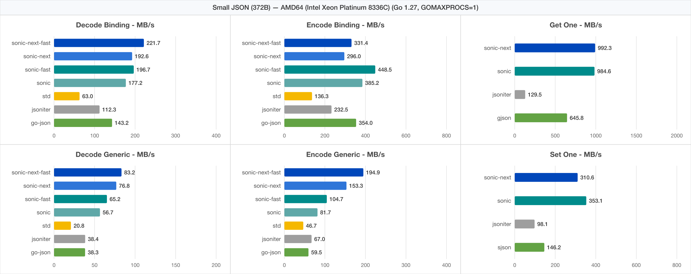
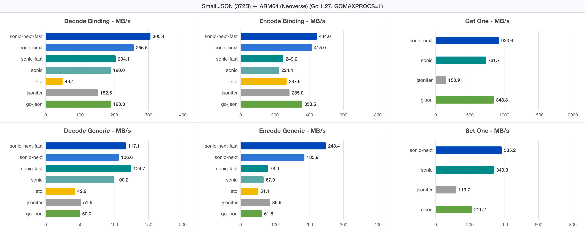
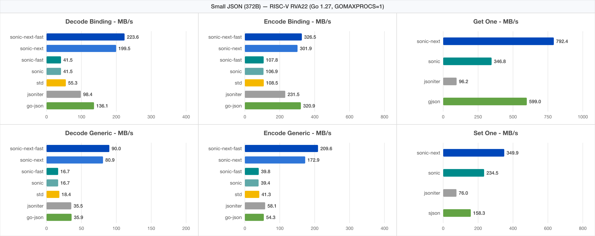
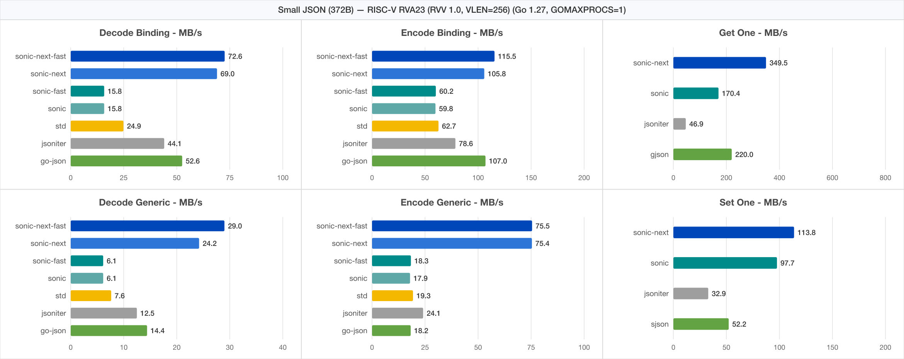
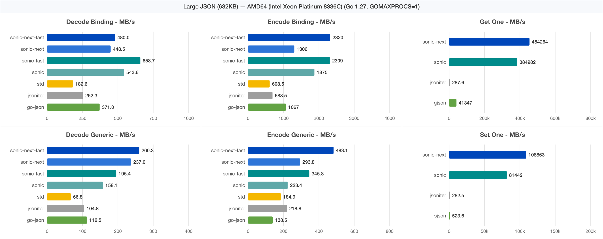
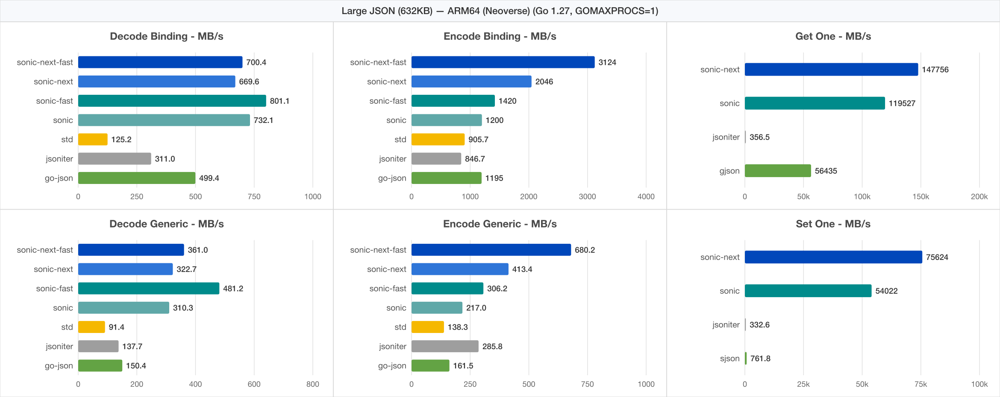
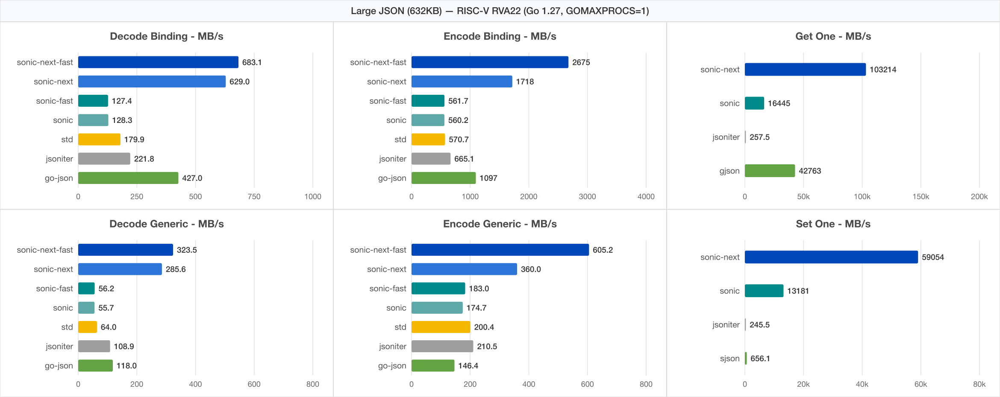
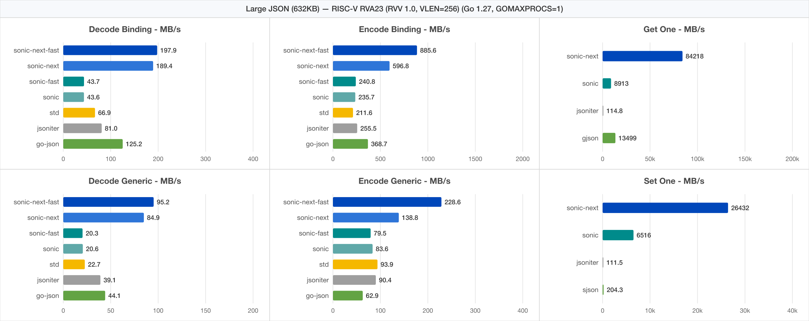

# Sonic

English | [中文](README_ZH_CN.md)

A blazingly fast JSON serializing &amp; deserializing library, accelerated by SIMD (single-instruction-multiple-data) and architecture-specialized native kernels.

## Requirement

- Go: 1.20~1.27
- OS: Linux / MacOS / Windows
- CPU: AMD64 / ARM64 / RISC-V (RVA22 / RVA23)

## Features

- Runtime object binding without code generation
- Complete APIs for JSON value manipulation
- Fast, fast, fast!

## APIs

see [go.dev](https://pkg.go.dev/github.com/bytedance/sonic)

## Benchmarks

For **all sizes** of json and **all scenarios** of usage, **Sonic performs best**.

> Note: `Sonic_Next` / `sonic-next` denotes this refactored multi-arch branch (zero `//go:linkname`, zero JIT, native Go SIMD scanners + VM), while `Sonic` / `sonic` denotes upstream `main` (`4640e45`, built with `-ldflags=-checklinkname=0` on Go 1.27; on `riscv64`, upstream `main` falls back to `encoding/json` for Marshal/Unmarshal).

- [Medium](https://github.com/bytedance/sonic/blob/main/decoder/testdata_test.go#L19) (13KB, 300+ key, 6 layers)

```powershell
goversion: 1.27.0
goos: linux
goarch: amd64
cpu: Intel(R) Xeon(R) Platinum 8336C CPU @ 2.30GHz
BenchmarkEncoder_Generic_Sonic_Next-16                         38602 ns/op        337.67 MB/s        9472 B/op          1 allocs/op
BenchmarkEncoder_Generic_Sonic_Next_Fast-16                    23857 ns/op        546.37 MB/s        9472 B/op          1 allocs/op
BenchmarkEncoder_Generic_Sonic-16                              66243 ns/op        196.78 MB/s       13138 B/op         40 allocs/op
BenchmarkEncoder_Generic_Sonic_Fast-16                         38537 ns/op        338.24 MB/s       13137 B/op         40 allocs/op
BenchmarkEncoder_Generic_JsonIter-16                           61566 ns/op        211.73 MB/s       17984 B/op        153 allocs/op
BenchmarkEncoder_Generic_GoJson-16                            101745 ns/op        128.11 MB/s       26892 B/op         55 allocs/op
BenchmarkEncoder_Generic_StdLib-16                             68209 ns/op        191.10 MB/s        9576 B/op          8 allocs/op
BenchmarkEncoder_Binding_Sonic_Next-16                         10415 ns/op       1251.62 MB/s        9472 B/op          1 allocs/op
BenchmarkEncoder_Binding_Sonic_Next_Fast-16                     8884 ns/op       1467.25 MB/s        9472 B/op          1 allocs/op
BenchmarkEncoder_Binding_Sonic-16                               8516 ns/op       1530.63 MB/s        9488 B/op          2 allocs/op
BenchmarkEncoder_Binding_Sonic_Fast-16                          7514 ns/op       1734.82 MB/s        9488 B/op          2 allocs/op
BenchmarkEncoder_Binding_JsonIter-16                           27735 ns/op        469.98 MB/s        9480 B/op          2 allocs/op
BenchmarkEncoder_Binding_GoJson-16                             11528 ns/op       1130.70 MB/s        9472 B/op          1 allocs/op
BenchmarkEncoder_Binding_StdLib-16                             32362 ns/op        402.79 MB/s        9504 B/op          3 allocs/op
BenchmarkEncoder_Parallel_Generic_Sonic_Next-16                 3296 ns/op       3954.73 MB/s        9703 B/op          1 allocs/op
BenchmarkEncoder_Parallel_Generic_Sonic_Next_Fast-16            2327 ns/op       5602.02 MB/s        9677 B/op          1 allocs/op
BenchmarkEncoder_Parallel_Generic_Sonic-16                      7152 ns/op       1822.50 MB/s       13665 B/op         40 allocs/op
BenchmarkEncoder_Parallel_Generic_Sonic_Fast-16                 5192 ns/op       2510.53 MB/s       13624 B/op         40 allocs/op
BenchmarkEncoder_Parallel_Generic_JsonIter-16                   5153 ns/op       2529.50 MB/s       17992 B/op        153 allocs/op
BenchmarkEncoder_Parallel_Generic_GoJson-16                    10279 ns/op       1268.15 MB/s       26772 B/op         55 allocs/op
BenchmarkEncoder_Parallel_Generic_StdLib-16                     6108 ns/op       2134.00 MB/s        9583 B/op          8 allocs/op
BenchmarkEncoder_Parallel_Binding_Sonic_Next-16                 1304 ns/op       9999.44 MB/s        9842 B/op          1 allocs/op
BenchmarkEncoder_Parallel_Binding_Sonic_Next_Fast-16            1305 ns/op       9987.61 MB/s        9835 B/op          1 allocs/op
BenchmarkEncoder_Parallel_Binding_Sonic-16                      1812 ns/op       7194.27 MB/s       10757 B/op          2 allocs/op
BenchmarkEncoder_Parallel_Binding_Sonic_Fast-16                 1782 ns/op       7315.96 MB/s       10607 B/op          2 allocs/op
BenchmarkEncoder_Parallel_Binding_JsonIter-16                   2294 ns/op       5682.65 MB/s        9480 B/op          2 allocs/op
BenchmarkEncoder_Parallel_Binding_GoJson-16                     1380 ns/op       9446.26 MB/s        9474 B/op          1 allocs/op
BenchmarkEncoder_Parallel_Binding_StdLib-16                     2400 ns/op       5432.04 MB/s        9508 B/op          3 allocs/op

BenchmarkDecoder_Generic_Sonic_Next-16                         51987 ns/op        250.73 MB/s       35856 B/op        237 allocs/op
BenchmarkDecoder_Generic_Sonic_Next_Fast-16                    44547 ns/op        292.61 MB/s       27888 B/op        236 allocs/op
BenchmarkDecoder_Generic_Sonic-16                              90539 ns/op        143.97 MB/s       55321 B/op        747 allocs/op
BenchmarkDecoder_Generic_Sonic_Fast-16                         73780 ns/op        176.67 MB/s       47561 B/op        337 allocs/op
BenchmarkDecoder_Generic_StdLib-16                            207627 ns/op         62.78 MB/s       49368 B/op        931 allocs/op
BenchmarkDecoder_Generic_JsonIter-16                          140965 ns/op         92.47 MB/s       54216 B/op       1085 allocs/op
BenchmarkDecoder_Generic_GoJson-16                            138497 ns/op         94.12 MB/s       64865 B/op        996 allocs/op
BenchmarkDecoder_Binding_Sonic_Next-16                         19837 ns/op        657.10 MB/s        7840 B/op         24 allocs/op
BenchmarkDecoder_Binding_Sonic_Next_Fast-16                    17308 ns/op        753.14 MB/s        4480 B/op         22 allocs/op
BenchmarkDecoder_Binding_Sonic-16                              26690 ns/op        488.39 MB/s        9608 B/op        127 allocs/op
BenchmarkDecoder_Binding_Sonic_Fast-16                         22238 ns/op        586.15 MB/s        6576 B/op         24 allocs/op
BenchmarkDecoder_Binding_StdLib-16                             70059 ns/op        186.06 MB/s        8912 B/op         70 allocs/op
BenchmarkDecoder_Binding_JsonIter-16                           53700 ns/op        242.74 MB/s       14536 B/op        379 allocs/op
BenchmarkDecoder_Binding_GoJson-16                             45909 ns/op        283.93 MB/s       21936 B/op         49 allocs/op
BenchmarkDecoder_Parallel_Generic_Sonic_Next-16                 7010 ns/op       1859.54 MB/s       35906 B/op        237 allocs/op
BenchmarkDecoder_Parallel_Generic_Sonic_Next_Fast-16            5585 ns/op       2333.79 MB/s       27942 B/op        236 allocs/op
BenchmarkDecoder_Parallel_Generic_Sonic-16                     17940 ns/op        726.58 MB/s       55447 B/op        747 allocs/op
BenchmarkDecoder_Parallel_Generic_Sonic_Fast-16                14151 ns/op        921.14 MB/s       47704 B/op        337 allocs/op
BenchmarkDecoder_Parallel_Generic_StdLib-16                    17896 ns/op        728.36 MB/s       49376 B/op        931 allocs/op
BenchmarkDecoder_Parallel_Generic_JsonIter-16                  13820 ns/op        943.19 MB/s       54221 B/op       1085 allocs/op
BenchmarkDecoder_Parallel_Generic_GoJson-16                    13478 ns/op        967.10 MB/s       64887 B/op        996 allocs/op
BenchmarkDecoder_Parallel_Binding_Sonic_Next-16                 1757 ns/op       7417.13 MB/s        7869 B/op         24 allocs/op
BenchmarkDecoder_Parallel_Binding_Sonic_Next_Fast-16            1324 ns/op       9843.64 MB/s        4494 B/op         22 allocs/op
BenchmarkDecoder_Parallel_Binding_Sonic-16                      3644 ns/op       3577.34 MB/s        9678 B/op        127 allocs/op
BenchmarkDecoder_Parallel_Binding_Sonic_Fast-16                 2437 ns/op       5347.81 MB/s        6637 B/op         24 allocs/op
BenchmarkDecoder_Parallel_Binding_StdLib-16                     5029 ns/op       2591.81 MB/s        8914 B/op         70 allocs/op
BenchmarkDecoder_Parallel_Binding_JsonIter-16                   4571 ns/op       2851.80 MB/s       14537 B/op        379 allocs/op
BenchmarkDecoder_Parallel_Binding_GoJson-16                     4218 ns/op       3090.58 MB/s       21974 B/op         49 allocs/op

BenchmarkGetOne_Sonic_Next-16                                   1253 ns/op      10404.91 MB/s           0 B/op          0 allocs/op
BenchmarkGetOne_Sonic-16                                        1313 ns/op       9924.33 MB/s           0 B/op          0 allocs/op
BenchmarkGetOne_Gjson-16                                        8563 ns/op       1522.26 MB/s           0 B/op          0 allocs/op
BenchmarkGetOne_Jsoniter-16                                    80412 ns/op        162.10 MB/s       27664 B/op        635 allocs/op
BenchmarkGetOne_Parallel_Sonic_Next-16                         79.28 ns/op     164420.58 MB/s           0 B/op          0 allocs/op
BenchmarkGetOne_Parallel_Sonic-16                              85.74 ns/op     152030.57 MB/s           0 B/op          0 allocs/op
BenchmarkGetOne_Parallel_Gjson-16                              589.2 ns/op      22122.36 MB/s           0 B/op          0 allocs/op
BenchmarkGetOne_Parallel_Jsoniter-16                            6331 ns/op       2059.04 MB/s       27666 B/op        635 allocs/op
BenchmarkSetOne_Sonic_Next-16                                   4318 ns/op       3018.63 MB/s        1024 B/op          1 allocs/op
BenchmarkSetOne_Sonic-16                                        5022 ns/op       2595.53 MB/s        1056 B/op          2 allocs/op
BenchmarkSetOne_Sjson-16                                       48525 ns/op        268.62 MB/s       52152 B/op         10 allocs/op
BenchmarkSetOne_Jsoniter-16                                   123198 ns/op        105.80 MB/s       45120 B/op        952 allocs/op
BenchmarkSetOne_Parallel_Sonic_Next-16                         361.4 ns/op      36068.39 MB/s        1024 B/op          1 allocs/op
BenchmarkSetOne_Parallel_Sonic-16                              566.5 ns/op      23007.89 MB/s        1103 B/op          2 allocs/op
BenchmarkSetOne_Parallel_Sjson-16                               6961 ns/op       1872.51 MB/s       52165 B/op         10 allocs/op
BenchmarkSetOne_Parallel_Jsoniter-16                           11956 ns/op       1090.26 MB/s       45125 B/op        952 allocs/op
BenchmarkLoadNode/LoadAll()_Sonic_Next-16                       5079 ns/op       2566.48 MB/s        2072 B/op          4 allocs/op
BenchmarkLoadNode/LoadAll()_Sonic-16                            6739 ns/op       1934.25 MB/s        2944 B/op         12 allocs/op
BenchmarkLoadNode_Parallel/LoadAll()_Sonic_Next-16             481.9 ns/op      27050.59 MB/s        2072 B/op          4 allocs/op
BenchmarkLoadNode_Parallel/LoadAll()_Sonic-16                   1045 ns/op      12479.20 MB/s        3076 B/op         12 allocs/op
BenchmarkLoadNode/Interface()_Sonic_Next-16                    20123 ns/op        647.78 MB/s        9968 B/op         75 allocs/op
BenchmarkLoadNode/Interface()_Sonic-16                         28165 ns/op        462.81 MB/s       23392 B/op         95 allocs/op
BenchmarkLoadNode_Parallel/Interface()_Sonic_Next-16            2202 ns/op       5918.53 MB/s        9968 B/op         75 allocs/op
BenchmarkLoadNode_Parallel/Interface()_Sonic-16                 7050 ns/op       1848.92 MB/s       24061 B/op         95 allocs/op
```

<details>
<summary>More architectures — ARM64 / RISC-V RVA22 / RISC-V RVA23 (Medium 13KB)</summary>

```powershell
goversion: 1.27.0
goos: linux
goarch: arm64
cpu: ARM64 Neoverse (aarch64)
BenchmarkEncoder_Generic_Sonic_Next-16                         29344 ns/op        444.21 MB/s        9472 B/op          1 allocs/op
BenchmarkEncoder_Generic_Sonic_Next_Fast-16                    20488 ns/op        636.23 MB/s        9472 B/op          1 allocs/op
BenchmarkEncoder_Generic_Sonic-16                              75420 ns/op        172.83 MB/s       13140 B/op         40 allocs/op
BenchmarkEncoder_Generic_Sonic_Fast-16                         50701 ns/op        257.09 MB/s       13138 B/op         40 allocs/op
BenchmarkEncoder_Generic_JsonIter-16                           49999 ns/op        260.71 MB/s       17984 B/op        153 allocs/op
BenchmarkEncoder_Generic_GoJson-16                             84131 ns/op        154.94 MB/s       26897 B/op         55 allocs/op
BenchmarkEncoder_Generic_StdLib-16                             99001 ns/op        131.67 MB/s       32880 B/op        653 allocs/op
BenchmarkEncoder_Binding_Sonic_Next-16                          7118 ns/op       1831.34 MB/s        9472 B/op          1 allocs/op
BenchmarkEncoder_Binding_Sonic_Next_Fast-16                     6797 ns/op       1917.80 MB/s        9472 B/op          1 allocs/op
BenchmarkEncoder_Binding_Sonic-16                              16457 ns/op        792.07 MB/s        9489 B/op          2 allocs/op
BenchmarkEncoder_Binding_Sonic_Fast-16                         14781 ns/op        881.86 MB/s        9488 B/op          2 allocs/op
BenchmarkEncoder_Binding_JsonIter-16                           22945 ns/op        568.11 MB/s        9480 B/op          2 allocs/op
BenchmarkEncoder_Binding_GoJson-16                             10660 ns/op       1222.78 MB/s        9472 B/op          1 allocs/op
BenchmarkEncoder_Binding_StdLib-16                             16976 ns/op        767.86 MB/s        9472 B/op          1 allocs/op
BenchmarkEncoder_Parallel_Generic_Sonic_Next-16                 3267 ns/op       3990.37 MB/s        9952 B/op          1 allocs/op
BenchmarkEncoder_Parallel_Generic_Sonic_Next_Fast-16            2415 ns/op       5396.89 MB/s        9997 B/op          1 allocs/op
BenchmarkEncoder_Parallel_Generic_Sonic-16                     11199 ns/op       1163.97 MB/s       14022 B/op         40 allocs/op
BenchmarkEncoder_Parallel_Generic_Sonic_Fast-16                 9806 ns/op       1329.29 MB/s       13700 B/op         40 allocs/op
BenchmarkEncoder_Parallel_Generic_JsonIter-16                   7021 ns/op       1856.61 MB/s       17998 B/op        153 allocs/op
BenchmarkEncoder_Parallel_Generic_GoJson-16                    14474 ns/op        900.56 MB/s       26761 B/op         55 allocs/op
BenchmarkEncoder_Parallel_Generic_StdLib-16                    13838 ns/op        941.99 MB/s       32887 B/op        653 allocs/op
BenchmarkEncoder_Parallel_Binding_Sonic_Next-16                 1591 ns/op       8191.64 MB/s        9778 B/op          1 allocs/op
BenchmarkEncoder_Parallel_Binding_Sonic_Next_Fast-16            1577 ns/op       8264.88 MB/s        9879 B/op          1 allocs/op
BenchmarkEncoder_Parallel_Binding_Sonic-16                      3204 ns/op       4068.91 MB/s       10846 B/op          2 allocs/op
BenchmarkEncoder_Parallel_Binding_Sonic_Fast-16                 2910 ns/op       4478.95 MB/s       10671 B/op          2 allocs/op
BenchmarkEncoder_Parallel_Binding_JsonIter-16                   2454 ns/op       5312.73 MB/s        9481 B/op          2 allocs/op
BenchmarkEncoder_Parallel_Binding_GoJson-16                     1828 ns/op       7131.06 MB/s        9473 B/op          1 allocs/op
BenchmarkEncoder_Parallel_Binding_StdLib-16                     2081 ns/op       6262.81 MB/s        9473 B/op          1 allocs/op

BenchmarkDecoder_Generic_Sonic_Next-16                         39448 ns/op        330.43 MB/s       35856 B/op        237 allocs/op
BenchmarkDecoder_Generic_Sonic_Next_Fast-16                    33862 ns/op        384.94 MB/s       27888 B/op        236 allocs/op
BenchmarkDecoder_Generic_Sonic-16                              45982 ns/op        283.48 MB/s       36200 B/op        705 allocs/op
BenchmarkDecoder_Generic_Sonic_Fast-16                         30217 ns/op        431.37 MB/s       28952 B/op        105 allocs/op
BenchmarkDecoder_Generic_StdLib-16                            155010 ns/op         84.09 MB/s       49464 B/op        795 allocs/op
BenchmarkDecoder_Generic_JsonIter-16                          100440 ns/op        129.78 MB/s       54216 B/op       1085 allocs/op
BenchmarkDecoder_Generic_GoJson-16                            103518 ns/op        125.92 MB/s       64865 B/op        996 allocs/op
BenchmarkDecoder_Binding_Sonic_Next-16                         15474 ns/op        842.39 MB/s        7840 B/op         24 allocs/op
BenchmarkDecoder_Binding_Sonic_Next_Fast-16                    12955 ns/op       1006.16 MB/s        4480 B/op         22 allocs/op
BenchmarkDecoder_Binding_Sonic-16                              24567 ns/op        530.59 MB/s        7952 B/op        144 allocs/op
BenchmarkDecoder_Binding_Sonic_Fast-16                         21153 ns/op        616.23 MB/s        4920 B/op         41 allocs/op
BenchmarkDecoder_Binding_StdLib-16                            127456 ns/op        102.27 MB/s       11416 B/op        160 allocs/op
BenchmarkDecoder_Binding_JsonIter-16                           43784 ns/op        297.71 MB/s       14536 B/op        379 allocs/op
BenchmarkDecoder_Binding_GoJson-16                             32802 ns/op        397.38 MB/s       21937 B/op         49 allocs/op
BenchmarkDecoder_Parallel_Generic_Sonic_Next-16                10395 ns/op       1254.00 MB/s       35891 B/op        237 allocs/op
BenchmarkDecoder_Parallel_Generic_Sonic_Next_Fast-16            7061 ns/op       1846.03 MB/s       27941 B/op        236 allocs/op
BenchmarkDecoder_Parallel_Generic_Sonic-16                      7020 ns/op       1856.72 MB/s       36553 B/op        705 allocs/op
BenchmarkDecoder_Parallel_Generic_Sonic_Fast-16                 5397 ns/op       2415.43 MB/s       29214 B/op        105 allocs/op
BenchmarkDecoder_Parallel_Generic_StdLib-16                    19569 ns/op        666.11 MB/s       49464 B/op        795 allocs/op
BenchmarkDecoder_Parallel_Generic_JsonIter-16                  16591 ns/op        785.67 MB/s       54222 B/op       1085 allocs/op
BenchmarkDecoder_Parallel_Generic_GoJson-16                    18746 ns/op        695.35 MB/s       64886 B/op        996 allocs/op
BenchmarkDecoder_Parallel_Binding_Sonic_Next-16                 2028 ns/op       6426.10 MB/s        7858 B/op         24 allocs/op
BenchmarkDecoder_Parallel_Binding_Sonic_Next_Fast-16            1375 ns/op       9478.19 MB/s        4510 B/op         22 allocs/op
BenchmarkDecoder_Parallel_Binding_Sonic-16                      2210 ns/op       5897.94 MB/s        8439 B/op        144 allocs/op
BenchmarkDecoder_Parallel_Binding_Sonic_Fast-16                 1774 ns/op       7345.97 MB/s        5305 B/op         41 allocs/op
BenchmarkDecoder_Parallel_Binding_StdLib-16                    10013 ns/op       1301.75 MB/s       11416 B/op        160 allocs/op
BenchmarkDecoder_Parallel_Binding_JsonIter-16                   5489 ns/op       2374.65 MB/s       14537 B/op        379 allocs/op
BenchmarkDecoder_Parallel_Binding_GoJson-16                     5356 ns/op       2433.63 MB/s       21968 B/op         49 allocs/op

BenchmarkGetOne_Sonic_Next-16                                   2817 ns/op       4627.28 MB/s           0 B/op          0 allocs/op
BenchmarkGetOne_Sonic-16                                        3360 ns/op       3879.15 MB/s           0 B/op          0 allocs/op
BenchmarkGetOne_Gjson-16                                        6603 ns/op       1974.01 MB/s           0 B/op          0 allocs/op
BenchmarkGetOne_Jsoniter-16                                    61964 ns/op        210.36 MB/s       27664 B/op        635 allocs/op
BenchmarkGetOne_Parallel_Sonic_Next-16                         175.5 ns/op      74268.37 MB/s           0 B/op          0 allocs/op
BenchmarkGetOne_Parallel_Sonic-16                              210.1 ns/op      62054.61 MB/s           0 B/op          0 allocs/op
BenchmarkGetOne_Parallel_Gjson-16                              424.7 ns/op      30694.02 MB/s           0 B/op          0 allocs/op
BenchmarkGetOne_Parallel_Jsoniter-16                            8766 ns/op       1487.07 MB/s       27666 B/op        635 allocs/op
BenchmarkSetOne_Sonic_Next-16                                   5186 ns/op       2513.69 MB/s        1024 B/op          1 allocs/op
BenchmarkSetOne_Sonic-16                                        7198 ns/op       1810.96 MB/s        1056 B/op          2 allocs/op
BenchmarkSetOne_Sjson-16                                       33767 ns/op        386.02 MB/s       52144 B/op          9 allocs/op
BenchmarkSetOne_Jsoniter-16                                    93987 ns/op        138.69 MB/s       45120 B/op        952 allocs/op
BenchmarkSetOne_Parallel_Sonic_Next-16                         534.7 ns/op      24376.26 MB/s        1024 B/op          1 allocs/op
BenchmarkSetOne_Parallel_Sonic-16                              984.4 ns/op      13241.22 MB/s        1146 B/op          2 allocs/op
BenchmarkSetOne_Parallel_Sjson-16                              10364 ns/op       1257.68 MB/s       52155 B/op          9 allocs/op
BenchmarkSetOne_Parallel_Jsoniter-16                           14634 ns/op        890.73 MB/s       45124 B/op        952 allocs/op
BenchmarkLoadNode/LoadAll()_Sonic_Next-16                       4407 ns/op       2957.90 MB/s        2072 B/op          4 allocs/op
BenchmarkLoadNode/LoadAll()_Sonic-16                            7141 ns/op       1825.37 MB/s        2944 B/op         12 allocs/op
BenchmarkLoadNode_Parallel/LoadAll()_Sonic_Next-16             713.9 ns/op      18260.12 MB/s        2072 B/op          4 allocs/op
BenchmarkLoadNode_Parallel/LoadAll()_Sonic-16                   2153 ns/op       6055.71 MB/s        3120 B/op         12 allocs/op
BenchmarkLoadNode/Interface()_Sonic_Next-16                    15214 ns/op        856.75 MB/s        9968 B/op         75 allocs/op
BenchmarkLoadNode/Interface()_Sonic-16                         25424 ns/op        512.70 MB/s       23392 B/op         95 allocs/op
BenchmarkLoadNode_Parallel/Interface()_Sonic_Next-16            3234 ns/op       4030.33 MB/s        9968 B/op         75 allocs/op
BenchmarkLoadNode_Parallel/Interface()_Sonic-16                14201 ns/op        917.89 MB/s       24356 B/op         95 allocs/op
```

```powershell
goversion: 1.27.0
goos: linux
goarch: riscv64 (GORISCV64=rva22u64)
cpu: RISC-V 64-bit RVA22U64 (Scalar + Zba/Zbb/Zbs)
BenchmarkEncoder_Generic_Sonic_Next-16                         35549 ns/op        366.68 MB/s        9472 B/op          1 allocs/op
BenchmarkEncoder_Generic_Sonic_Next_Fast-16                    23324 ns/op        558.86 MB/s        9472 B/op          1 allocs/op
BenchmarkEncoder_Generic_Sonic-16                              72200 ns/op        180.54 MB/s        9577 B/op          8 allocs/op
BenchmarkEncoder_Generic_Sonic_Fast-16                         65391 ns/op        199.34 MB/s        9577 B/op          8 allocs/op
BenchmarkEncoder_Generic_JsonIter-16                           66748 ns/op        195.29 MB/s       17984 B/op        153 allocs/op
BenchmarkEncoder_Generic_GoJson-16                            102063 ns/op        127.71 MB/s       26746 B/op         54 allocs/op
BenchmarkEncoder_Generic_StdLib-16                             65806 ns/op        198.08 MB/s        9576 B/op          8 allocs/op
BenchmarkEncoder_Binding_Sonic_Next-16                          8996 ns/op       1449.04 MB/s        9472 B/op          1 allocs/op
BenchmarkEncoder_Binding_Sonic_Next_Fast-16                     8280 ns/op       1574.28 MB/s        9472 B/op          1 allocs/op
BenchmarkEncoder_Binding_Sonic-16                              38093 ns/op        342.19 MB/s        9504 B/op          3 allocs/op
BenchmarkEncoder_Binding_Sonic_Fast-16                         38591 ns/op        337.77 MB/s        9504 B/op          3 allocs/op
BenchmarkEncoder_Binding_JsonIter-16                           29480 ns/op        442.17 MB/s        9480 B/op          2 allocs/op
BenchmarkEncoder_Binding_GoJson-16                             11191 ns/op       1164.76 MB/s        9472 B/op          1 allocs/op
BenchmarkEncoder_Binding_StdLib-16                             39063 ns/op        333.69 MB/s        9504 B/op          3 allocs/op
BenchmarkEncoder_Parallel_Generic_Sonic_Next-16                 2649 ns/op       4921.24 MB/s        9696 B/op          1 allocs/op
BenchmarkEncoder_Parallel_Generic_Sonic_Next_Fast-16            1910 ns/op       6825.66 MB/s        9614 B/op          1 allocs/op
BenchmarkEncoder_Parallel_Generic_Sonic-16                      8693 ns/op       1499.54 MB/s        9647 B/op          8 allocs/op
BenchmarkEncoder_Parallel_Generic_Sonic_Fast-16                 9080 ns/op       1435.57 MB/s        9658 B/op          8 allocs/op
BenchmarkEncoder_Parallel_Generic_JsonIter-16                  18099 ns/op        720.22 MB/s       17987 B/op        153 allocs/op
BenchmarkEncoder_Parallel_Generic_GoJson-16                     8711 ns/op       1496.43 MB/s       26700 B/op         54 allocs/op
BenchmarkEncoder_Parallel_Generic_StdLib-16                     5507 ns/op       2366.81 MB/s        9582 B/op          8 allocs/op
BenchmarkEncoder_Parallel_Binding_Sonic_Next-16                 1112 ns/op      11727.26 MB/s        9754 B/op          1 allocs/op
BenchmarkEncoder_Parallel_Binding_Sonic_Next_Fast-16            1112 ns/op      11720.96 MB/s        9748 B/op          1 allocs/op
BenchmarkEncoder_Parallel_Binding_Sonic-16                      5734 ns/op       2273.15 MB/s        9525 B/op          3 allocs/op
BenchmarkEncoder_Parallel_Binding_Sonic_Fast-16                 5903 ns/op       2208.02 MB/s        9519 B/op          3 allocs/op
BenchmarkEncoder_Parallel_Binding_JsonIter-16                   2308 ns/op       5647.35 MB/s        9480 B/op          2 allocs/op
BenchmarkEncoder_Parallel_Binding_GoJson-16                     1229 ns/op      10609.05 MB/s        9474 B/op          1 allocs/op
BenchmarkEncoder_Parallel_Binding_StdLib-16                     2957 ns/op       4408.14 MB/s        9506 B/op          3 allocs/op

BenchmarkDecoder_Generic_Sonic_Next-16                         45826 ns/op        284.44 MB/s       35856 B/op        237 allocs/op
BenchmarkDecoder_Generic_Sonic_Next_Fast-16                    38859 ns/op        335.44 MB/s       27888 B/op        236 allocs/op
BenchmarkDecoder_Generic_Sonic-16                             245728 ns/op         53.05 MB/s       96076 B/op        946 allocs/op
BenchmarkDecoder_Generic_Sonic_Fast-16                        244845 ns/op         53.24 MB/s       96076 B/op        946 allocs/op
BenchmarkDecoder_Generic_StdLib-16                            217952 ns/op         59.81 MB/s       49368 B/op        931 allocs/op
BenchmarkDecoder_Generic_JsonIter-16                          137378 ns/op         94.88 MB/s       54216 B/op       1085 allocs/op
BenchmarkDecoder_Generic_GoJson-16                            125838 ns/op        103.59 MB/s       64865 B/op        996 allocs/op
BenchmarkDecoder_Binding_Sonic_Next-16                         16773 ns/op        777.16 MB/s        7840 B/op         24 allocs/op
BenchmarkDecoder_Binding_Sonic_Next_Fast-16                    14205 ns/op        917.60 MB/s        4480 B/op         22 allocs/op
BenchmarkDecoder_Binding_Sonic-16                             104104 ns/op        125.21 MB/s       55618 B/op         85 allocs/op
BenchmarkDecoder_Binding_Sonic_Fast-16                        104094 ns/op        125.22 MB/s       55618 B/op         85 allocs/op
BenchmarkDecoder_Binding_StdLib-16                             79104 ns/op        164.78 MB/s        8912 B/op         70 allocs/op
BenchmarkDecoder_Binding_JsonIter-16                           63416 ns/op        205.55 MB/s       14536 B/op        379 allocs/op
BenchmarkDecoder_Binding_GoJson-16                             37751 ns/op        345.29 MB/s       21937 B/op         49 allocs/op
BenchmarkDecoder_Parallel_Generic_Sonic_Next-16                 6618 ns/op       1969.69 MB/s       35874 B/op        237 allocs/op
BenchmarkDecoder_Parallel_Generic_Sonic_Next_Fast-16            5266 ns/op       2475.20 MB/s       27902 B/op        236 allocs/op
BenchmarkDecoder_Parallel_Generic_Sonic-16                     79009 ns/op        164.98 MB/s       97266 B/op        958 allocs/op
BenchmarkDecoder_Parallel_Generic_Sonic_Fast-16                79669 ns/op        163.61 MB/s       97279 B/op        958 allocs/op
BenchmarkDecoder_Parallel_Generic_StdLib-16                    29367 ns/op        443.87 MB/s       49376 B/op        931 allocs/op
BenchmarkDecoder_Parallel_Generic_JsonIter-16                  48538 ns/op        268.56 MB/s       54226 B/op       1085 allocs/op
BenchmarkDecoder_Parallel_Generic_GoJson-16                    14156 ns/op        920.81 MB/s       64888 B/op        996 allocs/op
BenchmarkDecoder_Parallel_Binding_Sonic_Next-16                 1739 ns/op       7495.08 MB/s        7883 B/op         24 allocs/op
BenchmarkDecoder_Parallel_Binding_Sonic_Next_Fast-16            1494 ns/op       8722.81 MB/s        4495 B/op         22 allocs/op
BenchmarkDecoder_Parallel_Binding_Sonic-16                     35799 ns/op        364.12 MB/s       56440 B/op         91 allocs/op
BenchmarkDecoder_Parallel_Binding_Sonic_Fast-16                33946 ns/op        383.99 MB/s       56584 B/op         93 allocs/op
BenchmarkDecoder_Parallel_Binding_StdLib-16                     5761 ns/op       2262.60 MB/s        8914 B/op         70 allocs/op
BenchmarkDecoder_Parallel_Binding_JsonIter-16                   4933 ns/op       2642.61 MB/s       14538 B/op        379 allocs/op
BenchmarkDecoder_Parallel_Binding_GoJson-16                     3785 ns/op       3443.69 MB/s       21975 B/op         49 allocs/op

BenchmarkGetOne_Sonic_Next-16                                   3948 ns/op       3302.08 MB/s           0 B/op          0 allocs/op
BenchmarkGetOne_Sonic-16                                       22735 ns/op        573.35 MB/s           0 B/op          0 allocs/op
BenchmarkGetOne_Gjson-16                                        8681 ns/op       1501.48 MB/s           0 B/op          0 allocs/op
BenchmarkGetOne_Jsoniter-16                                    94502 ns/op        137.93 MB/s       27664 B/op        635 allocs/op
BenchmarkGetOne_Parallel_Sonic_Next-16                         249.9 ns/op      52161.50 MB/s           0 B/op          0 allocs/op
BenchmarkGetOne_Parallel_Sonic-16                               1436 ns/op       9075.16 MB/s           0 B/op          0 allocs/op
BenchmarkGetOne_Parallel_Gjson-16                              546.7 ns/op      23841.06 MB/s           0 B/op          0 allocs/op
BenchmarkGetOne_Parallel_Jsoniter-16                            7608 ns/op       1713.28 MB/s       27666 B/op        635 allocs/op
BenchmarkSetOne_Sonic_Next-16                                   6673 ns/op       1953.49 MB/s        1024 B/op          1 allocs/op
BenchmarkSetOne_Sonic-16                                       27328 ns/op        476.98 MB/s        1056 B/op          2 allocs/op
BenchmarkSetOne_Sjson-16                                       40240 ns/op        323.93 MB/s       52152 B/op         10 allocs/op
BenchmarkSetOne_Jsoniter-16                                   135703 ns/op         96.06 MB/s       45120 B/op        952 allocs/op
BenchmarkSetOne_Parallel_Sonic_Next-16                         496.2 ns/op      26267.16 MB/s        1024 B/op          1 allocs/op
BenchmarkSetOne_Parallel_Sonic-16                               1949 ns/op       6689.08 MB/s        1056 B/op          2 allocs/op
BenchmarkSetOne_Parallel_Sjson-16                               6391 ns/op       2039.72 MB/s       52169 B/op         10 allocs/op
BenchmarkSetOne_Parallel_Jsoniter-16                           14363 ns/op        907.52 MB/s       45126 B/op        952 allocs/op
BenchmarkLoadNode/LoadAll()_Sonic_Next-16                       5122 ns/op       2544.85 MB/s        2072 B/op          4 allocs/op
BenchmarkLoadNode/LoadAll()_Sonic-16                           13319 ns/op        978.69 MB/s        3056 B/op         13 allocs/op
BenchmarkLoadNode_Parallel/LoadAll()_Sonic_Next-16             535.7 ns/op      24331.60 MB/s        2072 B/op          4 allocs/op
BenchmarkLoadNode_Parallel/LoadAll()_Sonic-16                   2250 ns/op       5793.88 MB/s        3056 B/op         13 allocs/op
BenchmarkLoadNode/Interface()_Sonic_Next-16                    18051 ns/op        722.12 MB/s        9968 B/op         75 allocs/op
BenchmarkLoadNode/Interface()_Sonic-16                         29595 ns/op        440.45 MB/s       23504 B/op         96 allocs/op
BenchmarkLoadNode_Parallel/Interface()_Sonic_Next-16            2149 ns/op       6065.31 MB/s        9968 B/op         75 allocs/op
BenchmarkLoadNode_Parallel/Interface()_Sonic-16                14420 ns/op        903.94 MB/s       23506 B/op         96 allocs/op
```

```powershell
goversion: 1.27.0
goos: linux
goarch: riscv64 (GORISCV64=rva23u64)
cpu: RISC-V 64-bit RVA23U64 + RVV 1.0 (VLEN=256)
BenchmarkEncoder_Generic_Sonic_Next-16                         87841 ns/op        148.39 MB/s        9472 B/op          1 allocs/op
BenchmarkEncoder_Generic_Sonic_Next_Fast-16                    64095 ns/op        203.37 MB/s        9472 B/op          1 allocs/op
BenchmarkEncoder_Generic_Sonic-16                             158832 ns/op         82.07 MB/s        9577 B/op          8 allocs/op
BenchmarkEncoder_Generic_Sonic_Fast-16                        157937 ns/op         82.53 MB/s        9577 B/op          8 allocs/op
BenchmarkEncoder_Generic_JsonIter-16                          169109 ns/op         77.08 MB/s       17984 B/op        153 allocs/op
BenchmarkEncoder_Generic_GoJson-16                            274774 ns/op         47.44 MB/s       26824 B/op         54 allocs/op
BenchmarkEncoder_Generic_StdLib-16                            152938 ns/op         85.23 MB/s        9576 B/op          8 allocs/op
BenchmarkEncoder_Binding_Sonic_Next-16                         29077 ns/op        448.29 MB/s        9472 B/op          1 allocs/op
BenchmarkEncoder_Binding_Sonic_Next_Fast-16                    26739 ns/op        487.48 MB/s        9472 B/op          1 allocs/op
BenchmarkEncoder_Binding_Sonic-16                              88994 ns/op        146.47 MB/s        9504 B/op          3 allocs/op
BenchmarkEncoder_Binding_Sonic_Fast-16                         83231 ns/op        156.61 MB/s        9504 B/op          3 allocs/op
BenchmarkEncoder_Binding_JsonIter-16                           72773 ns/op        179.12 MB/s        9480 B/op          2 allocs/op
BenchmarkEncoder_Binding_GoJson-16                             39027 ns/op        334.00 MB/s        9472 B/op          1 allocs/op
BenchmarkEncoder_Binding_StdLib-16                             93661 ns/op        139.17 MB/s        9504 B/op          3 allocs/op
BenchmarkEncoder_Parallel_Generic_Sonic_Next-16                 8236 ns/op       1582.72 MB/s        9731 B/op          1 allocs/op
BenchmarkEncoder_Parallel_Generic_Sonic_Next_Fast-16            6676 ns/op       1952.61 MB/s        9766 B/op          1 allocs/op
BenchmarkEncoder_Parallel_Generic_Sonic-16                     26747 ns/op        487.34 MB/s        9654 B/op          8 allocs/op
BenchmarkEncoder_Parallel_Generic_Sonic_Fast-16                24471 ns/op        532.66 MB/s        9650 B/op          8 allocs/op
BenchmarkEncoder_Parallel_Generic_JsonIter-16                  15337 ns/op        849.90 MB/s       17994 B/op        153 allocs/op
BenchmarkEncoder_Parallel_Generic_GoJson-16                    28367 ns/op        459.52 MB/s       26748 B/op         54 allocs/op
BenchmarkEncoder_Parallel_Generic_StdLib-16                    15241 ns/op        855.24 MB/s        9584 B/op          8 allocs/op
BenchmarkEncoder_Parallel_Binding_Sonic_Next-16                 3427 ns/op       3803.30 MB/s        9905 B/op          1 allocs/op
BenchmarkEncoder_Parallel_Binding_Sonic_Next_Fast-16            3426 ns/op       3805.18 MB/s        9720 B/op          1 allocs/op
BenchmarkEncoder_Parallel_Binding_Sonic-16                     13682 ns/op        952.72 MB/s        9546 B/op          3 allocs/op
BenchmarkEncoder_Parallel_Binding_Sonic_Fast-16                13667 ns/op        953.77 MB/s        9525 B/op          3 allocs/op
BenchmarkEncoder_Parallel_Binding_JsonIter-16                   6529 ns/op       1996.44 MB/s        9484 B/op          2 allocs/op
BenchmarkEncoder_Parallel_Binding_GoJson-16                     4954 ns/op       2631.16 MB/s        9474 B/op          1 allocs/op
BenchmarkEncoder_Parallel_Binding_StdLib-16                     7276 ns/op       1791.45 MB/s        9507 B/op          3 allocs/op

BenchmarkDecoder_Generic_Sonic_Next-16                        165940 ns/op         78.55 MB/s       35856 B/op        237 allocs/op
BenchmarkDecoder_Generic_Sonic_Next_Fast-16                   135651 ns/op         96.09 MB/s       27888 B/op        236 allocs/op
BenchmarkDecoder_Generic_Sonic-16                             705719 ns/op         18.47 MB/s       96076 B/op        946 allocs/op
BenchmarkDecoder_Generic_Sonic_Fast-16                        693936 ns/op         18.78 MB/s       96075 B/op        946 allocs/op
BenchmarkDecoder_Generic_StdLib-16                            636891 ns/op         20.47 MB/s       49368 B/op        931 allocs/op
BenchmarkDecoder_Generic_JsonIter-16                          364620 ns/op         35.75 MB/s       54216 B/op       1085 allocs/op
BenchmarkDecoder_Generic_GoJson-16                            362421 ns/op         35.97 MB/s       64865 B/op        996 allocs/op
BenchmarkDecoder_Binding_Sonic_Next-16                         69025 ns/op        188.85 MB/s        7840 B/op         24 allocs/op
BenchmarkDecoder_Binding_Sonic_Next_Fast-16                    56215 ns/op        231.88 MB/s        4480 B/op         22 allocs/op
BenchmarkDecoder_Binding_Sonic-16                             333291 ns/op         39.11 MB/s       55618 B/op         85 allocs/op
BenchmarkDecoder_Binding_Sonic_Fast-16                        334345 ns/op         38.99 MB/s       55618 B/op         85 allocs/op
BenchmarkDecoder_Binding_StdLib-16                            219714 ns/op         59.33 MB/s        8912 B/op         70 allocs/op
BenchmarkDecoder_Binding_JsonIter-16                          178874 ns/op         72.87 MB/s       14536 B/op        379 allocs/op
BenchmarkDecoder_Binding_GoJson-16                            134135 ns/op         97.18 MB/s       21937 B/op         49 allocs/op
BenchmarkDecoder_Parallel_Generic_Sonic_Next-16                19031 ns/op        684.95 MB/s       35939 B/op        237 allocs/op
BenchmarkDecoder_Parallel_Generic_Sonic_Next_Fast-16           13990 ns/op        931.73 MB/s       27957 B/op        236 allocs/op
BenchmarkDecoder_Parallel_Generic_Sonic-16                    200278 ns/op         65.08 MB/s       97613 B/op        962 allocs/op
BenchmarkDecoder_Parallel_Generic_Sonic_Fast-16               202228 ns/op         64.46 MB/s       97935 B/op        966 allocs/op
BenchmarkDecoder_Parallel_Generic_StdLib-16                    54291 ns/op        240.09 MB/s       49386 B/op        931 allocs/op
BenchmarkDecoder_Parallel_Generic_JsonIter-16                  38958 ns/op        334.59 MB/s       54224 B/op       1085 allocs/op
BenchmarkDecoder_Parallel_Generic_GoJson-16                    40410 ns/op        322.57 MB/s       64889 B/op        996 allocs/op
BenchmarkDecoder_Parallel_Binding_Sonic_Next-16                 5667 ns/op       2299.97 MB/s        7865 B/op         24 allocs/op
BenchmarkDecoder_Parallel_Binding_Sonic_Next_Fast-16            4095 ns/op       3182.96 MB/s        4495 B/op         22 allocs/op
BenchmarkDecoder_Parallel_Binding_Sonic-16                    108598 ns/op        120.03 MB/s       56749 B/op         94 allocs/op
BenchmarkDecoder_Parallel_Binding_Sonic_Fast-16               111674 ns/op        116.72 MB/s       56715 B/op         94 allocs/op
BenchmarkDecoder_Parallel_Binding_StdLib-16                    17273 ns/op        754.64 MB/s        8915 B/op         70 allocs/op
BenchmarkDecoder_Parallel_Binding_JsonIter-16                  14714 ns/op        885.90 MB/s       14538 B/op        379 allocs/op
BenchmarkDecoder_Parallel_Binding_GoJson-16                    12924 ns/op       1008.63 MB/s       21981 B/op         49 allocs/op

BenchmarkGetOne_Sonic_Next-16                                   5441 ns/op       2395.54 MB/s           0 B/op          0 allocs/op
BenchmarkGetOne_Sonic-16                                       42061 ns/op        309.91 MB/s           0 B/op          0 allocs/op
BenchmarkGetOne_Gjson-16                                       26845 ns/op        485.56 MB/s           0 B/op          0 allocs/op
BenchmarkGetOne_Jsoniter-16                                   220421 ns/op         59.14 MB/s       27664 B/op        635 allocs/op
BenchmarkGetOne_Parallel_Sonic_Next-16                         349.5 ns/op      37297.48 MB/s           0 B/op          0 allocs/op
BenchmarkGetOne_Parallel_Sonic-16                               2720 ns/op       4792.59 MB/s           0 B/op          0 allocs/op
BenchmarkGetOne_Parallel_Gjson-16                               1766 ns/op       7379.70 MB/s           0 B/op          0 allocs/op
BenchmarkGetOne_Parallel_Jsoniter-16                           18783 ns/op        693.99 MB/s       27668 B/op        635 allocs/op
BenchmarkSetOne_Sonic_Next-16                                  14531 ns/op        897.06 MB/s        1024 B/op          1 allocs/op
BenchmarkSetOne_Sonic-16                                       59686 ns/op        218.39 MB/s        1056 B/op          2 allocs/op
BenchmarkSetOne_Sjson-16                                      141854 ns/op         91.89 MB/s       52152 B/op         10 allocs/op
BenchmarkSetOne_Jsoniter-16                                   329682 ns/op         39.54 MB/s       45120 B/op        952 allocs/op
BenchmarkSetOne_Parallel_Sonic_Next-16                          1175 ns/op      11091.54 MB/s        1024 B/op          1 allocs/op
BenchmarkSetOne_Parallel_Sonic-16                               4186 ns/op       3114.28 MB/s        1056 B/op          2 allocs/op
BenchmarkSetOne_Parallel_Sjson-16                              21311 ns/op        611.65 MB/s       52170 B/op         10 allocs/op
BenchmarkSetOne_Parallel_Jsoniter-16                           34014 ns/op        383.22 MB/s       45125 B/op        952 allocs/op
BenchmarkLoadNode/LoadAll()_Sonic_Next-16                      15265 ns/op        853.90 MB/s        2072 B/op          4 allocs/op
BenchmarkLoadNode/LoadAll()_Sonic-16                           31831 ns/op        409.51 MB/s        3056 B/op         13 allocs/op
BenchmarkLoadNode_Parallel/LoadAll()_Sonic_Next-16              1473 ns/op       8848.07 MB/s        2072 B/op          4 allocs/op
BenchmarkLoadNode_Parallel/LoadAll()_Sonic-16                   5524 ns/op       2359.87 MB/s        3056 B/op         13 allocs/op
BenchmarkLoadNode/Interface()_Sonic_Next-16                    60341 ns/op        216.02 MB/s        9968 B/op         75 allocs/op
BenchmarkLoadNode/Interface()_Sonic-16                         91219 ns/op        142.90 MB/s       23504 B/op         96 allocs/op
BenchmarkLoadNode_Parallel/Interface()_Sonic_Next-16            6695 ns/op       1947.11 MB/s        9968 B/op         75 allocs/op
BenchmarkLoadNode_Parallel/Interface()_Sonic-16                35767 ns/op        364.45 MB/s       23506 B/op         96 allocs/op
```

</details>

- [Small](https://github.com/bytedance/sonic/blob/main/testdata/small.go) (400B, 11 keys, 3 layers)


<details>
<summary>More architectures — ARM64 / RISC-V RVA22 / RISC-V RVA23 (Small 400B)</summary>





</details>

- [Large](https://github.com/bytedance/sonic/blob/main/testdata/twitter.json) (635KB, 10000+ key, 6 layers)


<details>
<summary>More architectures — ARM64 / RISC-V RVA22 / RISC-V RVA23 (Large 635KB)</summary>





</details>

See [bench.sh](https://github.com/bytedance/sonic/blob/main/scripts/bench.sh) for benchmark codes.

## How it works

See [INTRODUCTION.md](./docs/INTRODUCTION.md).

## Usage

### Marshal/Unmarshal

Default behaviors are mostly consistent with `encoding/json`, except HTML escaping form (see [Escape HTML](https://github.com/bytedance/sonic/blob/main/README.md#escape-html)) and `SortKeys` feature (optional support see [Sort Keys](https://github.com/bytedance/sonic/blob/main/README.md#sort-keys)) that is **NOT** in conformity to [RFC8259](https://datatracker.ietf.org/doc/html/rfc8259).

 ```go
import "github.com/bytedance/sonic"

var data YourSchema
// Marshal
output, err := sonic.Marshal(&data)
// Unmarshal
err := sonic.Unmarshal(output, &data)
 ```

### Streaming IO

Sonic supports decoding json from `io.Reader` or encoding objects into `io.Writer`, aims at handling multiple values as well as reducing memory consumption.

- encoder

```go
var o1 = map[string]interface{}{
    "a": "b",
}
var o2 = 1
var w = bytes.NewBuffer(nil)
var enc = sonic.ConfigDefault.NewEncoder(w)
enc.Encode(o1)
enc.Encode(o2)
fmt.Println(w.String())
// Output:
// {"a":"b"}
// 1
```

- decoder

```go
var o =  map[string]interface{}{}
var r = strings.NewReader(`{"a":"b"}{"1":"2"}`)
var dec = sonic.ConfigDefault.NewDecoder(r)
dec.Decode(&o)
dec.Decode(&o)
fmt.Printf("%+v", o)
// Output:
// map[1:2 a:b]
```

### Use Number/Use Int64

 ```go
import "github.com/bytedance/sonic/decoder"

var input = `1`
var data interface{}

// default float64
dc := decoder.NewDecoder(input)
dc.Decode(&data) // data == float64(1)
// use json.Number
dc = decoder.NewDecoder(input)
dc.UseNumber()
dc.Decode(&data) // data == json.Number("1")
// use int64
dc = decoder.NewDecoder(input)
dc.UseInt64()
dc.Decode(&data) // data == int64(1)

root, err := sonic.GetFromString(input)
// Get json.Number
jn := root.Number()
jm := root.InterfaceUseNumber().(json.Number) // jn == jm
// Get float64
fn := root.Float64()
fm := root.Interface().(float64) // jn == jm
 ```

### Sort Keys

On account of the performance loss from sorting (roughly 10%), sonic doesn't enable this feature by default. If your component depends on it to work (like [zstd](https://github.com/facebook/zstd)), Use it like this:

```go
import "github.com/bytedance/sonic"
import "github.com/bytedance/sonic/encoder"

// Binding map only
m := map[string]interface{}{}
v, err := encoder.Encode(m, encoder.SortMapKeys)

// Or ast.Node.SortKeys() before marshal
var root := sonic.Get(JSON)
err := root.SortKeys()
```

### Escape HTML

On account of the performance loss (roughly 15%), sonic doesn't enable this feature by default. You can use `encoder.EscapeHTML` option to open this feature (align with `encoding/json.HTMLEscape`).

```go
import "github.com/bytedance/sonic"

v := map[string]string{"&&":"<>"}
ret, err := Encode(v, EscapeHTML) // ret == `{"\u0026\u0026":{"X":"\u003c\u003e"}}`
```

### Compact Format

Sonic encodes primitive objects (struct/map...) as compact-format JSON by default, except marshaling `json.RawMessage` or `json.Marshaler`: sonic ensures validating their output JSON but **DO NOT** compacting them for performance concerns. We provide the option `encoder.CompactMarshaler` to add compacting process.

### Print Error

If there invalid syntax in input JSON, sonic will return `decoder.SyntaxError`, which supports pretty-printing of error position

```go
import "github.com/bytedance/sonic"
import "github.com/bytedance/sonic/decoder"

var data interface{}
err := sonic.UnmarshalString("[[[}]]", &data)
if err != nil {
    /* One line by default */
    println(e.Error()) // "Syntax error at index 3: invalid char\n\n\t[[[}]]\n\t...^..\n"
    /* Pretty print */
    if e, ok := err.(decoder.SyntaxError); ok {
        /*Syntax error at index 3: invalid char

            [[[}]]
            ...^..
        */
        print(e.Description())
    } else if me, ok := err.(*decoder.MismatchTypeError); ok {
        // decoder.MismatchTypeError is new to Sonic v1.6.0
        print(me.Description())
    }
}
```

#### Mismatched Types [Sonic v1.6.0]

If there a **mismatch-typed** value for a given key, sonic will report `decoder.MismatchTypeError` (if there are many, report the last one), but still skip wrong the value and keep decoding next JSON.

```go
import "github.com/bytedance/sonic"
import "github.com/bytedance/sonic/decoder"

var data = struct{
    A int
    B int
}{}
err := UnmarshalString(`{"A":"1","B":1}`, &data)
println(err.Error())    // Mismatch type int with value string "at index 5: mismatched type with value\n\n\t{\"A\":\"1\",\"B\":1}\n\t.....^.........\n"
fmt.Printf("%+v", data) // {A:0 B:1}
```

### Ast.Node

Sonic/ast.Node is a completely self-contained AST for JSON. It implements serialization and deserialization both and provides robust APIs for obtaining and modification of generic data.

#### Get/Index

Search partial JSON by given paths, which must be non-negative integer or string, or nil

```go
import "github.com/bytedance/sonic"

input := []byte(`{"key1":[{},{"key2":{"key3":[1,2,3]}}]}`)

// no path, returns entire json
root, err := sonic.Get(input)
raw := root.Raw() // == string(input)

// multiple paths
root, err := sonic.Get(input, "key1", 1, "key2")
sub := root.Get("key3").Index(2).Int64() // == 3
```

**Tip**: since `Index()` uses offset to locate data, which is much faster than scanning like `Get()`, we suggest you use it as much as possible. And sonic also provides another API `IndexOrGet()` to underlying use offset as well as ensure the key is matched.

#### SearchOption

`Searcher` provides some options for user to meet different needs:

```go
opts := ast.SearchOption{ CopyReturn: true ... }
val, err := sonic.GetWithOptions(JSON, opts, "key")
```

- CopyReturn
Indicate the searcher to copy the result JSON string instead of refer from the input. This can help to reduce memory usage if you cache the results
- ConcurentRead
Since `ast.Node` use `Lazy-Load` design, it doesn't support Concurrently-Read by default. If you want to read it concurrently, please specify it.
- ValidateJSON
Indicate the searcher to validate the entire JSON. This option is enabled by default, which slow down the search speed a little.

#### Set/Unset

Modify the json content by Set()/Unset()

```go
import "github.com/bytedance/sonic"

// Set
exist, err := root.Set("key4", NewBool(true)) // exist == false
alias1 := root.Get("key4")
println(alias1.Valid()) // true
alias2 := root.Index(1)
println(alias1 == alias2) // true

// Unset
exist, err := root.UnsetByIndex(1) // exist == true
println(root.Get("key4").Check()) // "value not exist"
```

#### Serialize

To encode `ast.Node` as json, use `MarshalJson()` or `json.Marshal()` (MUST pass the node's pointer)

```go
import (
    "encoding/json"
    "github.com/bytedance/sonic"
)

buf, err := root.MarshalJson()
println(string(buf))                // {"key1":[{},{"key2":{"key3":[1,2,3]}}]}
exp, err := json.Marshal(&root)     // WARN: use pointer
println(string(buf) == string(exp)) // true
```

#### APIs

- validation: `Check()`, `Error()`, `Valid()`, `Exist()`
- searching: `Index()`, `Get()`, `IndexPair()`, `IndexOrGet()`, `GetByPath()`
- go-type casting: `Int64()`, `Float64()`, `String()`, `Number()`, `Bool()`, `Map[UseNumber|UseNode]()`, `Array[UseNumber|UseNode]()`, `Interface[UseNumber|UseNode]()`
- go-type packing: `NewRaw()`, `NewNumber()`, `NewNull()`, `NewBool()`, `NewString()`, `NewObject()`, `NewArray()`
- iteration: `Values()`, `Properties()`, `ForEach()`, `SortKeys()`
- modification: `Set()`, `SetByIndex()`, `Add()`

### Ast.Visitor

Sonic provides an advanced API for fully parsing JSON into non-standard types (neither `struct` not `map[string]interface{}`) without using any intermediate representation (`ast.Node` or `interface{}`). For example, you might have the following types which are like `interface{}` but actually not `interface{}`:

```go
type UserNode interface {}

// the following types implement the UserNode interface.
type (
    UserNull    struct{}
    UserBool    struct{ Value bool }
    UserInt64   struct{ Value int64 }
    UserFloat64 struct{ Value float64 }
    UserString  struct{ Value string }
    UserObject  struct{ Value map[string]UserNode }
    UserArray   struct{ Value []UserNode }
)
```

Sonic provides the following API to return **the preorder traversal of a JSON AST**. The `ast.Visitor` is a SAX style interface which is used in some C++ JSON library. You should implement `ast.Visitor` by yourself and pass it to `ast.Preorder()` method. In your visitor you can make your custom types to represent JSON values. There may be an O(n) space container (such as stack) in your visitor to record the object / array hierarchy.

```go
func Preorder(str string, visitor Visitor, opts *VisitorOptions) error

type Visitor interface {
    OnNull() error
    OnBool(v bool) error
    OnString(v string) error
    OnInt64(v int64, n json.Number) error
    OnFloat64(v float64, n json.Number) error
    OnObjectBegin(capacity int) error
    OnObjectKey(key string) error
    OnObjectEnd() error
    OnArrayBegin(capacity int) error
    OnArrayEnd() error
}
```

See [ast/visitor.go](https://github.com/bytedance/sonic/blob/main/ast/visitor.go) for detailed usage. We also implement a demo visitor for `UserNode` in [ast/visitor_test.go](https://github.com/bytedance/sonic/blob/main/ast/visitor_test.go).

## Compatibility

For developers who want to use sonic to meet different scenarios, we provide some integrated configs as `sonic.API`

- `ConfigDefault`: the sonic's default config (`EscapeHTML=false`,`SortKeys=false`...) to run sonic fast meanwhile ensure security.
- `ConfigStd`: the std-compatible config (`EscapeHTML=true`,`SortKeys=true`...)
- `ConfigFastest`: the fastest config (`NoQuoteTextMarshaler=true`) to run on sonic as fast as possible.
Sonic **DOES NOT** ensure to support all environments, due to the difficulty of developing high-performance codes. On non-sonic-supporting environment, the implementation will fall back to `encoding/json`. Thus below configs will all equal to `ConfigStd`.

## Tips

### Pretouch

Since Sonic uses [golang-asm](https://github.com/twitchyliquid64/golang-asm) as a JIT assembler, which is NOT very suitable for runtime compiling, first-hit running of a huge schema may cause request-timeout or even process-OOM. For better stability, we advise **using `PretouchMany()` for huge-schema or lantency-sensitive applications** before `Marshal()/Unmarshal()`.

```go
import (
    "reflect"
    "github.com/bytedance/sonic"
    "github.com/bytedance/sonic/option"
)

func init() {
    var v1 HugeStruct1
    var v2 HugeStruct2

    // For most large types (nesting depth <= option.DefaultMaxInlineDepth)
    sonic.PretouchMany([]reflect.Type{reflect.TypeOf(v1), reflect.TypeOf(v2)},
        // If the type is too deep nesting (nesting depth > option.DefaultMaxInlineDepth),
        // you can set more recursive loops in Pretouch for fully sufficient JIT.
        option.WithCompileRecursiveDepth(loop),
        // For a large struct, try to set a smaller depth to reduce compiling time.
        option.WithCompileMaxInlineDepth(depth),
    )
}
```

### Copy string

When decoding **string values without any escaped characters**, sonic references them from the origin JSON buffer instead of mallocing a new buffer to copy. This helps a lot for CPU performance but may leave the whole JSON buffer in memory as long as the decoded objects are being used. In practice, we found the extra memory introduced by referring JSON buffer is usually 20% ~ 80% of decoded objects. Once an application holds these objects for a long time (for example, cache the decoded objects for reusing), its in-use memory on the server may go up. - `Config.CopyString`/`decoder.CopyString()`: We provide the option for `Decode()` / `Unmarshal()` users to choose not to reference the JSON buffer, which may cause a decline in CPU performance to some degree.

- `GetFromStringNoCopy()`: For memory safety, `sonic.Get()` / `sonic.GetFromString()` now copies return JSON. If users want to get json more quickly and not care about memory usage, you can use `GetFromStringNoCopy()` to return a JSON directly referenced from source.

### Pass string or []byte?

For alignment to `encoding/json`, we provide API to pass `[]byte` as an argument, but the string-to-bytes copy is conducted at the same time considering safety, which may lose performance when the origin JSON is huge. Therefore, you can use `UnmarshalString()` and `GetFromString()` to pass a string, as long as your origin data is a string or **nocopy-cast** is safe for your []byte. We also provide API `MarshalString()` for convenient **nocopy-cast** of encoded JSON []byte, which is safe since sonic's output bytes is always duplicated and unique.

### Accelerate `encoding.TextMarshaler`

To ensure data security, sonic.Encoder quotes and escapes string values from `encoding.TextMarshaler` interfaces by default, which may degrade performance much if most of your data is in form of them. We provide `encoder.NoQuoteTextMarshaler` to skip these operations, which means you **MUST** ensure their output string escaped and quoted following [RFC8259](https://datatracker.ietf.org/doc/html/rfc8259).

### Better performance for generic data

In **fully-parsed** scenario, `Unmarshal()` performs better than `Get()`+`Node.Interface()`. But if you only have a part of the schema for specific json, you can combine `Get()` and `Unmarshal()` together:

```go
import "github.com/bytedance/sonic"

node, err := sonic.GetFromString(_TwitterJson, "statuses", 3, "user")
var user User // your partial schema...
err = sonic.UnmarshalString(node.Raw(), &user)
```

Even if you don't have any schema, use `ast.Node` as the container of generic values instead of `map` or `interface`:

```go
import "github.com/bytedance/sonic"

root, err := sonic.GetFromString(_TwitterJson)
user := root.GetByPath("statuses", 3, "user")  // === root.Get("status").Index(3).Get("user")
err = user.Check()

// err = user.LoadAll() // only call this when you want to use 'user' concurrently...
go someFunc(user)
```

Why? Because `ast.Node` stores its children using `array`:

- `Array`'s performance is **much better** than `Map` when Inserting (Deserialize) and Scanning (Serialize) data;
- **Hashing** (`map[x]`) is not as efficient as **Indexing** (`array[x]`), which `ast.Node` can conduct on **both array and object**;
- Using `Interface()`/`Map()` means Sonic must parse all the underlying values, while `ast.Node` can parse them **on demand**.

**CAUTION:** `ast.Node` **DOESN'T** ensure concurrent security directly, due to its **lazy-load** design. However, you can call `Node.Load()`/`Node.LoadAll()` to achieve that, which may bring performance reduction while it still works faster than converting to `map` or `interface{}`

### Ast.Node or Ast.Visitor?

For generic data, `ast.Node` should be enough for your needs in most cases.

However, `ast.Node` is designed for partially processing JSON string. It has some special designs such as lazy-load which might not be suitable for directly parsing the whole JSON string like `Unmarshal()`. Although `ast.Node` is better then `map` or `interface{}`, it's also a kind of intermediate representation after all if your final types are customized and you have to convert the above types to your custom types after parsing.

For better performance, in previous case the `ast.Visitor` will be the better choice. It performs JSON decoding like `Unmarshal()` and you can directly use your final types to represents a JSON AST without any intermediate representations.

But `ast.Visitor` is not a very handy API. You might need to write a lot of code to implement your visitor and carefully maintain the tree hierarchy during decoding. Please read the comments in [ast/visitor.go](https://github.com/bytedance/sonic/blob/main/ast/visitor.go) carefully if you decide to use this API.

### Buffer Size

Sonic use memory pool in many places like `encoder.Encode`, `ast.Node.MarshalJSON` to improve performance, which may produce more memory usage (in-use) when server's load is high. See [issue 614](https://github.com/bytedance/sonic/issues/614). Therefore, we introduce some options to let user control the behavior of memory pool. See [option](https://pkg.go.dev/github.com/bytedance/sonic@v1.11.9/option#pkg-variables) package.

### Faster JSON Skip

For security, sonic use [FSM](native/skip_one.c) algorithm to  validate JSON when decoding raw JSON or encoding `json.Marshaler`, which is much slower (1~10x) than [SIMD-searching-pair](native/skip_one_fast.c) algorithm. If user has many redundant JSON value and DO NOT NEED to strictly validate JSON correctness, you can enable below options:

- `Config.NoValidateSkipJSON`: for faster skipping JSON when decoding, such as unknown fields, json.Unmarshaler(json.RawMessage), mismatched values, and redundant array elements
- `Config.NoValidateJSONMarshaler`: avoid validating JSON when encoding `json.Marshaler`
- `SearchOption.ValidateJSON`: indicates if validate located JSON value when `Get`

## JSON-Path Support (GJSON)

[tidwall/gjson](https://github.com/tidwall/gjson) has provided a comprehensive and popular JSON-Path API, and
 a lot of older codes heavily relies on it. Therefore, we provides a wrapper library, which combines gjson's API with sonic's SIMD algorithm to boost up the performance. See [cloudwego/gjson](https://github.com/cloudwego/gjson).

## Community

Sonic is a subproject of [CloudWeGo](https://www.cloudwego.io/). We are committed to building a cloud native ecosystem.
