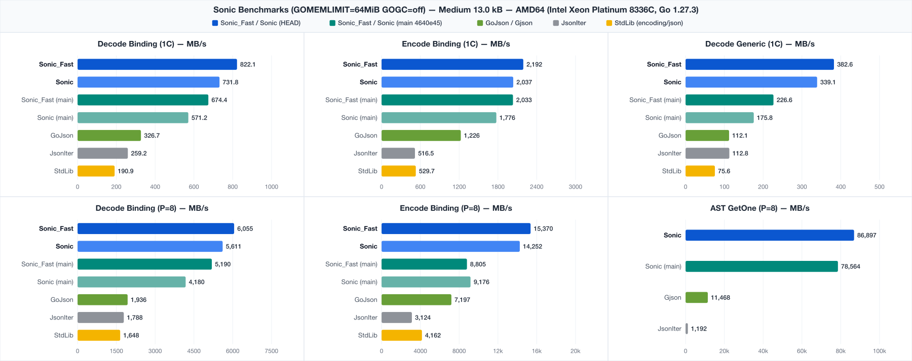
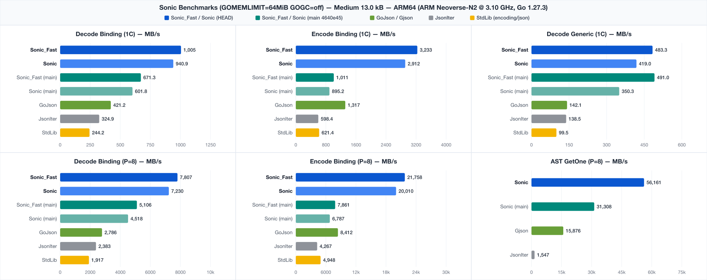
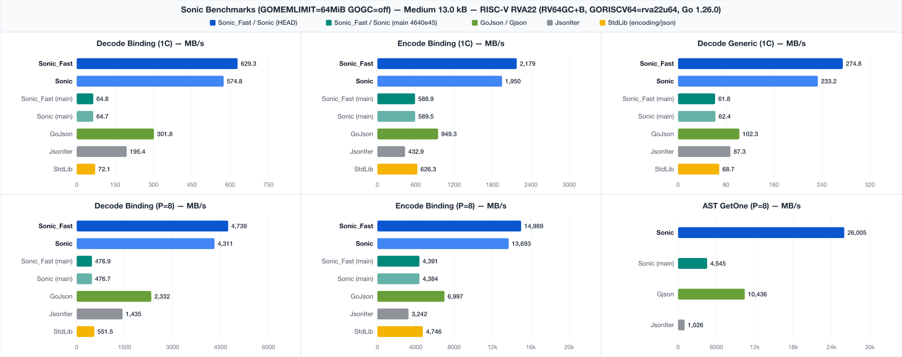
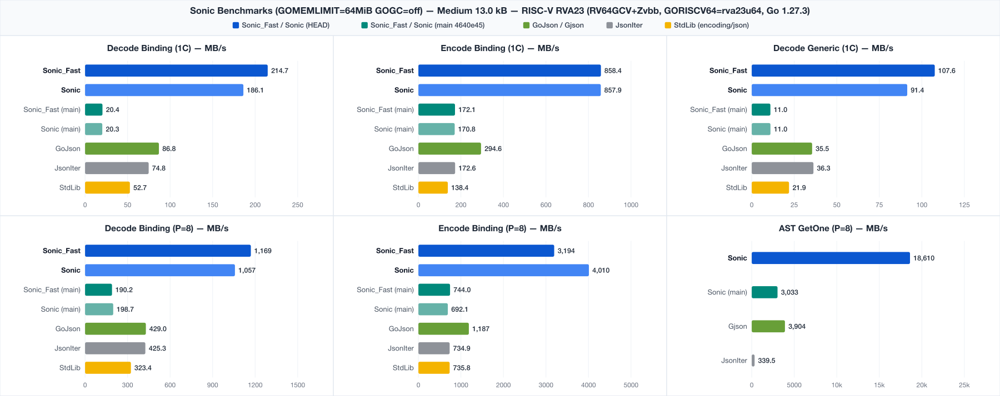

# Sonic

English | [中文](README_ZH_CN.md)

A high-performance JSON serializing and deserializing library for Go, combining a shared Go semantic core (`OptDec` decoder, table-driven encoder VM, and lazy/streaming `ast`) with bounded multi-architecture Plan 9 SIMD kernels and pure-Go scalar primitives—with zero runtime JIT machine-code generation and zero `//go:linkname` private runtime dependencies.

## Requirements & Backends

- **Go**: `1.20`–`1.27` (no `-ldflags="-checklinkname=0"` required; all `//go:linkname` and runtime JIT dependencies have been removed). Note: individual workspace test modules (such as `compatibility/`) may declare their own minimum Go versions in their `go.mod`.
- **OS**: Linux / macOS / Windows
- **Architectures, Build Tags, and Runtime Modes**:

| Configuration | Execution Backend | Notes |
|---|---|---|
| Default build on **AMD64** (`go1.20+`) | Native Sonic Go core + Plan 9 SIMD kernels | Dynamically dispatches AVX2 / SSSE3 / SSE2 based on CPU & OS vector-state support; does not assume AVX2 on every AMD64 host. |
| Default build on **ARM64** (`go1.20+`) | Native Sonic Go core + Plan 9 NEON kernels | Uses AArch64 NEON assembly kernels where applicable. |
| Default build on **RISC-V 64** (`go1.26+`, `GORISCV64=rva22u64` / `rva23u64`) | Native Sonic Go core + Plan 9 RISC-V kernels | `rva22u64` selects scalar + Zbb assembly; `rva23u64` enables RVV 1.0 vector kernels. Default `rva20u64` falls back to the compatibility backend. |
| Runtime `SONIC_MODE=noavx2 \| nossse3 \| scalar` | Native Sonic Go core with restricted runtime kernel dispatch | Restricts SIMD tier selection at runtime (does not remove assembly from the binary or change package selection). |
| Compile-time `-tags=sonic_scalar` (`amd64` / `arm64` / `riscv64`, `go1.20+`) | Native Sonic Go core + pure-Go scalar kernels | Compiles zero `.s` assembly files while retaining Sonic's native semantics (distinct from `-tags=sonic_compat`). |
| Compile-time `-tags=sonic_compat` or unsupported targets (32-bit, `wasm`, `rva20u64`, etc.) | Standard-library compatibility backend (`encoding/json`) | Delegates root-package encoding/decoding to the active Go toolchain's `encoding/json` (see [Compatibility & Presets](#compatibility--presets)). |

## Features

- Runtime object binding with no per-type code generation and no runtime machine-code generation
- Complete APIs for JSON marshaling, unmarshaling, validation, path lookup, AST manipulation, raw-span patching, and streaming traversal
- High single-core and multi-core throughput across AMD64, ARM64, and RISC-V 64

## APIs

See [go.dev](https://pkg.go.dev/github.com/bytedance/sonic) (or browse the repository packages directly for unreleased branch APIs).

## Benchmarks

Across **AMD64**, **ARM64**, and **RISC-V 64 (`rva22u64` / `rva23u64`)**, Sonic's native SIMD + precompiled-plan architecture delivers strong single-core and multi-core throughput across small, medium, and large payloads without runtime JIT or `//go:linkname`.

**Snapshot provenance & methodology** (median of 5 runs, `-benchtime=300ms`, `GOMEMLIMIT=64MiB GOGC=off SONIC_NO_ASYNC_GC=1`; single-core `-cpu=1` and parallel `-cpu=8`):
- **Snapshot revisions**: This section records an archived comparison against legacy `origin/main` (`4640e45` — JIT/loader on AMD64, legacy `optdec`/C-NEON on ARM64, and `encoding/json` compatibility fallback on RISC-V). Candidate measurements across all four hosts were collected on the converged Go/ASM source of `cfe70a4` (identical Go/ASM source to branch `HEAD`; the final commit updates workspace build/CI/docs only). Numbers reflect those archived runs on the hosts below rather than a guarantee for arbitrary hardware, Go versions, or default GC settings.
- **Why `GOMEMLIMIT=64MiB GOGC=off SONIC_NO_ASYNC_GC=1`**: Under default `GOGC=100` in an isolated microbenchmark, Go triggers GC at `2×` live heap, favoring libraries that pre-allocate large static tables or pools (e.g., `GoJson` allocates ~17 MB in `init()`, legacy ARM64 `main` pools ~19 MB at `P=8`). Configuring the same `64 MiB` Go soft memory limit across all libraries keeps GC mark/sweep and allocation costs active under identical Go GC configuration (note: `GOMEMLIMIT` is a soft heap limit, not an identical RSS cap, and `SONIC_NO_ASYNC_GC=1` disables the benchmark helper's forced background GC loop).
- **Test hosts**:
  - **AMD64**: Intel Xeon Platinum 8336C @ 2.30 GHz (Linux, Go 1.27.3)
  - **ARM64**: ARM Neoverse-N2 @ 3.10 GHz (Linux, Go 1.27.3, NUMA node0 `numactl --membind=0 taskset -c 0-7`)
  - **RISC-V RVA22**: RV64GC + B (`GORISCV64=rva22u64`, Linux, Go 1.26.0)
  - **RISC-V RVA23**: RV64GCV + Zvbb (`GORISCV64=rva23u64`, Linux, Go 1.27.3)
- **Third-party baselines**: `goccy/go-json v0.9.11`, `json-iterator/go v1.1.12`, `tidwall/gjson v1.14.3`, `tidwall/sjson v1.2.5`, and Go stdlib `encoding/json`.
- **Benchmark label legend (`Sonic` vs `Sonic_Fast`)**:
  - **Encoder benchmarks** ([`encoder/encoder_test.go`](./encoder/encoder_test.go)): `Sonic` passes `SortMapKeys | EscapeHTML | CompactMarshaler`; `Sonic_Fast` passes `0` (Generic) or `NoQuoteTextMarshaler` (Binding).
  - **Decoder benchmarks** ([`decoder/decoder_test.go`](./decoder/decoder_test.go)): both call `decoder.NewDecoder(TwitterJson).Decode(&dst)` into a fresh target; `Sonic` enables `CopyString()`, whereas `Sonic_Fast` leaves `CopyString` off (borrowing unescaped strings from the immutable `string` input). These benchmark labels do not directly map to `ConfigDefault.Unmarshal([]byte)` vs `ConfigFastest.Unmarshal([]byte)`.

### Overall Geometric Mean Speedup

Each ratio is the equal-weight geometric mean of per-case throughput ratios (`candidate MB/s ÷ baseline MB/s`) on the same host and payload set. AST and Validate rows are excluded from these codec geometric means. On RISC-V, `Sonic (main)` delegates to stdlib `encoding/json`, so RISC-V ratios vs `main` reflect native Sonic versus the legacy stdlib fallback rather than two native backends.

**Single-Core (`-cpu=1`, 8 Codec Cases: Medium Generic/Binding Encode & Decode + Small/Large Binding Encode & Decode)**

| Platform | `Sonic_Fast` vs `Sonic_Fast (main)` | `Sonic` vs `Sonic (main)` | `Sonic_Fast` vs `GoJson` | `Sonic_Fast` vs `JsonIter` | `Sonic_Fast` vs `StdLib` |
|---|---:|---:|---:|---:|---:|
| **AMD64** | **1.20x** | **1.23x** | **2.11x** | **2.69x** | **3.65x** |
| **ARM64** | **1.78x** | **1.79x** | **2.39x** | **3.00x** | **3.89x** |
| **RISC-V RVA22** | **5.35x** | **4.58x** | **2.41x** | **3.38x** | **5.05x** |
| **RISC-V RVA23** | **5.52x** | **4.76x** | **2.58x** | **2.86x** | **3.94x** |

**Parallel (`-cpu=8`, 4 Medium Codec Cases: Generic/Binding Encode & Decode; aggregate throughput, not single-request latency)**

| Platform | `Sonic_Fast` vs `Sonic_Fast (main)` | `Sonic` vs `Sonic (main)` | `Sonic_Fast` vs `GoJson` | `Sonic_Fast` vs `JsonIter` | `Sonic_Fast` vs `StdLib` |
|---|---:|---:|---:|---:|---:|
| **AMD64** | **1.65x** | **1.64x** | **3.53x** | **3.69x** | **3.67x** |
| **ARM64** | **1.94x** | **1.96x** | **3.84x** | **3.98x** | **4.19x** |
| **RISC-V RVA22** | **6.19x** | **5.16x** | **2.86x** | **5.14x** | **6.54x** |
| **RISC-V RVA23** | **3.85x** | **3.71x** | **3.24x** | **3.00x** | **3.28x** |

### Four-Platform Visual Comparison (Medium `13,035 B`: Single-Core `1C` & Parallel `P=8`)



<details>
<summary><strong>ARM64 (ARM Neoverse-N2) Chart</strong></summary>



</details>

<details>
<summary><strong>RISC-V RVA22 (<code>rva22u64</code>) Chart</strong></summary>



</details>

<details>
<summary><strong>RISC-V RVA23 (<code>rva23u64</code>, RVV 1.0) Chart</strong></summary>



</details>

### Medium ([`TwitterJson`](./decoder/testdata_test.go#L28), `13,035 B` ≈ `13.0 kB`, 300+ keys, 6 layers) — Single-Core (`-cpu=1`, MB/s, higher is better)

> Note: All rows below set `b.SetBytes(13035)` (the full `TwitterJson` document length) as the throughput denominator; for `AST GetOne` and `AST SetOne`, MB/s measures full-document lookup/edit throughput rather than full-document materialization. Allocation counts and bytes are measured on **AMD64** and are not extrapolated to other architectures.

| Scenario | Library / Version | AMD64 | ARM64 | RVA22 | RVA23 | AMD64 Alloc (B/op) |
|---|---|---:|---:|---:|---:|---:|
| **Encoder Generic** | **Sonic_Fast** | **755.4** | **972.4** | **721.1** | **288.6** | 1 (9,472 B) |
|   | **Sonic** | 396.8 | 578.2 | 432.8 | 175.8 | 1 (9,472 B) |
|   | Sonic_Fast (`main`) | 493.7 | 357.6 | 103.8 | 80.3 | 40 (13,136 B) |
|   | Sonic (`main`) | 314.5 | 282.1 | 103.5 | 79.9 | 40 (13,136 B) |
|   | GoJson | 153.0 | 174.0 | 122.2 | 42.2 | 55 (26,902 B) |
|   | JsonIter | 238.1 | 286.8 | 188.6 | 82.2 | 153 (17,984 B) |
|   | StdLib (`encoding/json`) | 218.6 | 290.5 | 103.5 | 81.6 | 8 (9,576 B) |
| **Encoder Binding** | **Sonic_Fast** | **2,192.1** | **3,233.4** | **2,179.2** | **858.4** | 1 (9,472 B) |
|   | **Sonic** | 2,037.1 | 2,911.7 | 1,950.2 | 857.9 | 1 (9,472 B) |
|   | Sonic_Fast (`main`) | 2,032.5 | 1,010.5 | 588.9 | 172.1 | 2 (9,488 B) |
|   | Sonic (`main`) | 1,775.9 | 895.2 | 589.5 | 170.8 | 2 (9,488 B) |
|   | GoJson | 1,225.9 | 1,317.3 | 949.3 | 294.6 | 1 (9,472 B) |
|   | JsonIter | 516.5 | 598.4 | 432.9 | 172.6 | 2 (9,480 B) |
|   | StdLib (`encoding/json`) | 529.7 | 621.4 | 626.3 | 138.4 | 3 (9,504 B) |
| **Decoder Generic** | **Sonic_Fast** | **382.6** | 483.3 | **274.8** | **107.6** | 239 (28,200 B) |
|   | **Sonic** | 339.1 | 419.0 | 233.2 | 91.4 | 227 (35,672 B) |
|   | Sonic_Fast (`main`) | 226.6 | **491.0** | 61.8 | 11.0 | 337 (47,560 B) |
|   | Sonic (`main`) | 175.8 | 350.3 | 62.4 | 11.0 | 747 (55,320 B) |
|   | GoJson | 112.1 | 142.1 | 102.3 | 35.5 | 996 (64,864 B) |
|   | JsonIter | 112.8 | 138.5 | 87.3 | 36.3 | 1,085 (54,216 B) |
|   | StdLib (`encoding/json`) | 75.6 | 99.5 | 68.7 | 21.9 | 931 (49,368 B) |
| **Decoder Binding** | **Sonic_Fast** | **822.1** | **1,005.2** | **629.3** | **214.7** | 22 (4,768 B) |
|   | **Sonic** | 731.8 | 940.9 | 574.8 | 186.1 | 22 (7,712 B) |
|   | Sonic_Fast (`main`) | 674.4 | 671.3 | 64.8 | 20.4 | 24 (6,576 B) |
|   | Sonic (`main`) | 571.2 | 601.8 | 64.7 | 20.3 | 127 (9,608 B) |
|   | GoJson | 326.7 | 421.2 | 301.8 | 86.8 | 49 (21,936 B) |
|   | JsonIter | 259.2 | 324.9 | 195.4 | 74.8 | 379 (14,536 B) |
|   | StdLib (`encoding/json`) | 190.9 | 244.2 | 72.1 | 52.7 | 70 (8,912 B) |
| **Validate** | **Sonic** | **1,998.5** | **2,129.2** | **1,113.6** | **517.5** | 0 (0 B) |
|   | Sonic (`main`) | 1,369.8 | 1,183.8 | 245.3 | 286.2 | 0 (0 B) |
|   | StdLib (`encoding/json`) | 911.0 | 1,105.0 | 254.3 | 287.3 | 0 (0 B) |
| **AST GetOne** | **Sonic** | **10,825.4** | **7,043.2** | **3,254.3** | **2,361.0** | 0 (0 B) |
|   | Sonic (`main`) | 9,800.7 | 3,926.6 | 567.8 | 381.6 | 1 (32 B) |
|   | Gjson | 1,447.7 | 1,987.5 | 1,304.4 | 493.8 | 0 (0 B) |
|   | JsonIter | 181.2 | 225.0 | 137.5 | 57.6 | 635 (27,666 B) |
| **AST SetOne** | **Sonic** | **3,452.6** | **3,437.2** | **1,698.2** | **869.4** | 1 (1,024 B) |
|   | Sonic (`main`) | 2,800.4 | 1,940.8 | 461.4 | 251.5 | 2 (1,056 B) |
|   | Sjson | 270.2 | 419.4 | 360.8 | 94.0 | 10 (52,152 B) |
|   | JsonIter | 120.6 | 148.8 | 92.4 | 38.6 | 952 (45,120 B) |
| **AST LoadAll()** | **Sonic** | **3,241.0** | **3,612.6** | **1,973.0** | **902.7** | 4 (2,072 B) |
|   | Sonic (`main`) | 2,251.4 | 1,997.3 | 887.7 | 419.4 | 12 (2,944 B) |
| **AST Interface()** | **Sonic** | **669.0** | **813.8** | **436.2** | **171.2** | 76 (12,000 B) |
|   | Sonic (`main`) | 604.1 | 608.6 | 374.5 | 139.2 | 95 (23,392 B) |

### Medium (`13,035 B`) — Parallel (`-cpu=8`, MB/s, higher is better)

| Scenario | Library / Version | AMD64 | ARM64 | RVA22 | RVA23 |
|---|---|---:|---:|---:|---:|
| **Encoder Generic (P=8)** | **Sonic_Fast** / **Sonic** | **4,559.5** / 2,900.4 | **7,648.4** / 4,563.1 | **4,985.9** / 3,422.0 | **920.5** / 909.6 |
| | Sonic_Fast / Sonic (`main`) | 2,384.3 / 1,579.0 | 2,382.8 / 1,843.0 | 487.0 / 492.5 | 465.5 / 527.5 |
| | GoJson / JsonIter / StdLib | 870.2 / 1,659.7 / 1,560.9 | 1,109.0 / 2,067.2 / 2,183.6 | 878.9 / 634.0 / 274.3 | 203.9 / 403.8 / 453.9 |
| **Encoder Binding (P=8)** | **Sonic_Fast** / **Sonic** | **15,370.0** / 14,252.2 | **21,757.8** / 20,009.8 | **14,988.8** / 13,692.8 | 3,193.6 / **4,009.9** |
| | Sonic_Fast / Sonic (`main`) | 8,804.5 / 9,175.5 | 7,860.6 / 6,786.6 | 4,390.5 / 4,384.1 | 744.0 / 692.1 |
| | GoJson / JsonIter / StdLib | 7,197.4 / 3,123.8 / 4,161.5 | 8,412.1 / 4,266.9 / 4,948.3 | 6,996.8 / 3,242.0 / 4,745.7 | 1,187.1 / 734.9 / 735.8 |
| **Decoder Generic (P=8)** | **Sonic_Fast** / **Sonic** | **2,726.9** / 2,271.1 | **3,706.5** / 3,128.2 | **1,878.9** / 1,617.1 | **469.7** / 450.0 |
| | Sonic_Fast / Sonic (`main`) | 1,435.0 / 1,205.2 | 3,535.7 / 2,461.4 | 445.4 / 446.1 | 111.0 / 125.7 |
| | GoJson / JsonIter / StdLib | 617.1 / 676.6 / 593.1 | 849.8 / 914.8 / 756.2 | 692.4 / 322.6 / 505.1 | 140.5 / 159.0 / 129.7 |
| **Decoder Binding (P=8)** | **Sonic_Fast** / **Sonic** | **6,055.2** / 5,610.6 | **7,806.6** / 7,229.8 | **4,738.7** / 4,310.9 | **1,169.4** / 1,057.3 |
| | Sonic_Fast / Sonic (`main`) | 5,190.3 / 4,180.5 | 5,106.4 / 4,518.2 | 476.9 / 476.7 | 190.2 / 198.7 |
| | GoJson / JsonIter / StdLib | 1,935.6 / 1,788.0 / 1,648.1 | 2,785.6 / 2,383.4 / 1,917.2 | 2,331.6 / 1,435.3 / 551.5 | 429.0 / 425.3 / 323.4 |
| **AST GetOne (P=8)** | **Sonic** / Sonic (`main`) / Gjson / JsonIter | **86,897.1** / 78,563.6 / 11,468.0 / 1,192.3 | **56,161.4** / 31,307.7 / 15,876.0 / 1,547.3 | **26,005.0** / 4,544.9 / 10,435.9 / 1,025.8 | **18,609.5** / 3,032.7 / 3,904.0 / 339.5 |
| **AST SetOne (P=8)** | **Sonic** / Sonic (`main`) / Sjson / JsonIter | **26,997.5** / 21,639.3 / 1,366.2 / 740.9 | **26,630.7** / 15,163.3 / 2,219.4 / 1,012.0 | **13,043.3** / 3,639.1 / 2,268.0 / 623.6 | **5,908.9** / 2,063.4 / 394.5 / 197.9 |
| **AST LoadAll / Interface (P=8)** | **Sonic** vs Sonic (`main`) | **22,197.5** / **4,950.1** vs 16,623.5 / 3,719.4 | **27,092.9** / **6,079.8** vs 15,082.6 / 4,162.9 | **14,491.0** / **3,164.3** vs 6,629.0 / 2,461.2 | **5,437.4** / **1,091.1** vs 2,701.7 / 681.8 |

### Small (`Book`-schema payload, `365 B` UTF-8) & Large ([`twitter.json`](./testdata/twitter.json), `631,514 B` ≈ `631.5 kB` / `616.7 KiB`) — Binding (`-cpu=1`, MB/s, higher is better)

> Note: Throughput denominators match the exact measured JSON inputs (`365 B` UTF-8 for Small; `631,514 B` for [`testdata/twitter.json`](./testdata/twitter.json)).

| Payload & Op | Library / Version | AMD64 | ARM64 | RVA22 | RVA23 | AMD64 Alloc (B/op) |
|---|---|---:|---:|---:|---:|---:|
| **Small `365 B` — Encode** | **Sonic_Fast** / **Sonic** | 440.6 / **441.5** | **612.0** / 587.6 | **435.8** / 433.8 | **151.5** / 150.0 | 1 (384 B) |
| | Sonic_Fast / Sonic (`main`) | 427.2 / 393.7 | 263.6 / 238.2 | 168.8 / 168.8 | 51.3 / 52.1 | 2 (400 B) |
| | GoJson / JsonIter / StdLib | 386.9 / 270.9 / 155.5 | 376.9 / 304.1 / 186.5 | 229.3 / 168.0 / 164.1 | 89.8 / 82.0 / 56.9 | 1 / 2 / 1 |
| **Small `365 B` — Decode** | **Sonic_Fast** / **Sonic** | 193.5 / 173.8 | **263.7** / 240.4 | **187.3** / 172.1 | **73.6** / 61.4 | 7 (435 B) / 8 (531 B) |
| | Sonic_Fast / Sonic (`main`) | **206.5** / 189.1 | 206.7 / 190.6 | 26.7 / 26.8 | 14.3 / 14.4 | 9 (528 B) / 16 (584 B) |
| | GoJson / JsonIter / StdLib | 159.9 / 127.8 / 63.0 | 209.2 / 163.1 / 85.7 | 121.9 / 83.9 / 29.7 | 47.4 / 41.3 / 23.7 | 19 / 31 / 11 |
| **Large `631.5 kB` — Encode** | **Sonic_Fast** / **Sonic** | **2,389.6** / 2,092.4 | **3,300.6** / 2,858.2 | **3,160.7** / 2,588.1 | **860.7** / 794.7 | 1 (262,146 B) |
| | Sonic_Fast / Sonic (`main`) | 1,942.0 / 1,742.2 | 1,387.2 / 1,215.4 | 745.0 / 744.0 | 192.3 / 191.7 | 106 (272,148 B) |
| | GoJson / JsonIter / StdLib | 1,112.1 / 752.6 / 683.2 | 1,251.5 / 896.7 / 819.2 | 951.0 / 631.9 / 714.6 | 319.3 / 277.3 / 209.6 | 119 / 418 / 466 |
| **Large `631.5 kB` — Decode** | **Sonic_Fast** / **Sonic** | **670.8** / 648.6 | **914.5** / 857.1 | **626.5** / 590.6 | **243.3** / 215.1 | 1,021 (180,848 B) / 834 (252,337 B) |
| | Sonic_Fast / Sonic (`main`) | 648.9 / 551.4 | 835.5 / 743.6 | 80.0 / 79.9 | 35.5 / 35.2 | 1,393 (329,545 B) / 4,244 (425,114 B) |
| | GoJson / JsonIter / StdLib | 382.9 / 274.3 / 202.3 | 515.3 / 331.9 / 247.8 | 401.1 / 207.9 / 92.8 | 129.1 / 83.0 / 62.1 | 2,793 / 17,851 / 4,589 |

See [scripts/bench.sh](./scripts/bench.sh) to run the repository's general benchmark suites locally (note: `scripts/bench.sh` uses standard `go test -bench` defaults rather than the `GOMEMLIMIT=64MiB` snapshot harness above).

## How It Works

See [docs/INTRODUCTION.md](./docs/INTRODUCTION.md).

## Usage

### Marshal / Unmarshal and Basic Query

Default native encoding (`sonic.ConfigDefault`) outputs RFC 8259-compliant JSON without sorting map keys or escaping HTML characters (`<`, `>`, `&`); both behaviors are valid under RFC 8259 (see [Sort Map Keys](#sort-map-keys) and [Escape HTML](#escape-html) if you need `encoding/json`-style output). See [Compatibility & Presets](#compatibility--presets) for other differences from `encoding/json`.

```go
package main

import (
	"fmt"
	"log"

	"github.com/bytedance/sonic"
)

type Record struct {
	ID int `json:"id"`
}

func main() {
	buf, err := sonic.Marshal(Record{ID: 7})
	if err != nil {
		log.Fatal(err)
	}

	var dst Record
	if err := sonic.Unmarshal(buf, &dst); err != nil {
		log.Fatal(err)
	}

	node, err := sonic.Get(buf, "id")
	if err != nil {
		log.Fatal(err)
	}
	id, err := node.Int64()
	if err != nil {
		log.Fatal(err)
	}

	fmt.Println(dst.ID, id) // 7 7
}
```

### Streaming I/O

Sonic supports encoding values to an `io.Writer` and decoding consecutive JSON values from an `io.Reader`.

- **Stream Encoder**

```go
package main

import (
	"bytes"
	"fmt"
	"log"

	"github.com/bytedance/sonic"
)

func main() {
	var w bytes.Buffer
	enc := sonic.ConfigDefault.NewEncoder(&w)
	if err := enc.Encode(map[string]any{"a": "b"}); err != nil {
		log.Fatal(err)
	}
	if err := enc.Encode(1); err != nil {
		log.Fatal(err)
	}
	fmt.Print(w.String())
	// Output:
	// {"a":"b"}
	// 1
}
```

- **Stream Decoder**

Declare a fresh target per iteration for independent records (reusing a non-empty map merges keys across values rather than clearing it). Check `errors.Is(err, io.EOF)` to detect end-of-stream. If your protocol requires exactly one root JSON value with no trailing values, verify that separately.

```go
package main

import (
	"errors"
	"fmt"
	"io"
	"log"
	"strings"

	"github.com/bytedance/sonic"
)

func main() {
	dec := sonic.ConfigDefault.NewDecoder(strings.NewReader(`{"id":1}{"id":2}`))
	for {
		var item struct{ ID int }
		err := dec.Decode(&item)
		if errors.Is(err, io.EOF) {
			break
		}
		if err != nil {
			log.Fatal(err)
		}
		fmt.Println(item.ID) // 1, then 2
	}
}
```

### `UseNumber` and `UseInt64`

When decoding into `any` (`interface{}`), numbers default to `float64`. Use `UseNumber()` to preserve exact lexical numbers (such as 64-bit integers beyond `float64` precision) as `json.Number`, or `UseInt64()` to decode integer tokens into `int64` (choose one rather than stacking both). On `ast.Node`, numeric accessors return `(value, error)`.

```go
package main

import (
	"encoding/json"
	"fmt"
	"log"

	"github.com/bytedance/sonic"
	"github.com/bytedance/sonic/decoder"
)

func main() {
	// Default float64
	var f any
	if err := decoder.NewDecoder(`1`).Decode(&f); err != nil {
		log.Fatal(err)
	}

	// Preserve exact digits as json.Number (e.g. > 2^53)
	var num any
	dc := decoder.NewDecoder(`9007199254740993`)
	dc.UseNumber()
	if err := dc.Decode(&num); err != nil {
		log.Fatal(err)
	}

	// Decode integers as int64
	var i64 any
	dc = decoder.NewDecoder(`42`)
	dc.UseInt64()
	if err := dc.Decode(&i64); err != nil {
		log.Fatal(err)
	}

	// AST number accessors
	root, err := sonic.GetFromString(`9007199254740993`)
	if err != nil {
		log.Fatal(err)
	}
	jn, err := root.Number()
	if err != nil {
		log.Fatal(err)
	}
	ifaceNum, err := root.InterfaceUseNumber()
	if err != nil {
		log.Fatal(err)
	}

	fmt.Printf("%T %v | %T %v | %T %v | ast=%v\n",
		f, f, num.(json.Number), num, i64.(int64), i64, jn == ifaceNum.(json.Number))
}
```

### Sort Map Keys

RFC 8259 defines JSON objects as unordered name/value collections, so Sonic does not sort map keys by default. Enable `Config{SortMapKeys: true}` (or `encoder.SortMapKeys`) when deterministic key ordering is needed (for example, hashing, comparison, or cache keys); sorting cost depends on map size and key distribution. On `ast.Node`, call `SortKeys(recursive)` (pass `true` to sort nested objects recursively).

```go
package main

import (
	"fmt"
	"log"

	"github.com/bytedance/sonic"
	"github.com/bytedance/sonic/encoder"
)

func main() {
	m := map[string]any{"b": 2, "a": 1}
	out, err := encoder.Encode(m, encoder.SortMapKeys)
	if err != nil {
		log.Fatal(err)
	}

	root, err := sonic.Get([]byte(`{"b":2,"a":1}`))
	if err != nil {
		log.Fatal(err)
	}
	if err := root.SortKeys(false); err != nil {
		log.Fatal(err)
	}
	astOut, err := root.MarshalJSON()
	if err != nil {
		log.Fatal(err)
	}

	fmt.Println(string(out), string(astOut)) // {"a":1,"b":2} {"a":1,"b":2}
}
```

### Escape HTML

RFC 8259 does not require escaping `<`, `>`, or `&`, so Sonic leaves them unescaped by default. Enable `Config{EscapeHTML: true}` or `encoder.EscapeHTML` when embedding JSON in HTML contexts (matching `encoding/json.HTMLEscape`); escaping cost depends on string content and payload shape.

```go
package main

import (
	"fmt"
	"log"

	"github.com/bytedance/sonic/encoder"
)

func main() {
	v := map[string]string{"&&": "<>"}
	ret, err := encoder.Encode(v, encoder.EscapeHTML)
	if err != nil {
		log.Fatal(err)
	}
	fmt.Println(string(ret)) // {"\u0026\u0026":"\u003c\u003e"}
}
```

### Compact Format (`CompactMarshaler`)

Sonic encodes standard Go structs, maps, and slices as compact JSON by default. On the native backend, values implementing `json.Marshaler` (including `json.RawMessage`) or `JSONAppender` are validated for JSON syntax by default without stripping whitespace from the returned fragment; enable `Config{CompactMarshaler: true}` (or `encoder.CompactMarshaler`) to actively validate and compact their output.

### Error Handling & Mismatched Types

Syntax errors (malformed JSON) and type-mismatch errors (syntactically valid JSON that does not fit the target Go type) are distinct:
- On native Sonic, callers can inspect `decoder.SyntaxError` and `*decoder.MismatchTypeError` with `errors.As` (do not rely on the compatibility backend or arbitrary custom `UnmarshalJSON` implementations returning the same concrete error types or exact diagnostic text).
- When a type mismatch occurs, Sonic returns an error while other compatible fields may already have been written. Do not rely on which mismatch is reported when multiple fields mismatch. If you need all-or-nothing updates, decode into an isolated temporary value (without sharing mutable slices, maps, or pointers with the destination) and assign on success.

```go
package main

import (
	"errors"
	"fmt"

	"github.com/bytedance/sonic"
	"github.com/bytedance/sonic/decoder"
)

func main() {
	var generic any
	if err := sonic.UnmarshalString("[[[}]]", &generic); err != nil {
		var syn decoder.SyntaxError
		if errors.As(err, &syn) {
			fmt.Println("syntax error at pos:", syn.Pos)
		}
	}

	var data struct {
		A int
		B int
	}
	if err := sonic.UnmarshalString(`{"A":"1","B":2}`, &data); err != nil {
		var mis *decoder.MismatchTypeError
		if errors.As(err, &mis) {
			fmt.Println("mismatch at pos:", mis.Pos)
		}
	}
	fmt.Printf("partial result: %+v\n", data) // {A:0 B:2}
}
```

### `ast.Node` and Path APIs

`ast.Node` provides a lazy, mutable JSON AST alongside path lookup and raw-span patching APIs.

#### Single-Path Lookup and Root Access

Pass zero path arguments (`sonic.Get(buf)`) to wrap the root value; pass string keys and non-negative integer indices for nested lookup (do not pass `nil` as a root path segment).

```go
package main

import (
	"fmt"
	"log"

	"github.com/bytedance/sonic"
)

func main() {
	input := []byte(`{"key1":[{},{"key2":{"key3":[1,2,3]}}]}`)

	// No path arguments: root node
	root, err := sonic.Get(input)
	if err != nil {
		log.Fatal(err)
	}
	raw, err := root.Raw()
	if err != nil {
		log.Fatal(err)
	}

	// Single path with multiple segments: key1 -> [1] -> key2
	sub, err := sonic.Get(input, "key1", 1, "key2")
	if err != nil {
		log.Fatal(err)
	}
	val, err := sub.Get("key3").Index(2).Int64()
	if err != nil {
		log.Fatal(err)
	}

	fmt.Println(len(raw), val) // 39 3
}
```

#### Multi-Path Lookup (`PathPlan`) and Raw-Span Patching (`PatchByPath`)

- **Repeated multi-path queries**: compile a reusable plan with `ast.CompilePathPlan(paths...)` and run `searcher.GetManyWithPlan(plan)` (or one-shot `searcher.GetManyByPath(paths...)`). Results align with caller path order; missing individual paths yield an empty node (`!node.Exists()`) without failing sibling paths, while malformed JSON returns a syntax error.
- **Targeted raw-span replacement**: `ast.PatchByPath` validates the full input document, locates existing target paths, and writes a new patched JSON buffer while preserving untouched bytes. Target paths must exist; invalid replacement JSON or overlapping/duplicate target spans return an error.

#### `ast.SearchOptions`

`ast.NewSearcher(str)` defaults to `ValidateJSON: true`, `CopyReturn: false`, `ConcurrentRead: false`. Note that `sonic.GetWithOptions(buf, opts, path...)` assigns `opts` **in full**, so explicitly set every boolean option you rely on:

```go
opts := ast.SearchOptions{
	CopyReturn:     true, // copy matched fragment so buf can be reused
	ValidateJSON:   true, // validate the matched target value
	ConcurrentRead: true, // prepare the returned node for concurrent reads
}
val, err := sonic.GetWithOptions(buf, opts, "key")
```

- **`ValidateJSON` scope**: on single-path lookup, `ValidateJSON` validates the located target value—it does **not** prove that unvisited sibling fields or trailing bytes after the root value are valid JSON. If you require whole-document syntax validation, call `sonic.Valid(buf)` (or `json.Valid(buf)`); if you also require valid UTF-8, validate UTF-8 separately (e.g., `utf8.Validate(buf)`).
- **`CopyReturn`**: copies the matched JSON fragment out of `buf`. If `CopyReturn` is `false` with `GetWithOptions(buf, ...)`, the returned node may borrow `buf`'s backing memory; do not mutate `buf` while holding the node.
- **`ConcurrentRead`**: makes read operations on the returned node safe for concurrent goroutines (concurrent mutation is still not supported).

#### Modification and Serialization

Use `ast.NewBool`, `ast.NewString`, etc. to construct nodes, prefer key-based `Unset(key)` over positional indices on objects, and call `MarshalJSON()` (or `json.Marshal(&root)` with a node pointer) to serialize.

```go
package main

import (
	"encoding/json"
	"fmt"
	"log"

	"github.com/bytedance/sonic"
	"github.com/bytedance/sonic/ast"
)

func main() {
	root, err := sonic.Get([]byte(`{"a":1}`))
	if err != nil {
		log.Fatal(err)
	}

	existed, err := root.Set("key4", ast.NewBool(true))
	if err != nil {
		log.Fatal(err)
	}
	fmt.Println("existed before Set:", existed, "valid:", root.Get("key4").Valid())

	existed, err = root.Unset("key4")
	if err != nil {
		log.Fatal(err)
	}
	fmt.Println("existed before Unset:", existed, "exists now:", root.Get("key4").Exists())

	buf, err := root.MarshalJSON()
	if err != nil {
		log.Fatal(err)
	}
	stdBuf, err := json.Marshal(&root) // pass pointer to ast.Node
	if err != nil {
		log.Fatal(err)
	}
	fmt.Println(string(buf), string(buf) == string(stdBuf)) // {"a":1} true
}
```

#### `ast.Node` API Quick Reference

- **State & checks**: `Exists()`, `Valid()`, `Check()`, `Error()` (note: `Valid()` / `Check()` inspect node state, not whole-document RFC compliance)
- **Lookup**: `Get()`, `Index()`, `IndexPair()`, `IndexOrGet()`, `GetByPath()`
- **Conversions**: `Int64()`, `Float64()`, `String()`, `Number()`, `Bool()`, `Map()`, `MapUseNumber()`, `MapUseNode()`, `Array()`, `ArrayUseNumber()`, `ArrayUseNode()`, `Interface()`, `InterfaceUseNumber()`, `InterfaceUseNode()`
- **Constructors**: `NewRaw()`, `NewNumber()`, `NewNull()`, `NewBool()`, `NewString()`, `NewObject()`, `NewArray()`
- **Iteration**: `Values()`, `Properties()`, `ForEach()`
- **Modification**: `Set()`, `SetByIndex()`, `Add()`, `Unset()`, `UnsetByIndex()`, `SortKeys()`
- **Loading & serialization**: `Load()`, `LoadAll()`, `Raw()`, `MarshalJSON()`

### `ast.Visitor` (`ast.Preorder`)

`ast.Preorder` performs a SAX-style preorder traversal over a JSON string, invoking caller-supplied `ast.Visitor` callbacks and returning an `error`. Capacity arguments passed to `OnObjectBegin` / `OnArrayBegin` are hints rather than guaranteed final element counts. Whether a result tree is allocated (and its memory footprint) depends on your visitor implementation.

```go
func Preorder(str string, visitor Visitor, opts *VisitorOptions) error

type Visitor interface {
	OnNull() error
	OnBool(v bool) error
	OnString(v string) error
	OnInt64(v int64, n json.Number) error
	OnFloat64(v float64, n json.Number) error
	OnObjectBegin(capacity int) error
	OnObjectKey(key string) error
	OnObjectEnd() error
	OnArrayBegin(capacity int) error
	OnArrayEnd() error
}
```

See [ast/visitor.go](./ast/visitor.go) and the demo visitor in [ast/visitor_test.go](./ast/visitor_test.go).

## Compatibility & Presets

Sonic provides three frozen presets (`sonic.API`) alongside custom `sonic.Config{...}.Froze()` configurations:

| Preset / Backend | Configured Settings | Scope & Guarantees |
|---|---|---|
| `ConfigDefault` | Zero-value `Config{}` | Native encoder does not sort map keys or escape HTML by default. Differences from `encoding/json` are not limited to those two flags (see [`compatibility/`](./compatibility/README.md)). |
| `ConfigStd` | `EscapeHTML`, `SortMapKeys`, `CompactMarshaler`, `CopyString`, `ValidateString` | Aims for closer compatibility with `encoding/json`, not byte-for-byte parity across every edge input, error string, or custom callback. |
| `ConfigFastest` | `NoValidateJSONMarshaler`, `NoValidateJSONSkip` | Skips JSON syntax validation on `json.Marshaler` outputs and eligible skipped decoder subtrees. Does **not** enable `NoQuoteTextMarshaler` or disable all JSON validation. |
| Compatibility backend (`-tags=sonic_compat` or unsupported targets) | Delegates to active Go `encoding/json` | Forwards supported settings such as `EscapeHTML`, `UseNumber`, and `DisallowUnknownFields`; native-only options (e.g. `CaseSensitive`) need not take effect. Use `sonic.APIKind` (`UseSonicJSON` vs `UseStdJSON`) to inspect the active backend; presets do **not** all become `ConfigStd`. |

## Tips

### Pretouch

Sonic compiles and caches immutable encoder VM programs and decoder plans on first encounter of each Go type (runtime `golang-asm` JIT compilation has been removed). For large nested schemas or strict cold-start tail-latency budgets, call `sonic.Pretouch()` or `sonic.PretouchMany()` at startup:

```go
package main

import (
	"log"
	"reflect"

	"github.com/bytedance/sonic"
	"github.com/bytedance/sonic/option"
)

type ServicePayload struct {
	ID   int64
	Name string
}

func init() {
	if err := sonic.PretouchMany(
		[]reflect.Type{reflect.TypeOf(ServicePayload{})},
		option.WithCompileRecursiveDepth(1),
		option.WithCompileMaxInlineDepth(16),
	); err != nil {
		log.Fatal(err)
	}
}
```

### String Ownership, `CopyString`, and `[]byte` vs `string`

Ownership depends on the entry point and options—avoid assuming uniform zero-copy or uniform full-copy across all APIs:

| Entry Point / Type | Ownership Contract | Guidance |
|---|---|---|
| `sonic.Unmarshal(buf []byte, &v)` | Native decoder copies decoded built-in `string` values and diagnostic error sources out of `buf`, so `buf` may be mutated or reused after `Unmarshal` returns (do not mutate `buf` concurrently during the call; custom `UnmarshalJSON` implementations remain responsible for copying their `[]byte` argument if retained). | Safe default for reusable I/O buffers. Note that enabling `ValidateString` on invalid UTF-8 may also allocate a repaired input copy. |
| `sonic.UnmarshalString(s string, &v)` | With `CopyString: false` (`ConfigDefault`), unescaped decoded strings may borrow substrings of `s`; escaped strings are decoded into fresh storage. With `CopyString: true`, decoded strings are detached from `s`. | Enable `Config{CopyString: true}.Froze()` (or `decoder.CopyString()`) when caching small strings extracted from large source documents. |
| `sonic.Get(buf, path...)` | Copies the **matched JSON fragment** out of `buf` (does not require copying the entire document upfront). | Safe when `buf` will be reused. |
| `sonic.GetFromString(s, path...)` | **Borrows from `s` by default**; retaining a small returned node can keep the entire source string alive. | Use for short-lived queries; use **`sonic.GetCopyFromString(s, path...)`** when caching small subtrees long-term. |
| `sonic.GetWithOptions(buf, opts, ...)` | Applies `opts` as a whole; `CopyReturn: false` allows the returned node to borrow `buf`. | Set `CopyReturn: true` if `buf` will be mutated/reused. |
| `json.RawMessage` vs `sonic.NoCopyRawMessage` | `json.RawMessage` is detached on mutable inputs; `sonic.NoCopyRawMessage` allows native zero-copy borrowing only on immutable `string` inputs with `CopyString: false`. | Do not treat `NoCopyRawMessage` as guaranteed aliasing on `[]byte` or streaming `io.Reader` paths. |
| `StreamDecoder` | Decoded values and library-generated error sources are detached from reused internal reader buffers. | Safe across consecutive `Decode` calls. |
| `sonic.MarshalString` / `cfg.MarshalToString` | On native backends, avoids a final `[]byte`-to-`string` copy after encoding (serialization itself still allocates the output buffer). | Prefer when the caller needs a `string` directly. |

### `encoding.TextMarshaler` (`NoQuoteTextMarshaler`)

By default, Sonic quotes and escapes strings returned by `encoding.TextMarshaler`. If your `MarshalText()` implementation already produces a valid JSON representation (properly quoted and internally escaped per RFC 8259), you may opt into `Config{NoQuoteTextMarshaler: true}` or `encoder.NoQuoteTextMarshaler`. Merely having surrounding quotes does **not** substitute for escaping internal special characters.

### Choosing Between `Unmarshal`, `ast.Node` / Path APIs, and `ast.Visitor`

- **Known target schema & all fields needed**: call `Unmarshal` / `UnmarshalString` directly.
- **Single or few fields from a large payload**: use `sonic.Get` / `GetFromString` / `GetCopyFromString`, or combine path lookup with struct decoding:

```go
// import "github.com/bytedance/sonic"

type User struct {
	ID int64 `json:"id"`
}

func readUser(src string, index int) (User, error) {
	node, err := sonic.GetFromString(src, "statuses", index, "user")
	if err != nil {
		return User{}, err
	}
	raw, err := node.Raw()
	if err != nil {
		return User{}, err
	}
	var u User
	if err := sonic.UnmarshalString(raw, &u); err != nil {
		return User{}, err
	}
	return u, nil
}
```

- **Fixed set of paths across many documents**: precompile with `ast.CompilePathPlan` and call `GetManyWithPlan`.
- **Sharing a read-only `ast.Node` across goroutines**: `ast.Node` is lazy by default and **not** safe for concurrent reads until loaded (or fetched with `ast.SearchOptions{ConcurrentRead: true}`). Load and check errors **before** publishing to other goroutines, and never mutate concurrently:

```go
root, err := sonic.GetFromString(src)
if err != nil {
	return err
}
user := root.GetByPath("statuses", 3, "user")
if err := user.LoadAll(); err != nil {
	return err
}
go readOnlyConsumer(user)
```

- **Custom non-standard target tree in one event pass**: use `ast.Preorder` with `ast.Visitor`. Measure against direct decoding on your actual data rather than assuming one API is universally faster.

### Pool Buffer Limits

Sonic pools scratch buffers in paths such as `encoder.Encode` and `ast.Node.MarshalJSON`. To bound peak pooled memory under high load (see [issue 614](https://github.com/bytedance/sonic/issues/614)), adjust the buffer-size variables in [`option/option.go`](./option/option.go) (also documented on [pkg.go.dev](https://pkg.go.dev/github.com/bytedance/sonic/option#pkg-variables)).

### Faster JSON Skip (Trusted Inputs Only)

By default, Sonic validates skipped JSON values using a full structural state machine (`internal/native/skip_go.go`) when skipping unknown/mismatched fields or encoding `json.Marshaler` values. For **trusted** inputs where strict syntax validation of skipped values is unnecessary, you can opt into:

- `Config.NoValidateJSONSkip`: skips syntax validation on eligible skipped values during decoding (such as unknown fields, mismatched values, and extra array elements)
- `Config.NoValidateJSONMarshaler`: skips syntax validation of JSON returned by `json.Marshaler`
- `ast.SearchOptions.ValidateJSON: false`: skips syntax validation of the matched value during single-path AST lookup

## External JSON-Path Ecosystem

Sonic's native path APIs accept explicit string keys and non-negative integer indices rather than full GJSON expression syntax. For GJSON-style query expressions accelerated with Sonic primitives, see the external wrapper project [cloudwego/gjson](https://github.com/cloudwego/gjson).

## Community

Sonic is a subproject of [CloudWeGo](https://www.cloudwego.io/). We are committed to building a cloud native ecosystem.
