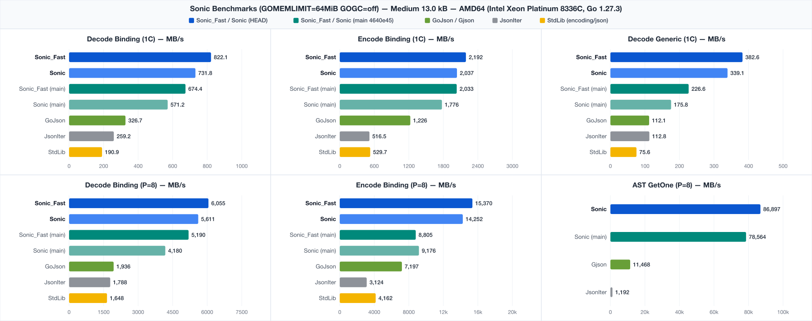
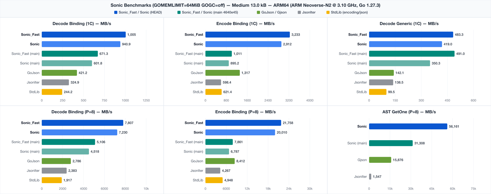
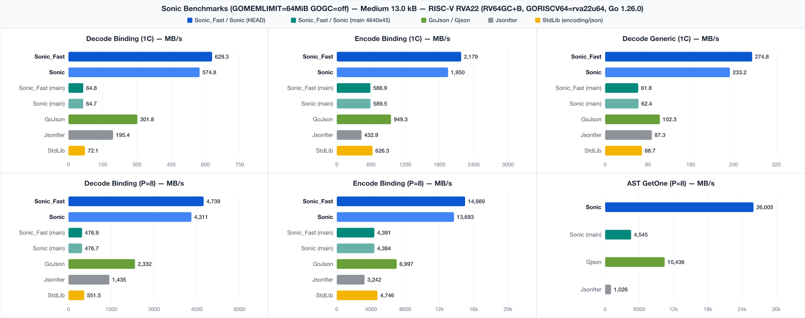
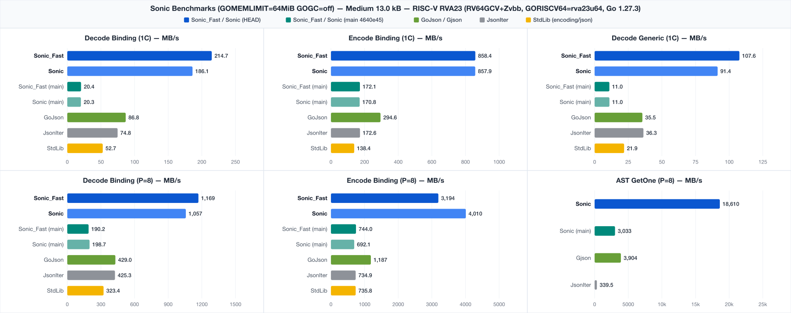

# Sonic

[English](README.md) | 中文

高性能 Go JSON 序列化与反序列化库，基于共享 Go 语义核心（`OptDec` 解码器、表驱动编码 VM 与惰性/流式 `ast`）以及多架构有界 Plan 9 SIMD 内核与纯 Go 标量原语构建，无运行期 JIT 机器码生成，无 `//go:linkname` 私有运行时依赖。

## 依赖与后端

- **Go**：`1.20`–`1.27`（已移除全部 `//go:linkname` 与运行期 JIT 依赖，不再需要 `-ldflags="-checklinkname=0"`）。注：工作区中的独立测试模块（如 `compatibility/`）在其各自的 `go.mod` 中有独立版本要求。
- **操作系统**：Linux / macOS / Windows
- **架构、编译标签与运行时模式**：

| 配置 | 执行后端 | 说明 |
|---|---|---|
| **AMD64** 默认构建（`go1.20+`） | 原生 Sonic Go 核心 + Plan 9 SIMD 内核 | 根据实际 CPU 与 OS 向量状态支持情况动态分派 AVX2 / SSSE3 / SSE2，不假定所有 AMD64 机器均支持 AVX2。 |
| **ARM64** 默认构建（`go1.20+`） | 原生 Sonic Go 核心 + Plan 9 NEON 内核 | 在适用热点路径调用 AArch64 NEON 汇编内核。 |
| **RISC-V 64** 默认构建（`go1.26+`，`GORISCV64=rva22u64` / `rva23u64`） | 原生 Sonic Go 核心 + Plan 9 RISC-V 内核 | `rva22u64` 选用标量 + Zbb 汇编；`rva23u64` 启用 RVV 1.0 向量内核。默认 `rva20u64` 回退至兼容后端。 |
| 运行时 `SONIC_MODE=noavx2 \| nossse3 \| scalar` | 原生 Sonic Go 核心（限制运行时内核分派档位） | 仅在运行期限制 SIMD 分派档位，不会从二进制中移除汇编，也不是切换包实现的编译标签。 |
| 编译期 `-tags=sonic_scalar`（`amd64` / `arm64` / `riscv64`，`go1.20+`） | 原生 Sonic Go 核心 + 纯 Go 标量内核 | 编译零个 `.s` 汇编文件，同时保留 Sonic 原生语义（不等价于 `-tags=sonic_compat`）。 |
| 编译期 `-tags=sonic_compat` 或未支持目标（32 位、`wasm`、`rva20u64` 等） | 标准库兼容后端（`encoding/json`） | 根包编解码委托当前 Go 工具链的 `encoding/json`（详见[兼容性与预设](#兼容性与预设)）。 |

## 特色

- 运行时对象绑定：业务类型无需预生成编解码器，运行期亦不生成机器码
- 完备的 JSON 编解码、语法校验、路径检索、AST 操作、原文片段替换与流式遍历 API
- 在 AMD64、ARM64 与 RISC-V 64 上均具备高单核与多核吞吐

## 接口

详见 [go.dev](https://pkg.go.dev/github.com/bytedance/sonic)（未发布分支的新增接口请直接参阅仓库源码）。

## 基准测试

在 **AMD64**、**ARM64** 与 **RISC-V 64（`rva22u64` / `rva23u64`）** 四大平台上，移除运行期 JIT 与 `//go:linkname` 后的多架构原生 SIMD + 预编译执行计划架构在小、中、大报文的**单核与多核并发**主力场景中均保持显著领先。

**快照出处与测试口径**（每项 5 轮中位数，`-benchtime=300ms`，`GOMEMLIMIT=64MiB GOGC=off SONIC_NO_ASYNC_GC=1`；单核 `-cpu=1` 与并发 `-cpu=8`）：
- **快照版本**：本节为留存对比快照，对比基线为上游旧版 `origin/main`（`4640e45`——AMD64 为旧版 JIT/loader，ARM64 为旧版 `optdec`/C-NEON，RISC-V 回退至标准库 `encoding/json` 兼容后端）。四平台候选数据均在 `cfe70a4` 的统一 Go/汇编源码上实测采集（与分支 `HEAD` 的 Go/汇编源码完全一致，末提交仅更新工作区构建/CI/文档）。此处展示的是上述版本在对应实机与口径下的结果，不构成对任意硬件、Go 版本或默认 GC 配置的绝对承诺。
- **为何采用 `GOMEMLIMIT=64MiB GOGC=off SONIC_NO_ASYNC_GC=1`**：在独立微基准下，默认 `GOGC=100` 按 `2×` 常驻活堆触发 GC，会反向奖励启动阶段静态预分配大量内存或大对象池的库（例如 `GoJson` 在 `init()` 预分配约 17 MB，旧版 `main` ARM64 在 `P=8` 常驻约 19 MB）。为所有库配置相同的 `64 MiB` Go 软内存上限，使单核与并发场景在统一 Go GC 配置下真实计入标记/清扫与分配成本（注：`GOMEMLIMIT` 为软堆上限而非相同 RSS 上限，`SONIC_NO_ASYNC_GC=1` 用于关闭测试辅助代码中的强制后台 GC 循环）。
- **实测环境**：
  - **AMD64**：Intel Xeon Platinum 8336C @ 2.30 GHz（Linux，Go 1.27.3）
  - **ARM64**：ARM Neoverse-N2 @ 3.10 GHz（Linux，Go 1.27.3，单 NUMA 节点 `numactl --membind=0 taskset -c 0-7`）
  - **RISC-V RVA22**：RV64GC + B（`GORISCV64=rva22u64`，Linux，Go 1.26.0）
  - **RISC-V RVA23**：RV64GCV + Zvbb（`GORISCV64=rva23u64`，Linux，Go 1.27.3）
- **第三方基线**：`goccy/go-json v0.9.11`、`json-iterator/go v1.1.12`、`tidwall/gjson v1.14.3`、`tidwall/sjson v1.2.5` 与 Go 标准库 `encoding/json`。
- **基准标签说明（`Sonic` 与 `Sonic_Fast`）**：
  - **编码基准**（[`encoder/encoder_test.go`](./encoder/encoder_test.go)）：`Sonic` 开启 `SortMapKeys | EscapeHTML | CompactMarshaler`；`Sonic_Fast` 传入 `0`（Generic）或 `NoQuoteTextMarshaler`（Binding）。
  - **解码基准**（[`decoder/decoder_test.go`](./decoder/decoder_test.go)）：两者均调用 `decoder.NewDecoder(TwitterJson).Decode(&dst)` 解到全新目标；`Sonic` 开启 `CopyString()`，`Sonic_Fast` 关闭 `CopyString`（从不可变 `string` 借用无转义字符串）。二者是具体基准用例的选项对照，不能直接等同于 `ConfigDefault.Unmarshal([]byte)` 与 `ConfigFastest.Unmarshal([]byte)`。

### 综合几何平均加速比

下表每项倍数为同平台、同场景下逐项吞吐比（`候选 MB/s ÷ 基线 MB/s`）的等权几何平均，不包含 AST 与 Validate 用例。在 RISC-V 平台上，旧版 `Sonic (main)` 回退至标准库 `encoding/json`，因此 RISC-V 相对 `main` 的倍数反映原生 Sonic 相对旧兼容层的收益，而非两个原生后端的差异。

**单核（`-cpu=1`，8 项编解码用例：Medium Generic/Binding 编解码 + Small/Large Binding 编解码）**

| 平台 | `Sonic_Fast` vs `Sonic_Fast (main)` | `Sonic` vs `Sonic (main)` | `Sonic_Fast` vs `GoJson` | `Sonic_Fast` vs `JsonIter` | `Sonic_Fast` vs `StdLib` |
|---|---:|---:|---:|---:|---:|
| **AMD64** | **1.20x** | **1.23x** | **2.11x** | **2.69x** | **3.65x** |
| **ARM64** | **1.78x** | **1.79x** | **2.39x** | **3.00x** | **3.89x** |
| **RISC-V RVA22** | **5.35x** | **4.58x** | **2.41x** | **3.38x** | **5.05x** |
| **RISC-V RVA23** | **5.52x** | **4.76x** | **2.58x** | **2.86x** | **3.94x** |

**并发（`-cpu=8`，4 项中型报文编解码用例；体现总吞吐而非单请求延迟）**

| 平台 | `Sonic_Fast` vs `Sonic_Fast (main)` | `Sonic` vs `Sonic (main)` | `Sonic_Fast` vs `GoJson` | `Sonic_Fast` vs `JsonIter` | `Sonic_Fast` vs `StdLib` |
|---|---:|---:|---:|---:|---:|
| **AMD64** | **1.65x** | **1.64x** | **3.53x** | **3.69x** | **3.67x** |
| **ARM64** | **1.94x** | **1.96x** | **3.84x** | **3.98x** | **4.19x** |
| **RISC-V RVA22** | **6.19x** | **5.16x** | **2.86x** | **5.14x** | **6.54x** |
| **RISC-V RVA23** | **3.85x** | **3.71x** | **3.24x** | **3.00x** | **3.28x** |

### 四平台核心性能对比图（中型报文 `13,035 B`：单核 `1C` 与并发 `P=8`）



<details>
<summary><strong>ARM64（ARM Neoverse-N2）对比图</strong></summary>



</details>

<details>
<summary><strong>RISC-V RVA22（<code>rva22u64</code>）对比图</strong></summary>



</details>

<details>
<summary><strong>RISC-V RVA23（<code>rva23u64</code>，RVV 1.0）对比图</strong></summary>



</details>

### 中型报文（[`TwitterJson`](./decoder/testdata_test.go#L28)，`13,035 B` ≈ `13.0 kB`，300+ 键，6 层）— 单核（`-cpu=1`，单位 MB/s，越高越好）

> 说明：下表各行均以完整 `TwitterJson` 长度（`13,035 B`）作为 `b.SetBytes` 吞吐分母；对于 `AST GetOne` 与 `AST SetOne`，MB/s 反映定位/修改整篇报文中的单条路径的等效吞吐，并非逐字节物化全文。分配列仅在 **AMD64** 上测得，不外推至其他架构。

| 场景 | 库 / 版本 | AMD64 | ARM64 | RVA22 | RVA23 | AMD64 分配 (B/op) |
|---|---|---:|---:|---:|---:|---:|
| **Encoder Generic** | **Sonic_Fast** | **755.4** | **972.4** | **721.1** | **288.6** | 1 (9,472 B) |
|   | **Sonic** | 396.8 | 578.2 | 432.8 | 175.8 | 1 (9,472 B) |
|   | Sonic_Fast (`main`) | 493.7 | 357.6 | 103.8 | 80.3 | 40 (13,136 B) |
|   | Sonic (`main`) | 314.5 | 282.1 | 103.5 | 79.9 | 40 (13,136 B) |
|   | GoJson | 153.0 | 174.0 | 122.2 | 42.2 | 55 (26,902 B) |
|   | JsonIter | 238.1 | 286.8 | 188.6 | 82.2 | 153 (17,984 B) |
|   | StdLib (`encoding/json`) | 218.6 | 290.5 | 103.5 | 81.6 | 8 (9,576 B) |
| **Encoder Binding** | **Sonic_Fast** | **2,192.1** | **3,233.4** | **2,179.2** | **858.4** | 1 (9,472 B) |
|   | **Sonic** | 2,037.1 | 2,911.7 | 1,950.2 | 857.9 | 1 (9,472 B) |
|   | Sonic_Fast (`main`) | 2,032.5 | 1,010.5 | 588.9 | 172.1 | 2 (9,488 B) |
|   | Sonic (`main`) | 1,775.9 | 895.2 | 589.5 | 170.8 | 2 (9,488 B) |
|   | GoJson | 1,225.9 | 1,317.3 | 949.3 | 294.6 | 1 (9,472 B) |
|   | JsonIter | 516.5 | 598.4 | 432.9 | 172.6 | 2 (9,480 B) |
|   | StdLib (`encoding/json`) | 529.7 | 621.4 | 626.3 | 138.4 | 3 (9,504 B) |
| **Decoder Generic** | **Sonic_Fast** | **382.6** | 483.3 | **274.8** | **107.6** | 239 (28,200 B) |
|   | **Sonic** | 339.1 | 419.0 | 233.2 | 91.4 | 227 (35,672 B) |
|   | Sonic_Fast (`main`) | 226.6 | **491.0** | 61.8 | 11.0 | 337 (47,560 B) |
|   | Sonic (`main`) | 175.8 | 350.3 | 62.4 | 11.0 | 747 (55,320 B) |
|   | GoJson | 112.1 | 142.1 | 102.3 | 35.5 | 996 (64,864 B) |
|   | JsonIter | 112.8 | 138.5 | 87.3 | 36.3 | 1,085 (54,216 B) |
|   | StdLib (`encoding/json`) | 75.6 | 99.5 | 68.7 | 21.9 | 931 (49,368 B) |
| **Decoder Binding** | **Sonic_Fast** | **822.1** | **1,005.2** | **629.3** | **214.7** | 22 (4,768 B) |
|   | **Sonic** | 731.8 | 940.9 | 574.8 | 186.1 | 22 (7,712 B) |
|   | Sonic_Fast (`main`) | 674.4 | 671.3 | 64.8 | 20.4 | 24 (6,576 B) |
|   | Sonic (`main`) | 571.2 | 601.8 | 64.7 | 20.3 | 127 (9,608 B) |
|   | GoJson | 326.7 | 421.2 | 301.8 | 86.8 | 49 (21,936 B) |
|   | JsonIter | 259.2 | 324.9 | 195.4 | 74.8 | 379 (14,536 B) |
|   | StdLib (`encoding/json`) | 190.9 | 244.2 | 72.1 | 52.7 | 70 (8,912 B) |
| **Validate** | **Sonic** | **1,998.5** | **2,129.2** | **1,113.6** | **517.5** | 0 (0 B) |
|   | Sonic (`main`) | 1,369.8 | 1,183.8 | 245.3 | 286.2 | 0 (0 B) |
|   | StdLib (`encoding/json`) | 911.0 | 1,105.0 | 254.3 | 287.3 | 0 (0 B) |
| **AST GetOne** | **Sonic** | **10,825.4** | **7,043.2** | **3,254.3** | **2,361.0** | 0 (0 B) |
|   | Sonic (`main`) | 9,800.7 | 3,926.6 | 567.8 | 381.6 | 1 (32 B) |
|   | Gjson | 1,447.7 | 1,987.5 | 1,304.4 | 493.8 | 0 (0 B) |
|   | JsonIter | 181.2 | 225.0 | 137.5 | 57.6 | 635 (27,666 B) |
| **AST SetOne** | **Sonic** | **3,452.6** | **3,437.2** | **1,698.2** | **869.4** | 1 (1,024 B) |
|   | Sonic (`main`) | 2,800.4 | 1,940.8 | 461.4 | 251.5 | 2 (1,056 B) |
|   | Sjson | 270.2 | 419.4 | 360.8 | 94.0 | 10 (52,152 B) |
|   | JsonIter | 120.6 | 148.8 | 92.4 | 38.6 | 952 (45,120 B) |
| **AST LoadAll()** | **Sonic** | **3,241.0** | **3,612.6** | **1,973.0** | **902.7** | 4 (2,072 B) |
|   | Sonic (`main`) | 2,251.4 | 1,997.3 | 887.7 | 419.4 | 12 (2,944 B) |
| **AST Interface()** | **Sonic** | **669.0** | **813.8** | **436.2** | **171.2** | 76 (12,000 B) |
|   | Sonic (`main`) | 604.1 | 608.6 | 374.5 | 139.2 | 95 (23,392 B) |

### 中型报文（`13,035 B`）— 并发（`-cpu=8`，单位 MB/s，越高越好）

| 场景 | 库 / 版本 | AMD64 | ARM64 | RVA22 | RVA23 |
|---|---|---:|---:|---:|---:|
| **Encoder Generic (P=8)** | **Sonic_Fast** / **Sonic** | **4,559.5** / 2,900.4 | **7,648.4** / 4,563.1 | **4,985.9** / 3,422.0 | **920.5** / 909.6 |
| | Sonic_Fast / Sonic (`main`) | 2,384.3 / 1,579.0 | 2,382.8 / 1,843.0 | 487.0 / 492.5 | 465.5 / 527.5 |
| | GoJson / JsonIter / StdLib | 870.2 / 1,659.7 / 1,560.9 | 1,109.0 / 2,067.2 / 2,183.6 | 878.9 / 634.0 / 274.3 | 203.9 / 403.8 / 453.9 |
| **Encoder Binding (P=8)** | **Sonic_Fast** / **Sonic** | **15,370.0** / 14,252.2 | **21,757.8** / 20,009.8 | **14,988.8** / 13,692.8 | 3,193.6 / **4,009.9** |
| | Sonic_Fast / Sonic (`main`) | 8,804.5 / 9,175.5 | 7,860.6 / 6,786.6 | 4,390.5 / 4,384.1 | 744.0 / 692.1 |
| | GoJson / JsonIter / StdLib | 7,197.4 / 3,123.8 / 4,161.5 | 8,412.1 / 4,266.9 / 4,948.3 | 6,996.8 / 3,242.0 / 4,745.7 | 1,187.1 / 734.9 / 735.8 |
| **Decoder Generic (P=8)** | **Sonic_Fast** / **Sonic** | **2,726.9** / 2,271.1 | **3,706.5** / 3,128.2 | **1,878.9** / 1,617.1 | **469.7** / 450.0 |
| | Sonic_Fast / Sonic (`main`) | 1,435.0 / 1,205.2 | 3,535.7 / 2,461.4 | 445.4 / 446.1 | 111.0 / 125.7 |
| | GoJson / JsonIter / StdLib | 617.1 / 676.6 / 593.1 | 849.8 / 914.8 / 756.2 | 692.4 / 322.6 / 505.1 | 140.5 / 159.0 / 129.7 |
| **Decoder Binding (P=8)** | **Sonic_Fast** / **Sonic** | **6,055.2** / 5,610.6 | **7,806.6** / 7,229.8 | **4,738.7** / 4,310.9 | **1,169.4** / 1,057.3 |
| | Sonic_Fast / Sonic (`main`) | 5,190.3 / 4,180.5 | 5,106.4 / 4,518.2 | 476.9 / 476.7 | 190.2 / 198.7 |
| | GoJson / JsonIter / StdLib | 1,935.6 / 1,788.0 / 1,648.1 | 2,785.6 / 2,383.4 / 1,917.2 | 2,331.6 / 1,435.3 / 551.5 | 429.0 / 425.3 / 323.4 |
| **AST GetOne (P=8)** | **Sonic** / Sonic (`main`) / Gjson / JsonIter | **86,897.1** / 78,563.6 / 11,468.0 / 1,192.3 | **56,161.4** / 31,307.7 / 15,876.0 / 1,547.3 | **26,005.0** / 4,544.9 / 10,435.9 / 1,025.8 | **18,609.5** / 3,032.7 / 3,904.0 / 339.5 |
| **AST SetOne (P=8)** | **Sonic** / Sonic (`main`) / Sjson / JsonIter | **26,997.5** / 21,639.3 / 1,366.2 / 740.9 | **26,630.7** / 15,163.3 / 2,219.4 / 1,012.0 | **13,043.3** / 3,639.1 / 2,268.0 / 623.6 | **5,908.9** / 2,063.4 / 394.5 / 197.9 |
| **AST LoadAll / Interface (P=8)** | **Sonic** vs Sonic (`main`) | **22,197.5** / **4,950.1** vs 16,623.5 / 3,719.4 | **27,092.9** / **6,079.8** vs 15,082.6 / 4,162.9 | **14,491.0** / **3,164.3** vs 6,629.0 / 2,461.2 | **5,437.4** / **1,091.1** vs 2,701.7 / 681.8 |

### 小型（`Book` 结构报文，`365 B` UTF-8）与大型（[`twitter.json`](./testdata/twitter.json)，`631,514 B` ≈ `631.5 kB` / `616.7 KiB`）— 结构体绑定（`-cpu=1`，单位 MB/s，越高越好）

> 说明：吞吐分母与实际测量的 JSON 字节数一致（小型 `365 B` UTF-8；大型 [`testdata/twitter.json`](./testdata/twitter.json) 为 `631,514 B`）。

| 报文与操作 | 库 / 版本 | AMD64 | ARM64 | RVA22 | RVA23 | AMD64 分配 (B/op) |
|---|---|---:|---:|---:|---:|---:|
| **小型 `365 B` — Encode** | **Sonic_Fast** / **Sonic** | 440.6 / **441.5** | **612.0** / 587.6 | **435.8** / 433.8 | **151.5** / 150.0 | 1 (384 B) |
| | Sonic_Fast / Sonic (`main`) | 427.2 / 393.7 | 263.6 / 238.2 | 168.8 / 168.8 | 51.3 / 52.1 | 2 (400 B) |
| | GoJson / JsonIter / StdLib | 386.9 / 270.9 / 155.5 | 376.9 / 304.1 / 186.5 | 229.3 / 168.0 / 164.1 | 89.8 / 82.0 / 56.9 | 1 / 2 / 1 |
| **小型 `365 B` — Decode** | **Sonic_Fast** / **Sonic** | 193.5 / 173.8 | **263.7** / 240.4 | **187.3** / 172.1 | **73.6** / 61.4 | 7 (435 B) / 8 (531 B) |
| | Sonic_Fast / Sonic (`main`) | **206.5** / 189.1 | 206.7 / 190.6 | 26.7 / 26.8 | 14.3 / 14.4 | 9 (528 B) / 16 (584 B) |
| | GoJson / JsonIter / StdLib | 159.9 / 127.8 / 63.0 | 209.2 / 163.1 / 85.7 | 121.9 / 83.9 / 29.7 | 47.4 / 41.3 / 23.7 | 19 / 31 / 11 |
| **大型 `631.5 kB` — Encode** | **Sonic_Fast** / **Sonic** | **2,389.6** / 2,092.4 | **3,300.6** / 2,858.2 | **3,160.7** / 2,588.1 | **860.7** / 794.7 | 1 (262,146 B) |
| | Sonic_Fast / Sonic (`main`) | 1,942.0 / 1,742.2 | 1,387.2 / 1,215.4 | 745.0 / 744.0 | 192.3 / 191.7 | 106 (272,148 B) |
| | GoJson / JsonIter / StdLib | 1,112.1 / 752.6 / 683.2 | 1,251.5 / 896.7 / 819.2 | 951.0 / 631.9 / 714.6 | 319.3 / 277.3 / 209.6 | 119 / 418 / 466 |
| **大型 `631.5 kB` — Decode** | **Sonic_Fast** / **Sonic** | **670.8** / 648.6 | **914.5** / 857.1 | **626.5** / 590.6 | **243.3** / 215.1 | 1,021 (180,848 B) / 834 (252,337 B) |
| | Sonic_Fast / Sonic (`main`) | 648.9 / 551.4 | 835.5 / 743.6 | 80.0 / 79.9 | 35.5 / 35.2 | 1,393 (329,545 B) / 4,244 (425,114 B) |
| | GoJson / JsonIter / StdLib | 382.9 / 274.3 / 202.3 | 515.3 / 331.9 / 247.8 | 401.1 / 207.9 / 92.8 | 129.1 / 83.0 / 62.1 | 2,793 / 17,851 / 4,589 |

运行通用基准测试套件请参阅 [scripts/bench.sh](./scripts/bench.sh)（该脚本采用常规 `go test -bench` 默认口径，不同于上述 `GOMEMLIMIT=64MiB` 留存快照）。

## 工作原理

请参阅 [docs/INTRODUCTION_ZH_CN.md](./docs/INTRODUCTION_ZH_CN.md)。

## 使用方式

### 基础编解码与查询

原生默认配置（`sonic.ConfigDefault`）输出符合 RFC 8259 的 JSON，默认不对 map 键排序，也不对 `<`、`>`、`&` 做 HTML 专用转义（二者均符合 RFC 8259；如需接近 `encoding/json` 的输出格式，请参阅[对 map 键排序](#对-map-键排序)与[HTML 转义](#html-转义)）。与 `encoding/json` 的其他差异详见[兼容性与预设](#兼容性与预设)。

```go
package main

import (
	"fmt"
	"log"

	"github.com/bytedance/sonic"
)

type Record struct {
	ID int `json:"id"`
}

func main() {
	buf, err := sonic.Marshal(Record{ID: 7})
	if err != nil {
		log.Fatal(err)
	}

	var dst Record
	if err := sonic.Unmarshal(buf, &dst); err != nil {
		log.Fatal(err)
	}

	node, err := sonic.Get(buf, "id")
	if err != nil {
		log.Fatal(err)
	}
	id, err := node.Int64()
	if err != nil {
		log.Fatal(err)
	}

	fmt.Println(dst.ID, id) // 7 7
}
```

### 流式输入输出

Sonic 支持向 `io.Writer` 编码输出，以及从 `io.Reader` 逐条解码多个连续 JSON 值。

- **流式编码器**

```go
package main

import (
	"bytes"
	"fmt"
	"log"

	"github.com/bytedance/sonic"
)

func main() {
	var w bytes.Buffer
	enc := sonic.ConfigDefault.NewEncoder(&w)
	if err := enc.Encode(map[string]any{"a": "b"}); err != nil {
		log.Fatal(err)
	}
	if err := enc.Encode(1); err != nil {
		log.Fatal(err)
	}
	fmt.Print(w.String())
	// Output:
	// {"a":"b"}
	// 1
}
```

- **流式解码器**

逐条解码独立记录时请在每次循环中声明新目标（复用非空 map 会合并多条记录的键，而不会自动清空）。使用 `errors.Is(err, io.EOF)` 判定流结束；若业务协议要求输入中仅允许出现一个根 JSON 值且不能有尾随值，请另行检查。

```go
package main

import (
	"errors"
	"fmt"
	"io"
	"log"
	"strings"

	"github.com/bytedance/sonic"
)

func main() {
	dec := sonic.ConfigDefault.NewDecoder(strings.NewReader(`{"id":1}{"id":2}`))
	for {
		var item struct{ ID int }
		err := dec.Decode(&item)
		if errors.Is(err, io.EOF) {
			break
		}
		if err != nil {
			log.Fatal(err)
		}
		fmt.Println(item.ID) // 先输出 1，再输出 2
	}
}
```

### `UseNumber` 与 `UseInt64`

解码到 `any`（`interface{}`）时，JSON 数字默认解码为 `float64`。需要保留精确数字文本（例如超出 `float64` 精度的 64 位整数）时使用 `UseNumber()` 解为 `json.Number`；需要将整型 token 解为 `int64` 时使用 `UseInt64()`（请按需二选一，不要同时叠加）。在 `ast.Node` 上，数字访问方法均返回 `(value, error)`。

```go
package main

import (
	"encoding/json"
	"fmt"
	"log"

	"github.com/bytedance/sonic"
	"github.com/bytedance/sonic/decoder"
)

func main() {
	// 默认解码为 float64
	var f any
	if err := decoder.NewDecoder(`1`).Decode(&f); err != nil {
		log.Fatal(err)
	}

	// 使用 json.Number 保留精确数字文本（如 > 2^53）
	var num any
	dc := decoder.NewDecoder(`9007199254740993`)
	dc.UseNumber()
	if err := dc.Decode(&num); err != nil {
		log.Fatal(err)
	}

	// 将整数解码为 int64
	var i64 any
	dc = decoder.NewDecoder(`42`)
	dc.UseInt64()
	if err := dc.Decode(&i64); err != nil {
		log.Fatal(err)
	}

	// AST 数字访问
	root, err := sonic.GetFromString(`9007199254740993`)
	if err != nil {
		log.Fatal(err)
	}
	jn, err := root.Number()
	if err != nil {
		log.Fatal(err)
	}
	ifaceNum, err := root.InterfaceUseNumber()
	if err != nil {
		log.Fatal(err)
	}

	fmt.Printf("%T %v | %T %v | %T %v | ast=%v\n",
		f, f, num.(json.Number), num, i64.(int64), i64, jn == ifaceNum.(json.Number))
}
```

### 对 map 键排序

RFC 8259 将 JSON 对象定义为无序键值对集合，因此 Sonic 默认不对 map 键排序。在需要确定性输出顺序的场景（如摘要计算、字节比对、缓存键等），可启用 `Config{SortMapKeys: true}` 或 `encoder.SortMapKeys`（额外开销取决于键数量与分布）。在 `ast.Node` 上调用 `SortKeys(recursive)`（传入 `true` 表示递归排序子对象）。

```go
package main

import (
	"fmt"
	"log"

	"github.com/bytedance/sonic"
	"github.com/bytedance/sonic/encoder"
)

func main() {
	m := map[string]any{"b": 2, "a": 1}
	out, err := encoder.Encode(m, encoder.SortMapKeys)
	if err != nil {
		log.Fatal(err)
	}

	root, err := sonic.Get([]byte(`{"b":2,"a":1}`))
	if err != nil {
		log.Fatal(err)
	}
	if err := root.SortKeys(false); err != nil {
		log.Fatal(err)
	}
	astOut, err := root.MarshalJSON()
	if err != nil {
		log.Fatal(err)
	}

	fmt.Println(string(out), string(astOut)) // {"a":1,"b":2} {"a":1,"b":2}
}
```

### HTML 转义

RFC 8259 不要求转义 `<`、`>`、`&`，因此 Sonic 默认不启用 HTML 转义。若需将 JSON 嵌入 HTML 场景并对齐 `encoding/json.HTMLEscape`，可开启 `Config{EscapeHTML: true}` 或 `encoder.EscapeHTML`（转义开销取决于字符串内容与报文结构）。

```go
package main

import (
	"fmt"
	"log"

	"github.com/bytedance/sonic/encoder"
)

func main() {
	v := map[string]string{"&&": "<>"}
	ret, err := encoder.Encode(v, encoder.EscapeHTML)
	if err != nil {
		log.Fatal(err)
	}
	fmt.Println(string(ret)) // {"\u0026\u0026":"\u003c\u003e"}
}
```

### 紧凑格式（`CompactMarshaler`）

Sonic 默认将普通 Go 结构体、map、切片编码为紧凑 JSON。在原生后端下，对于实现了 `json.Marshaler`（含 `json.RawMessage`）或 `JSONAppender` 的值，Sonic 默认仅校验其返回片段的 JSON 语法而不主动剥离空白；开启 `Config{CompactMarshaler: true}` 或 `encoder.CompactMarshaler` 后会主动校验并压缩空白。

### 错误处理与类型不匹配

语法错误（输入不是合法 JSON）与类型不匹配错误（JSON 语法合法但无法绑定到目标 Go 类型）属于两类不同错误：
- 在原生 Sonic 路径下，可通过 `errors.As` 识别 `decoder.SyntaxError` 与 `*decoder.MismatchTypeError`（不要假设兼容后端或自定义 `UnmarshalJSON` 返回相同的具体错误类型与诊断文本）。
- 发生类型不匹配时会返回错误，同时其他可绑定的字段可能已被写入。不要依赖多处不匹配时具体报告哪一个；若需要“全成功或全不变”的语义，请先解码到独立的临时目标（不与原目标共享可变切片、map 或指针），成功后再替换。

```go
package main

import (
	"errors"
	"fmt"

	"github.com/bytedance/sonic"
	"github.com/bytedance/sonic/decoder"
)

func main() {
	var generic any
	if err := sonic.UnmarshalString("[[[}]]", &generic); err != nil {
		var syn decoder.SyntaxError
		if errors.As(err, &syn) {
			fmt.Println("syntax error at pos:", syn.Pos)
		}
	}

	var data struct {
		A int
		B int
	}
	if err := sonic.UnmarshalString(`{"A":"1","B":2}`, &data); err != nil {
		var mis *decoder.MismatchTypeError
		if errors.As(err, &mis) {
			fmt.Println("mismatch at pos:", mis.Pos)
		}
	}
	fmt.Printf("partial result: %+v\n", data) // {A:0 B:2}
}
```

### `ast.Node` 与路径 API

`ast.Node` 提供按需惰性解析的可变 JSON AST，并配套路径查找与原文片段替换 API。

#### 单路径查找与根节点

不传路径参数（`sonic.Get(buf)`）即获取根节点；嵌套查找传入字符串键与非负整数下标（不要传入 `nil` 分量表示根）。

```go
package main

import (
	"fmt"
	"log"

	"github.com/bytedance/sonic"
)

func main() {
	input := []byte(`{"key1":[{},{"key2":{"key3":[1,2,3]}}]}`)

	// 无路径参数：获取根节点
	root, err := sonic.Get(input)
	if err != nil {
		log.Fatal(err)
	}
	raw, err := root.Raw()
	if err != nil {
		log.Fatal(err)
	}

	// 单条路径的多个分量：key1 -> [1] -> key2
	sub, err := sonic.Get(input, "key1", 1, "key2")
	if err != nil {
		log.Fatal(err)
	}
	val, err := sub.Get("key3").Index(2).Int64()
	if err != nil {
		log.Fatal(err)
	}

	fmt.Println(len(raw), val) // 39 3
}
```

#### 多路径查询（`PathPlan`）与原文片段替换（`PatchByPath`）

- **同一批路径反复查询多份报文**：先用 `ast.CompilePathPlan(paths...)` 预编译路径计划，再对每份输入调用 `searcher.GetManyWithPlan(plan)`（一次性查询可用 `searcher.GetManyByPath(paths...)`）。返回切片与请求路径一一对应；单条路径未命中返回空节点（可用 `node.Exists()` 区分）而不影响其他命中路径，遇到非法 JSON 则返回语法错误。
- **按路径替换现存字段并保留未改动字节**：`ast.PatchByPath` 会先校验整篇文档、定位现存路径并输出新 JSON 缓冲。目标路径必须存在；替换片段非法、路径重叠或重复均会返回错误。

#### 查找选项（`ast.SearchOptions`）

`ast.NewSearcher(str)` 默认启用 `ValidateJSON: true`、`CopyReturn: false`、`ConcurrentRead: false`。注意 `sonic.GetWithOptions(buf, opts, path...)` 会将 `opts` **整体赋值**给搜索器，因此请显式写全所需的布尔选项：

```go
opts := ast.SearchOptions{
	CopyReturn:     true, // 复制命中的 JSON 片段，返回后可安全复用 buf
	ValidateJSON:   true, // 校验命中的目标值语法
	ConcurrentRead: true, // 使返回节点支持并发只读
}
val, err := sonic.GetWithOptions(buf, opts, "key")
```

- **`ValidateJSON` 的作用范围**：单路径查找开启 `ValidateJSON` 时，校验的是**命中的目标值**，并不代表未访问的兄弟字段或文末无多余根值都合法。如需证明整篇输入恰好是一个合法 JSON 值，请独立调用 `sonic.Valid(buf)`（或 `json.Valid(buf)`）；如还要求字节序列为合法 UTF-8，请额外调用 `utf8.Validate(buf)`。
- **`CopyReturn`**：复制命中片段使其脱离 `buf`。若通过 `GetWithOptions(buf, ...)` 将 `CopyReturn` 设为 `false`，返回节点可能借用 `buf` 底层内存，持有期间不得改写 `buf`。
- **`ConcurrentRead`**：使返回节点支持多 goroutine 并发只读（不支持并发写）。

#### 修改与序列化

使用 `ast.NewBool`、`ast.NewString` 等构造节点；对对象删除字段优先按键调用 `Unset(key)` 而非依赖偶然下标；序列化请调用 `MarshalJSON()`（或传指针调用 `json.Marshal(&root)`）。

```go
package main

import (
	"encoding/json"
	"fmt"
	"log"

	"github.com/bytedance/sonic"
	"github.com/bytedance/sonic/ast"
)

func main() {
	root, err := sonic.Get([]byte(`{"a":1}`))
	if err != nil {
		log.Fatal(err)
	}

	existed, err := root.Set("key4", ast.NewBool(true))
	if err != nil {
		log.Fatal(err)
	}
	fmt.Println("existed before Set:", existed, "valid:", root.Get("key4").Valid())

	existed, err = root.Unset("key4")
	if err != nil {
		log.Fatal(err)
	}
	fmt.Println("existed before Unset:", existed, "exists now:", root.Get("key4").Exists())

	buf, err := root.MarshalJSON()
	if err != nil {
		log.Fatal(err)
	}
	stdBuf, err := json.Marshal(&root) // 必须传递 *ast.Node 指针
	if err != nil {
		log.Fatal(err)
	}
	fmt.Println(string(buf), string(buf) == string(stdBuf)) // {"a":1} true
}
```

#### `ast.Node` API 速查

- **状态检查**：`Exists()`, `Valid()`, `Check()`, `Error()`（注：`Valid()` / `Check()` 仅检查节点状态，不代表原始文档全文合规）
- **查找**：`Get()`, `Index()`, `IndexPair()`, `IndexOrGet()`, `GetByPath()`
- **类型转换**：`Int64()`, `Float64()`, `String()`, `Number()`, `Bool()`, `Map()`, `MapUseNumber()`, `MapUseNode()`, `Array()`, `ArrayUseNumber()`, `ArrayUseNode()`, `Interface()`, `InterfaceUseNumber()`, `InterfaceUseNode()`
- **节点构造**：`NewRaw()`, `NewNumber()`, `NewNull()`, `NewBool()`, `NewString()`, `NewObject()`, `NewArray()`
- **遍历**：`Values()`, `Properties()`, `ForEach()`
- **修改**：`Set()`, `SetByIndex()`, `Add()`, `Unset()`, `UnsetByIndex()`, `SortKeys()`
- **加载与编码**：`Load()`, `LoadAll()`, `Raw()`, `MarshalJSON()`

### `ast.Visitor`（`ast.Preorder`）

`ast.Preorder` 对 JSON 字符串执行 SAX 风格前序遍历，顺序触发调用方实现的 `ast.Visitor` 回调并返回 `error`。`OnObjectBegin` / `OnArrayBegin` 的 `capacity` 参数仅为提示值，不保证等于最终元素数；是否构造结果树及其空间开销由调用方回调决定。

```go
func Preorder(str string, visitor Visitor, opts *VisitorOptions) error

type Visitor interface {
	OnNull() error
	OnBool(v bool) error
	OnString(v string) error
	OnInt64(v int64, n json.Number) error
	OnFloat64(v float64, n json.Number) error
	OnObjectBegin(capacity int) error
	OnObjectKey(key string) error
	OnObjectEnd() error
	OnArrayBegin(capacity int) error
	OnArrayEnd() error
}
```

详细用法见 [ast/visitor.go](./ast/visitor.go)，示例实现见 [ast/visitor_test.go](./ast/visitor_test.go)。

## 兼容性与预设

Sonic 提供三组内置冻结配置（`sonic.API`），也可通过 `sonic.Config{...}.Froze()` 自定义：

| 预设 / 后端 | 启用项 | 适用范围与边界 |
|---|---|---|
| `ConfigDefault` | 零值 `Config{}` | 原生编码默认不对 map 键排序、不做 HTML 专用转义；与标准库的差异不限于这两项（详见 [`compatibility/`](./compatibility/README.md)）。 |
| `ConfigStd` | `EscapeHTML`、`SortMapKeys`、`CompactMarshaler`、`CopyString`、`ValidateString` | 目标是更贴近 `encoding/json`，但并非对所有边界输入、错误文案或自定义回调都逐字节一致。 |
| `ConfigFastest` | `NoValidateJSONMarshaler`、`NoValidateJSONSkip` | 跳过 `json.Marshaler` 输出校验及解码时适用的子树跳过校验；**不**开启 `NoQuoteTextMarshaler`，也并非统一关闭所有 JSON 校验。 |
| 兼容后端（`-tags=sonic_compat` 或未支持目标） | 委托当前 Go 工具链的 `encoding/json` | 会透传 `EscapeHTML`、`UseNumber`、`DisallowUnknownFields` 等标准库可表达的选项；原生专有选项（如 `CaseSensitive`）不保证生效。可通过 `sonic.APIKind`（`UseSonicJSON` / `UseStdJSON`）区分后端；切换后预设**不会**全部变成 `ConfigStd`。 |

## 注意事项

### 预热（`Pretouch`）

Sonic 会在首次遇到某个 Go 类型时编译并缓存不可变的编码 VM 程序与解码计划（已移除 `golang-asm` 运行期 JIT 机器码生成）。对于大型嵌套结构体或对冷启动尾延迟敏感的服务，可在启动阶段调用 `sonic.Pretouch()` 或 `sonic.PretouchMany()`：

```go
package main

import (
	"log"
	"reflect"

	"github.com/bytedance/sonic"
	"github.com/bytedance/sonic/option"
)

type ServicePayload struct {
	ID   int64
	Name string
}

func init() {
	if err := sonic.PretouchMany(
		[]reflect.Type{reflect.TypeOf(ServicePayload{})},
		option.WithCompileRecursiveDepth(1),
		option.WithCompileMaxInlineDepth(16),
	); err != nil {
		log.Fatal(err)
	}
}
```

### 字符串所有权、`CopyString` 与 `[]byte` / `string` 选择

返回结果是否借用输入取决于具体入口与选项，不同入口的契约如下：

| 入口 / 类型 | 所有权契约 | 使用建议 |
|---|---|---|
| `sonic.Unmarshal(buf []byte, &v)` | 原生解码器会将产出的内置 `string` 值及库生成的错误源与 `buf` 脱钩，返回后可安全改写或复用 `buf`（执行期间勿并发改写 `buf`；自定义 `UnmarshalJSON` 如保留传入的 `[]byte` 仍需自行复制）。 | 复用 I/O 缓冲的默认安全选择。注：开启 `ValidateString` 且输入含非法 UTF-8 时，修复输入也会引入额外拷贝。 |
| `sonic.UnmarshalString(s string, &v)` | 在 `CopyString: false`（`ConfigDefault`）下，无转义解码字符串可借用 `s` 子串；转义字符串会解码到新内存。开启 `CopyString: true` 则全部与 `s` 脱钩。 | 从大报文提取少量字段并长期缓存时，请开启 `Config{CopyString: true}.Froze()`（或 `decoder.CopyString()`）。 |
| `sonic.Get(buf, path...)` | 复制**命中的 JSON 片段**使其脱离 `buf`（无需预先复制整篇报文）。 | 适合随后需复用 `buf` 的场景。 |
| `sonic.GetFromString(s, path...)` | **默认借用输入字符串 `s`**；长期保留一个小节点可能延长整篇大字符串的生命周期。 | 适合短时查询；若需让返回的小子树脱离原文，请使用 **`sonic.GetCopyFromString(s, path...)`**。 |
| `sonic.GetWithOptions(buf, opts, ...)` | 整体应用 `opts`；`CopyReturn: false` 时返回节点可能借用 `buf`。 | 若需复用 `buf`，请显式设置 `CopyReturn: true`。 |
| `json.RawMessage` 与 `sonic.NoCopyRawMessage` | `json.RawMessage` 在可变输入路径下会脱钩；`sonic.NoCopyRawMessage` 仅在不可变 `string` 入口且 `CopyString: false` 时支持原生零拷贝借用。 | 不要假定 `NoCopyRawMessage` 在 `[]byte` 或 `io.Reader` 路径下必然零拷贝别名。 |
| `StreamDecoder` | 解码结果与库产生的诊断错误源均与内部复用的读取缓冲脱钩。 | 连续调用 `Decode` 安全。 |
| `sonic.MarshalString` / `cfg.MarshalToString` | 在原生后端下可避免编码结束后最后一次 `[]byte` 到 `string` 的拷贝（序列化过程本身仍需分配输出缓冲）。 | 下游直接需要 `string` 时推荐使用。 |

### `encoding.TextMarshaler`（`NoQuoteTextMarshaler`）

默认情况下，Sonic 会将 `encoding.TextMarshaler` 返回的文本按 JSON 字符串规则加引号并转义。仅当你确信 `MarshalText()` 已经返回符合 RFC 8259 的完整合法表示（包含必要的内部字符转义，而不只是首尾带引号）时，才可开启 `Config{NoQuoteTextMarshaler: true}` 或 `encoder.NoQuoteTextMarshaler`。

### 在 `Unmarshal`、`ast.Node`/路径 API 与 `ast.Visitor` 之间选择

- **已知目标类型且需要全部字段**：直接调用 `Unmarshal` / `UnmarshalString`。
- **只需从大报文中提取少量字段**：使用 `sonic.Get` / `GetFromString` / `GetCopyFromString`，或先查子树再解码：

```go
// import "github.com/bytedance/sonic"

type User struct {
	ID int64 `json:"id"`
}

func readUser(src string, index int) (User, error) {
	node, err := sonic.GetFromString(src, "statuses", index, "user")
	if err != nil {
		return User{}, err
	}
	raw, err := node.Raw()
	if err != nil {
		return User{}, err
	}
	var u User
	if err := sonic.UnmarshalString(raw, &u); err != nil {
		return User{}, err
	}
	return u, nil
}
```

- **固定多路径查询多份文档**：预先 `ast.CompilePathPlan`，每份输入调用 `GetManyWithPlan`。
- **多 goroutine 共享只读 `ast.Node`**：`ast.Node` 默认惰性加载，**不可**未经加载直接并发读取。在发布给其他 goroutine 之前，请先完成加载并检查错误（或在查找时开启 `ast.SearchOptions{ConcurrentRead: true}`），且禁止并发写：

```go
root, err := sonic.GetFromString(src)
if err != nil {
	return err
}
user := root.GetByPath("statuses", 3, "user")
if err := user.LoadAll(); err != nil {
	return err
}
go readOnlyConsumer(user)
```

- **希望在单次事件遍历中直接构造自定义容器**：使用 `ast.Preorder` 配合 `ast.Visitor`。不同 API 的收益取决于真实数据结构、命中位置与对象生命周期，请以实际业务压测为准。

### 内存池缓冲上限

Sonic 在 `encoder.Encode`、`ast.Node.MarshalJSON` 等路径使用缓冲池复用内存。高并发下如需限制池化内存占用（参见 [issue 614](https://github.com/bytedance/sonic/issues/614)），可调整 [`option/option.go`](./option/option.go) 中的缓冲大小变量（亦见 [pkg.go.dev](https://pkg.go.dev/github.com/bytedance/sonic/option#pkg-variables)）。

### 更快的 JSON 跳过（仅限可信输入）

出于安全考虑，解码跳过未知/不匹配字段或编码 `json.Marshaler` 时，Sonic 默认使用完整结构状态机（`internal/native/skip_go.go`）校验被跳过的 JSON 值。仅当输入来源**可信**且无需对跳过部分做严格语法校验时，可按需启用：

- `Config.NoValidateJSONSkip`：解码时对适用的跳过路径（如未知字段、类型不匹配值、数组多余元素等）跳过语法校验
- `Config.NoValidateJSONMarshaler`：编码 `json.Marshaler` 时跳过输出 JSON 语法校验
- `ast.SearchOptions.ValidateJSON: false`：单路径 AST 查找时跳过对命中目标值的语法校验

## 外部 JSON-Path 生态

Sonic 内置路径 API 使用明确的字符串键与非负整数下标，不支持完整的 GJSON 表达式语法。如需基于 Sonic 原语加速的 GJSON 风格查询接口，可参阅外部封装项目 [cloudwego/gjson](https://github.com/cloudwego/gjson)。

## 社区

Sonic 是 [CloudWeGo](https://www.cloudwego.io/) 下的一个子项目。我们致力于构建云原生生态系统。
