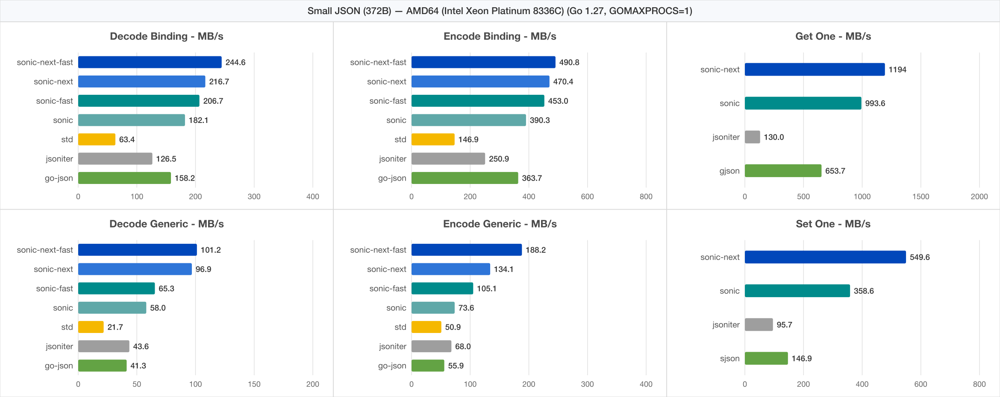
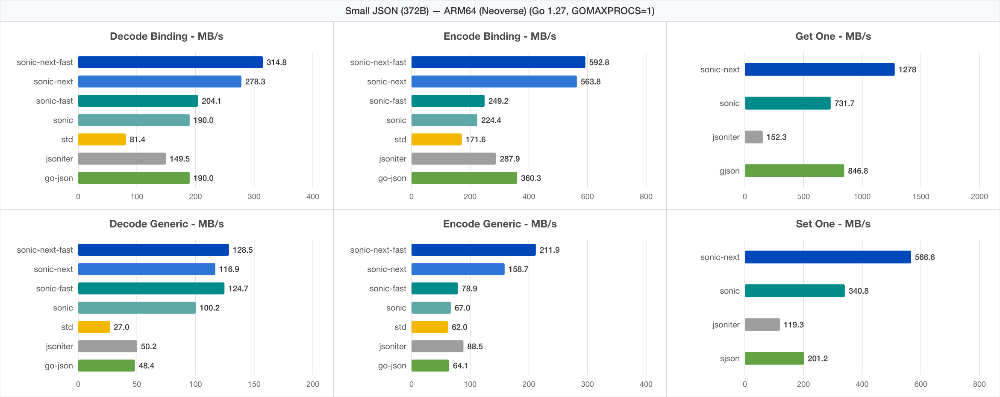
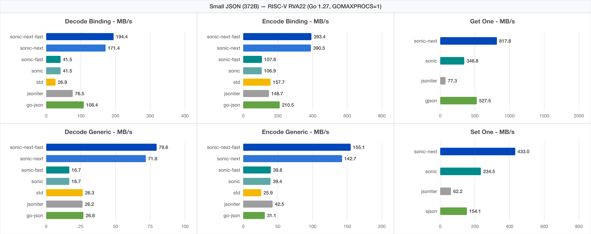
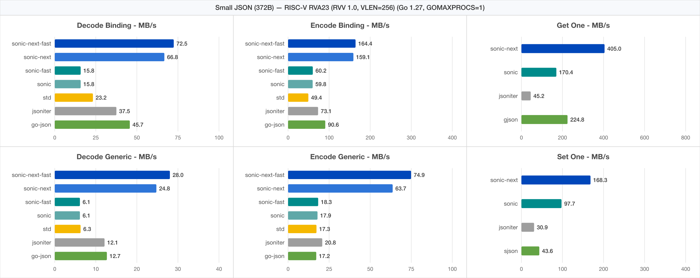
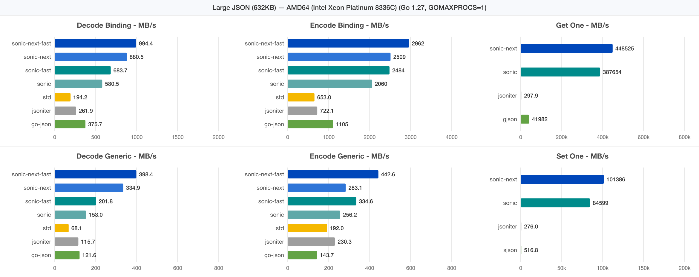
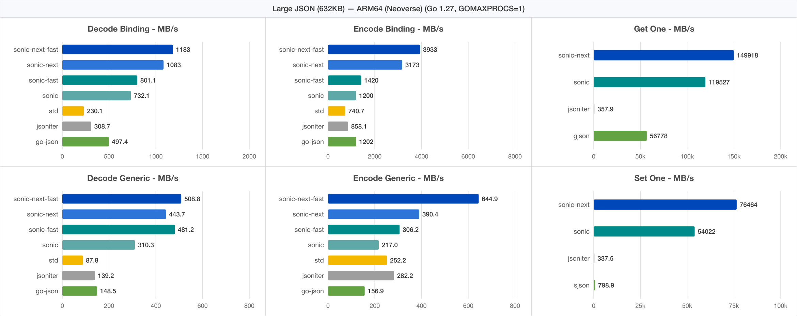
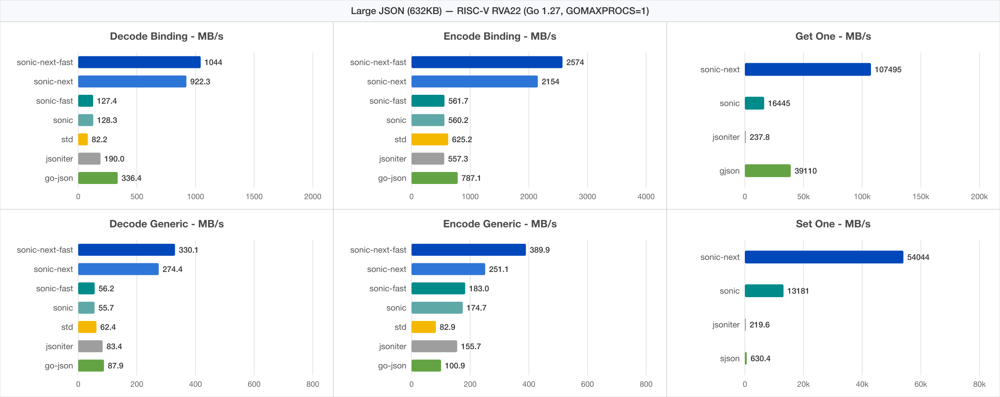
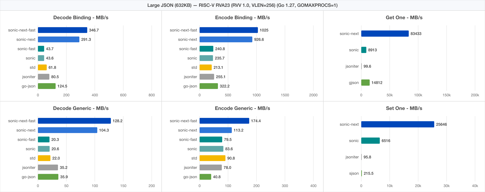

# Sonic

[English](README.md) | 中文

一个速度奇快的 JSON 序列化/反序列化库，由 SIMD（单指令流多数据流）与跨架构原生汇编内核加速。

## 依赖

- Go: 1.20~1.27
- OS: Linux / MacOS / Windows
- CPU: AMD64 / ARM64 / RISC-V (RVA22 / RVA23)

## 接口

详见 [go.dev](https://pkg.go.dev/github.com/bytedance/sonic)

## 特色

- 运行时对象绑定，无需代码生成
- 完备的 JSON 操作 API
- 快，更快，还要更快！

## 基准测试

对于**所有大小**的 json 和**所有使用场景**， **Sonic 表现均为最佳**。

> 注：`Sonic_Next` / `sonic-next` 表示当前重构后的多架构原生分支（零 `//go:linkname`、零 JIT、Go 原生 SIMD 扫描器 + VM），`Sonic` / `sonic` 表示上游 `main` 分支基线（`4640e45`，Go 1.27 下使用 `-ldflags=-checklinkname=0` 编译；在 `riscv64` 平台上，上游 `main` 的序列化/反序列化回退至 `encoding/json`）。

- [中型](https://github.com/bytedance/sonic/blob/main/decoder/testdata_test.go#L19) (13kB, 300+ 键, 6 层)

```powershell
goversion: 1.27.0
goos: linux
goarch: amd64
cpu: Intel(R) Xeon(R) Platinum 8336C CPU @ 2.30GHz
BenchmarkEncoder_Generic_Sonic_Next-16                         42449 ns/op        307.08 MB/s        9472 B/op          1 allocs/op
BenchmarkEncoder_Generic_Sonic_Next_Fast-16                    23884 ns/op        545.75 MB/s        9472 B/op          1 allocs/op
BenchmarkEncoder_Generic_Sonic-16                              72160 ns/op        180.64 MB/s       13140 B/op         40 allocs/op
BenchmarkEncoder_Generic_Sonic_Fast-16                         39354 ns/op        331.22 MB/s       13139 B/op         40 allocs/op
BenchmarkEncoder_Generic_JsonIter-16                           58409 ns/op        223.17 MB/s       17984 B/op        153 allocs/op
BenchmarkEncoder_Generic_GoJson-16                            101631 ns/op        128.26 MB/s       26873 B/op         55 allocs/op
BenchmarkEncoder_Generic_StdLib-16                             67660 ns/op        192.65 MB/s        9576 B/op          8 allocs/op
BenchmarkEncoder_Binding_Sonic_Next-16                          6287 ns/op       2073.46 MB/s        9472 B/op          1 allocs/op
BenchmarkEncoder_Binding_Sonic_Next_Fast-16                     5863 ns/op       2223.32 MB/s        9472 B/op          1 allocs/op
BenchmarkEncoder_Binding_Sonic-16                               8522 ns/op       1529.60 MB/s        9489 B/op          2 allocs/op
BenchmarkEncoder_Binding_Sonic_Fast-16                          7504 ns/op       1737.14 MB/s        9489 B/op          2 allocs/op
BenchmarkEncoder_Binding_JsonIter-16                           26228 ns/op        496.99 MB/s        9480 B/op          2 allocs/op
BenchmarkEncoder_Binding_GoJson-16                             10790 ns/op       1208.12 MB/s        9472 B/op          1 allocs/op
BenchmarkEncoder_Binding_StdLib-16                             29242 ns/op        445.76 MB/s        9504 B/op          3 allocs/op
BenchmarkEncoder_Parallel_Generic_Sonic_Next-16                 7334 ns/op       1777.40 MB/s        9636 B/op          1 allocs/op
BenchmarkEncoder_Parallel_Generic_Sonic_Next_Fast-16            5831 ns/op       2235.46 MB/s        9525 B/op          1 allocs/op
BenchmarkEncoder_Parallel_Generic_Sonic-16                      9926 ns/op       1313.22 MB/s       14010 B/op         40 allocs/op
BenchmarkEncoder_Parallel_Generic_Sonic_Fast-16                 7660 ns/op       1701.63 MB/s       13862 B/op         40 allocs/op
BenchmarkEncoder_Parallel_Generic_JsonIter-16                   5859 ns/op       2224.94 MB/s       18007 B/op        153 allocs/op
BenchmarkEncoder_Parallel_Generic_GoJson-16                    11613 ns/op       1122.49 MB/s       26885 B/op         55 allocs/op
BenchmarkEncoder_Parallel_Generic_StdLib-16                     6087 ns/op       2141.52 MB/s        9605 B/op          8 allocs/op
BenchmarkEncoder_Parallel_Binding_Sonic_Next-16                 4281 ns/op       3044.74 MB/s        9508 B/op          1 allocs/op
BenchmarkEncoder_Parallel_Binding_Sonic_Next_Fast-16            4237 ns/op       3076.55 MB/s        9510 B/op          1 allocs/op
BenchmarkEncoder_Parallel_Binding_Sonic-16                      2886 ns/op       4517.18 MB/s       11510 B/op          2 allocs/op
BenchmarkEncoder_Parallel_Binding_Sonic_Fast-16                 2726 ns/op       4781.62 MB/s       11380 B/op          2 allocs/op
BenchmarkEncoder_Parallel_Binding_JsonIter-16                   2579 ns/op       5055.05 MB/s        9490 B/op          2 allocs/op
BenchmarkEncoder_Parallel_Binding_GoJson-16                     1491 ns/op       8740.26 MB/s        9480 B/op          1 allocs/op
BenchmarkEncoder_Parallel_Binding_StdLib-16                     2575 ns/op       5061.45 MB/s        9515 B/op          3 allocs/op

BenchmarkDecoder_Generic_Sonic_Next-16                         41592 ns/op        313.40 MB/s       35857 B/op        237 allocs/op
BenchmarkDecoder_Generic_Sonic_Next_Fast-16                    35673 ns/op        365.41 MB/s       27889 B/op        236 allocs/op
BenchmarkDecoder_Generic_Sonic-16                              88646 ns/op        147.04 MB/s       55323 B/op        747 allocs/op
BenchmarkDecoder_Generic_Sonic_Fast-16                         74455 ns/op        175.07 MB/s       47562 B/op        337 allocs/op
BenchmarkDecoder_Generic_StdLib-16                            200069 ns/op         65.15 MB/s       49368 B/op        931 allocs/op
BenchmarkDecoder_Generic_JsonIter-16                          125530 ns/op        103.84 MB/s       54216 B/op       1085 allocs/op
BenchmarkDecoder_Generic_GoJson-16                            121880 ns/op        106.95 MB/s       64865 B/op        996 allocs/op
BenchmarkDecoder_Binding_Sonic_Next-16                         16653 ns/op        782.75 MB/s        7840 B/op         24 allocs/op
BenchmarkDecoder_Binding_Sonic_Next_Fast-16                    14415 ns/op        904.25 MB/s        4480 B/op         22 allocs/op
BenchmarkDecoder_Binding_Sonic-16                              26373 ns/op        494.26 MB/s        9608 B/op        127 allocs/op
BenchmarkDecoder_Binding_Sonic_Fast-16                         21374 ns/op        609.86 MB/s        6576 B/op         24 allocs/op
BenchmarkDecoder_Binding_StdLib-16                             68878 ns/op        189.25 MB/s        8912 B/op         70 allocs/op
BenchmarkDecoder_Binding_JsonIter-16                           52334 ns/op        249.08 MB/s       14536 B/op        379 allocs/op
BenchmarkDecoder_Binding_GoJson-16                             41006 ns/op        317.88 MB/s       21937 B/op         49 allocs/op
BenchmarkDecoder_Parallel_Generic_Sonic_Next-16                16535 ns/op        788.31 MB/s       36243 B/op        237 allocs/op
BenchmarkDecoder_Parallel_Generic_Sonic_Next_Fast-16           13374 ns/op        974.63 MB/s       28153 B/op        236 allocs/op
BenchmarkDecoder_Parallel_Generic_Sonic-16                     29501 ns/op        441.86 MB/s       55777 B/op        747 allocs/op
BenchmarkDecoder_Parallel_Generic_Sonic_Fast-16                22557 ns/op        577.88 MB/s       47943 B/op        337 allocs/op
BenchmarkDecoder_Parallel_Generic_StdLib-16                    20381 ns/op        639.58 MB/s       49389 B/op        931 allocs/op
BenchmarkDecoder_Parallel_Generic_JsonIter-16                  17348 ns/op        751.38 MB/s       54223 B/op       1085 allocs/op
BenchmarkDecoder_Parallel_Generic_GoJson-16                    18140 ns/op        718.58 MB/s       64890 B/op        996 allocs/op
BenchmarkDecoder_Parallel_Binding_Sonic_Next-16                 3552 ns/op       3669.51 MB/s        7974 B/op         24 allocs/op
BenchmarkDecoder_Parallel_Binding_Sonic_Next_Fast-16            2045 ns/op       6375.31 MB/s        4630 B/op         22 allocs/op
BenchmarkDecoder_Parallel_Binding_Sonic-16                      4571 ns/op       2851.56 MB/s        9725 B/op        127 allocs/op
BenchmarkDecoder_Parallel_Binding_Sonic_Fast-16                 2853 ns/op       4568.25 MB/s        6712 B/op         24 allocs/op
BenchmarkDecoder_Parallel_Binding_StdLib-16                     5111 ns/op       2550.19 MB/s        8917 B/op         70 allocs/op
BenchmarkDecoder_Parallel_Binding_JsonIter-16                   4946 ns/op       2635.50 MB/s       14538 B/op        379 allocs/op
BenchmarkDecoder_Parallel_Binding_GoJson-16                     5003 ns/op       2605.30 MB/s       21980 B/op         49 allocs/op

BenchmarkGetOne_Sonic_Next-16                                   1180 ns/op      11048.43 MB/s           0 B/op          0 allocs/op
BenchmarkGetOne_Sonic-16                                        1285 ns/op      10147.84 MB/s           0 B/op          0 allocs/op
BenchmarkGetOne_Gjson-16                                        9140 ns/op       1426.13 MB/s           0 B/op          0 allocs/op
BenchmarkGetOne_Jsoniter-16                                    77763 ns/op        167.63 MB/s       27664 B/op        635 allocs/op
BenchmarkGetOne_Parallel_Sonic_Next-16                         75.34 ns/op     173026.36 MB/s           0 B/op          0 allocs/op
BenchmarkGetOne_Parallel_Sonic-16                              87.66 ns/op     148698.57 MB/s           0 B/op          0 allocs/op
BenchmarkGetOne_Parallel_Gjson-16                              539.2 ns/op      24175.09 MB/s           0 B/op          0 allocs/op
BenchmarkGetOne_Parallel_Jsoniter-16                            7126 ns/op       1829.32 MB/s       27666 B/op        635 allocs/op
BenchmarkSetOne_Sonic_Next-16                                   4139 ns/op       3149.17 MB/s        1024 B/op          1 allocs/op
BenchmarkSetOne_Sonic-16                                        4977 ns/op       2619.07 MB/s        1056 B/op          2 allocs/op
BenchmarkSetOne_Sjson-16                                       49357 ns/op        264.10 MB/s       52152 B/op         10 allocs/op
BenchmarkSetOne_Jsoniter-16                                   115856 ns/op        112.51 MB/s       45120 B/op        952 allocs/op
BenchmarkSetOne_Parallel_Sonic_Next-16                         830.5 ns/op      15696.08 MB/s        1024 B/op          1 allocs/op
BenchmarkSetOne_Parallel_Sonic-16                              712.8 ns/op      18285.90 MB/s        1168 B/op          2 allocs/op
BenchmarkSetOne_Parallel_Sjson-16                               8445 ns/op       1543.51 MB/s       52166 B/op         10 allocs/op
BenchmarkSetOne_Parallel_Jsoniter-16                           11964 ns/op       1089.55 MB/s       45125 B/op        952 allocs/op
BenchmarkLoadNode/LoadAll()_Sonic_Next-16                       4452 ns/op       2928.15 MB/s        2072 B/op          4 allocs/op
BenchmarkLoadNode/LoadAll()_Sonic-16                            6869 ns/op       1897.69 MB/s        2944 B/op         12 allocs/op
BenchmarkLoadNode_Parallel/LoadAll()_Sonic_Next-16              1394 ns/op       9353.84 MB/s        2072 B/op          4 allocs/op
BenchmarkLoadNode_Parallel/LoadAll()_Sonic-16                   1765 ns/op       7384.01 MB/s        3205 B/op         12 allocs/op
BenchmarkLoadNode/Interface()_Sonic_Next-16                    16403 ns/op        794.67 MB/s        9968 B/op         75 allocs/op
BenchmarkLoadNode/Interface()_Sonic-16                         29200 ns/op        446.41 MB/s       23393 B/op         95 allocs/op
BenchmarkLoadNode_Parallel/Interface()_Sonic_Next-16            7072 ns/op       1843.25 MB/s        9968 B/op         75 allocs/op
BenchmarkLoadNode_Parallel/Interface()_Sonic-16                12058 ns/op       1081.06 MB/s       24807 B/op         95 allocs/op
```

<details>
<summary>更多硬件架构 — ARM64 / RISC-V RVA22 / RISC-V RVA23（中型 13kB）</summary>

```powershell
goversion: 1.27.0
goos: linux
goarch: arm64
cpu: ARM64 Neoverse (aarch64)
BenchmarkEncoder_Generic_Sonic_Next-16                         33484 ns/op        389.29 MB/s        9472 B/op          1 allocs/op
BenchmarkEncoder_Generic_Sonic_Next_Fast-16                    20572 ns/op        633.62 MB/s        9472 B/op          1 allocs/op
BenchmarkEncoder_Generic_Sonic-16                              75420 ns/op        172.83 MB/s       13140 B/op         40 allocs/op
BenchmarkEncoder_Generic_Sonic_Fast-16                         50701 ns/op        257.09 MB/s       13138 B/op         40 allocs/op
BenchmarkEncoder_Generic_JsonIter-16                           47678 ns/op        273.40 MB/s       17984 B/op        153 allocs/op
BenchmarkEncoder_Generic_GoJson-16                             91085 ns/op        143.11 MB/s       26792 B/op         54 allocs/op
BenchmarkEncoder_Generic_StdLib-16                             52174 ns/op        249.84 MB/s        9576 B/op          8 allocs/op
BenchmarkEncoder_Binding_Sonic_Next-16                          5781 ns/op       2254.62 MB/s        9472 B/op          1 allocs/op
BenchmarkEncoder_Binding_Sonic_Next_Fast-16                     5117 ns/op       2547.33 MB/s        9472 B/op          1 allocs/op
BenchmarkEncoder_Binding_Sonic-16                              16457 ns/op        792.07 MB/s        9489 B/op          2 allocs/op
BenchmarkEncoder_Binding_Sonic_Fast-16                         14781 ns/op        881.86 MB/s        9488 B/op          2 allocs/op
BenchmarkEncoder_Binding_JsonIter-16                           23157 ns/op        562.88 MB/s        9480 B/op          2 allocs/op
BenchmarkEncoder_Binding_GoJson-16                             10757 ns/op       1211.72 MB/s        9472 B/op          1 allocs/op
BenchmarkEncoder_Binding_StdLib-16                             26485 ns/op        492.17 MB/s        9504 B/op          3 allocs/op
BenchmarkEncoder_Parallel_Generic_Sonic_Next-16                 2864 ns/op       4550.96 MB/s        9535 B/op          1 allocs/op
BenchmarkEncoder_Parallel_Generic_Sonic_Next_Fast-16            2115 ns/op       6164.51 MB/s        9488 B/op          1 allocs/op
BenchmarkEncoder_Parallel_Generic_Sonic-16                     11199 ns/op       1163.97 MB/s       14022 B/op         40 allocs/op
BenchmarkEncoder_Parallel_Generic_Sonic_Fast-16                 9806 ns/op       1329.29 MB/s       13700 B/op         40 allocs/op
BenchmarkEncoder_Parallel_Generic_JsonIter-16                   4630 ns/op       2815.51 MB/s       17987 B/op        153 allocs/op
BenchmarkEncoder_Parallel_Generic_GoJson-16                     8740 ns/op       1491.39 MB/s       26746 B/op         55 allocs/op
BenchmarkEncoder_Parallel_Generic_StdLib-16                     4503 ns/op       2894.42 MB/s        9580 B/op          8 allocs/op
BenchmarkEncoder_Parallel_Binding_Sonic_Next-16                982.4 ns/op      13268.81 MB/s        9476 B/op          1 allocs/op
BenchmarkEncoder_Parallel_Binding_Sonic_Next_Fast-16           999.1 ns/op      13047.08 MB/s        9476 B/op          1 allocs/op
BenchmarkEncoder_Parallel_Binding_Sonic-16                      3204 ns/op       4068.91 MB/s       10846 B/op          2 allocs/op
BenchmarkEncoder_Parallel_Binding_Sonic_Fast-16                 2910 ns/op       4478.95 MB/s       10671 B/op          2 allocs/op
BenchmarkEncoder_Parallel_Binding_JsonIter-16                   1868 ns/op       6978.15 MB/s        9481 B/op          2 allocs/op
BenchmarkEncoder_Parallel_Binding_GoJson-16                     1213 ns/op      10746.40 MB/s        9473 B/op          1 allocs/op
BenchmarkEncoder_Parallel_Binding_StdLib-16                     2216 ns/op       5881.50 MB/s        9505 B/op          3 allocs/op

BenchmarkDecoder_Generic_Sonic_Next-16                         35750 ns/op        364.61 MB/s       35857 B/op        237 allocs/op
BenchmarkDecoder_Generic_Sonic_Next_Fast-16                    31243 ns/op        417.21 MB/s       27889 B/op        236 allocs/op
BenchmarkDecoder_Generic_Sonic-16                              45982 ns/op        283.48 MB/s       36200 B/op        705 allocs/op
BenchmarkDecoder_Generic_Sonic_Fast-16                         30217 ns/op        431.37 MB/s       28952 B/op        105 allocs/op
BenchmarkDecoder_Generic_StdLib-16                            157392 ns/op         82.82 MB/s       49368 B/op        931 allocs/op
BenchmarkDecoder_Generic_JsonIter-16                           99963 ns/op        130.40 MB/s       54216 B/op       1085 allocs/op
BenchmarkDecoder_Generic_GoJson-16                            100686 ns/op        129.46 MB/s       64865 B/op        996 allocs/op
BenchmarkDecoder_Binding_Sonic_Next-16                         14214 ns/op        917.04 MB/s        7840 B/op         24 allocs/op
BenchmarkDecoder_Binding_Sonic_Next_Fast-16                    12464 ns/op       1045.78 MB/s        4480 B/op         22 allocs/op
BenchmarkDecoder_Binding_Sonic-16                              24567 ns/op        530.59 MB/s        7952 B/op        144 allocs/op
BenchmarkDecoder_Binding_Sonic_Fast-16                         21153 ns/op        616.23 MB/s        4920 B/op         41 allocs/op
BenchmarkDecoder_Binding_StdLib-16                             57244 ns/op        227.71 MB/s        8912 B/op         70 allocs/op
BenchmarkDecoder_Binding_JsonIter-16                           42977 ns/op        303.30 MB/s       14536 B/op        379 allocs/op
BenchmarkDecoder_Binding_GoJson-16                             32442 ns/op        401.79 MB/s       21936 B/op         49 allocs/op
BenchmarkDecoder_Parallel_Generic_Sonic_Next-16                 9756 ns/op       1336.07 MB/s       36029 B/op        237 allocs/op
BenchmarkDecoder_Parallel_Generic_Sonic_Next_Fast-16            8137 ns/op       1601.95 MB/s       28032 B/op        236 allocs/op
BenchmarkDecoder_Parallel_Generic_Sonic-16                      7020 ns/op       1856.72 MB/s       36553 B/op        705 allocs/op
BenchmarkDecoder_Parallel_Generic_Sonic_Fast-16                 5397 ns/op       2415.43 MB/s       29214 B/op        105 allocs/op
BenchmarkDecoder_Parallel_Generic_StdLib-16                    16348 ns/op        797.36 MB/s       49371 B/op        931 allocs/op
BenchmarkDecoder_Parallel_Generic_JsonIter-16                  15262 ns/op        854.08 MB/s       54220 B/op       1085 allocs/op
BenchmarkDecoder_Parallel_Generic_GoJson-16                    15936 ns/op        817.97 MB/s       64880 B/op        996 allocs/op
BenchmarkDecoder_Parallel_Binding_Sonic_Next-16                 2355 ns/op       5534.62 MB/s        7893 B/op         24 allocs/op
BenchmarkDecoder_Parallel_Binding_Sonic_Next_Fast-16            1469 ns/op       8872.10 MB/s        4546 B/op         22 allocs/op
BenchmarkDecoder_Parallel_Binding_Sonic-16                      2210 ns/op       5897.94 MB/s        8439 B/op        144 allocs/op
BenchmarkDecoder_Parallel_Binding_Sonic_Fast-16                 1774 ns/op       7345.97 MB/s        5305 B/op         41 allocs/op
BenchmarkDecoder_Parallel_Binding_StdLib-16                     4460 ns/op       2922.72 MB/s        8913 B/op         70 allocs/op
BenchmarkDecoder_Parallel_Binding_JsonIter-16                   4369 ns/op       2983.25 MB/s       14537 B/op        379 allocs/op
BenchmarkDecoder_Parallel_Binding_GoJson-16                     4151 ns/op       3140.08 MB/s       21960 B/op         49 allocs/op

BenchmarkGetOne_Sonic_Next-16                                   2767 ns/op       4711.13 MB/s           0 B/op          0 allocs/op
BenchmarkGetOne_Sonic-16                                        3360 ns/op       3879.15 MB/s           0 B/op          0 allocs/op
BenchmarkGetOne_Gjson-16                                        6603 ns/op       1974.10 MB/s           0 B/op          0 allocs/op
BenchmarkGetOne_Jsoniter-16                                    62923 ns/op        207.16 MB/s       27664 B/op        635 allocs/op
BenchmarkGetOne_Parallel_Sonic_Next-16                         172.6 ns/op      75500.75 MB/s           0 B/op          0 allocs/op
BenchmarkGetOne_Parallel_Sonic-16                              210.1 ns/op      62054.61 MB/s           0 B/op          0 allocs/op
BenchmarkGetOne_Parallel_Gjson-16                              419.0 ns/op      31108.49 MB/s           0 B/op          0 allocs/op
BenchmarkGetOne_Parallel_Jsoniter-16                            6740 ns/op       1933.91 MB/s       27665 B/op        635 allocs/op
BenchmarkSetOne_Sonic_Next-16                                   5084 ns/op       2563.99 MB/s        1024 B/op          1 allocs/op
BenchmarkSetOne_Sonic-16                                        7198 ns/op       1810.96 MB/s        1056 B/op          2 allocs/op
BenchmarkSetOne_Sjson-16                                       33841 ns/op        385.18 MB/s       52152 B/op         10 allocs/op
BenchmarkSetOne_Jsoniter-16                                    94257 ns/op        138.29 MB/s       45120 B/op        952 allocs/op
BenchmarkSetOne_Parallel_Sonic_Next-16                         518.7 ns/op      25128.74 MB/s        1024 B/op          1 allocs/op
BenchmarkSetOne_Parallel_Sonic-16                              984.4 ns/op      13241.22 MB/s        1146 B/op          2 allocs/op
BenchmarkSetOne_Parallel_Sjson-16                               6698 ns/op       1946.17 MB/s       52160 B/op         10 allocs/op
BenchmarkSetOne_Parallel_Jsoniter-16                           10665 ns/op       1222.18 MB/s       45123 B/op        952 allocs/op
BenchmarkLoadNode/LoadAll()_Sonic_Next-16                       4124 ns/op       3160.98 MB/s        2072 B/op          4 allocs/op
BenchmarkLoadNode/LoadAll()_Sonic-16                            7141 ns/op       1825.37 MB/s        2944 B/op         12 allocs/op
BenchmarkLoadNode_Parallel/LoadAll()_Sonic_Next-16             760.6 ns/op      17137.71 MB/s        2072 B/op          4 allocs/op
BenchmarkLoadNode_Parallel/LoadAll()_Sonic-16                   2153 ns/op       6055.71 MB/s        3120 B/op         12 allocs/op
BenchmarkLoadNode/Interface()_Sonic_Next-16                    14217 ns/op        916.83 MB/s        9968 B/op         75 allocs/op
BenchmarkLoadNode/Interface()_Sonic-16                         25424 ns/op        512.70 MB/s       23392 B/op         95 allocs/op
BenchmarkLoadNode_Parallel/Interface()_Sonic_Next-16            3699 ns/op       3523.87 MB/s        9968 B/op         75 allocs/op
BenchmarkLoadNode_Parallel/Interface()_Sonic-16                14201 ns/op        917.89 MB/s       24356 B/op         95 allocs/op
```

```powershell
goversion: 1.27.0
goos: linux
goarch: riscv64 (GORISCV64=rva22u64)
cpu: RISC-V 64-bit RVA22U64 (Scalar + Zba/Zbb/Zbs)
BenchmarkEncoder_Generic_Sonic_Next-16                         48313 ns/op        269.80 MB/s        9472 B/op          1 allocs/op
BenchmarkEncoder_Generic_Sonic_Next_Fast-16                    31317 ns/op        416.22 MB/s        9472 B/op          1 allocs/op
BenchmarkEncoder_Generic_Sonic-16                              72200 ns/op        180.54 MB/s        9577 B/op          8 allocs/op
BenchmarkEncoder_Generic_Sonic_Fast-16                         65391 ns/op        199.34 MB/s        9577 B/op          8 allocs/op
BenchmarkEncoder_Generic_JsonIter-16                           89098 ns/op        146.30 MB/s       17984 B/op        153 allocs/op
BenchmarkEncoder_Generic_GoJson-16                            160136 ns/op         81.40 MB/s       26942 B/op         55 allocs/op
BenchmarkEncoder_Generic_StdLib-16                            183906 ns/op         70.88 MB/s       32881 B/op        653 allocs/op
BenchmarkEncoder_Binding_Sonic_Next-16                          7400 ns/op       1761.44 MB/s        9472 B/op          1 allocs/op
BenchmarkEncoder_Binding_Sonic_Next_Fast-16                     6720 ns/op       1939.59 MB/s        9472 B/op          1 allocs/op
BenchmarkEncoder_Binding_Sonic-16                              38093 ns/op        342.19 MB/s        9504 B/op          3 allocs/op
BenchmarkEncoder_Binding_Sonic_Fast-16                         38591 ns/op        337.77 MB/s        9504 B/op          3 allocs/op
BenchmarkEncoder_Binding_JsonIter-16                           33504 ns/op        389.06 MB/s        9480 B/op          2 allocs/op
BenchmarkEncoder_Binding_GoJson-16                             16315 ns/op        798.97 MB/s        9472 B/op          1 allocs/op
BenchmarkEncoder_Binding_StdLib-16                             23087 ns/op        564.61 MB/s        9472 B/op          1 allocs/op
BenchmarkEncoder_Parallel_Generic_Sonic_Next-16                 6556 ns/op       1988.36 MB/s        9654 B/op          1 allocs/op
BenchmarkEncoder_Parallel_Generic_Sonic_Next_Fast-16            5402 ns/op       2413.16 MB/s        9528 B/op          1 allocs/op
BenchmarkEncoder_Parallel_Generic_Sonic-16                      8693 ns/op       1499.54 MB/s        9647 B/op          8 allocs/op
BenchmarkEncoder_Parallel_Generic_Sonic_Fast-16                 9080 ns/op       1435.57 MB/s        9658 B/op          8 allocs/op
BenchmarkEncoder_Parallel_Generic_JsonIter-16                  30850 ns/op        422.52 MB/s       18019 B/op        153 allocs/op
BenchmarkEncoder_Parallel_Generic_GoJson-16                    20277 ns/op        642.83 MB/s       26891 B/op         55 allocs/op
BenchmarkEncoder_Parallel_Generic_StdLib-16                    36488 ns/op        357.24 MB/s       32950 B/op        653 allocs/op
BenchmarkEncoder_Parallel_Binding_Sonic_Next-16                 3668 ns/op       3554.06 MB/s        9495 B/op          1 allocs/op
BenchmarkEncoder_Parallel_Binding_Sonic_Next_Fast-16            3723 ns/op       3501.24 MB/s        9497 B/op          1 allocs/op
BenchmarkEncoder_Parallel_Binding_Sonic-16                      5734 ns/op       2273.15 MB/s        9525 B/op          3 allocs/op
BenchmarkEncoder_Parallel_Binding_Sonic_Fast-16                 5903 ns/op       2208.02 MB/s        9519 B/op          3 allocs/op
BenchmarkEncoder_Parallel_Binding_JsonIter-16                   5605 ns/op       2325.45 MB/s        9492 B/op          2 allocs/op
BenchmarkEncoder_Parallel_Binding_GoJson-16                     5342 ns/op       2440.31 MB/s        9485 B/op          1 allocs/op
BenchmarkEncoder_Parallel_Binding_StdLib-16                     4592 ns/op       2838.87 MB/s        9483 B/op          1 allocs/op

BenchmarkDecoder_Generic_Sonic_Next-16                         56712 ns/op        229.85 MB/s       35857 B/op        237 allocs/op
BenchmarkDecoder_Generic_Sonic_Next_Fast-16                    46800 ns/op        278.53 MB/s       27889 B/op        236 allocs/op
BenchmarkDecoder_Generic_Sonic-16                             245728 ns/op         53.05 MB/s       96076 B/op        946 allocs/op
BenchmarkDecoder_Generic_Sonic_Fast-16                        244845 ns/op         53.24 MB/s       96076 B/op        946 allocs/op
BenchmarkDecoder_Generic_StdLib-16                            221650 ns/op         58.81 MB/s       49464 B/op        795 allocs/op
BenchmarkDecoder_Generic_JsonIter-16                          168584 ns/op         77.32 MB/s       54218 B/op       1085 allocs/op
BenchmarkDecoder_Generic_GoJson-16                            162257 ns/op         80.34 MB/s       64876 B/op        996 allocs/op
BenchmarkDecoder_Binding_Sonic_Next-16                         20881 ns/op        624.25 MB/s        7840 B/op         24 allocs/op
BenchmarkDecoder_Binding_Sonic_Next_Fast-16                    17817 ns/op        731.59 MB/s        4480 B/op         22 allocs/op
BenchmarkDecoder_Binding_Sonic-16                             104104 ns/op        125.21 MB/s       55618 B/op         85 allocs/op
BenchmarkDecoder_Binding_Sonic_Fast-16                        104094 ns/op        125.22 MB/s       55618 B/op         85 allocs/op
BenchmarkDecoder_Binding_StdLib-16                            197817 ns/op         65.89 MB/s       11416 B/op        160 allocs/op
BenchmarkDecoder_Binding_JsonIter-16                           73835 ns/op        176.54 MB/s       14536 B/op        379 allocs/op
BenchmarkDecoder_Binding_GoJson-16                             48200 ns/op        270.43 MB/s       21943 B/op         49 allocs/op
BenchmarkDecoder_Parallel_Generic_Sonic_Next-16                12970 ns/op       1004.97 MB/s       36117 B/op        237 allocs/op
BenchmarkDecoder_Parallel_Generic_Sonic_Next_Fast-16           10177 ns/op       1280.87 MB/s       28156 B/op        236 allocs/op
BenchmarkDecoder_Parallel_Generic_Sonic-16                     79009 ns/op        164.98 MB/s       97266 B/op        958 allocs/op
BenchmarkDecoder_Parallel_Generic_Sonic_Fast-16                79669 ns/op        163.61 MB/s       97279 B/op        958 allocs/op
BenchmarkDecoder_Parallel_Generic_StdLib-16                    41571 ns/op        313.56 MB/s       49472 B/op        795 allocs/op
BenchmarkDecoder_Parallel_Generic_JsonIter-16                  68671 ns/op        189.82 MB/s       54299 B/op       1085 allocs/op
BenchmarkDecoder_Parallel_Generic_GoJson-16                    29231 ns/op        445.93 MB/s       64998 B/op        996 allocs/op
BenchmarkDecoder_Parallel_Binding_Sonic_Next-16                 2978 ns/op       4377.43 MB/s        7963 B/op         24 allocs/op
BenchmarkDecoder_Parallel_Binding_Sonic_Next_Fast-16            1987 ns/op       6559.05 MB/s        4637 B/op         22 allocs/op
BenchmarkDecoder_Parallel_Binding_Sonic-16                     35799 ns/op        364.12 MB/s       56440 B/op         91 allocs/op
BenchmarkDecoder_Parallel_Binding_Sonic_Fast-16                33946 ns/op        383.99 MB/s       56584 B/op         93 allocs/op
BenchmarkDecoder_Parallel_Binding_StdLib-16                    35961 ns/op        362.48 MB/s       11419 B/op        160 allocs/op
BenchmarkDecoder_Parallel_Binding_JsonIter-16                  11144 ns/op       1169.72 MB/s       14552 B/op        379 allocs/op
BenchmarkDecoder_Parallel_Binding_GoJson-16                    11926 ns/op       1093.02 MB/s       22184 B/op         49 allocs/op

BenchmarkGetOne_Sonic_Next-16                                   3876 ns/op       3363.36 MB/s           0 B/op          0 allocs/op
BenchmarkGetOne_Sonic-16                                       22735 ns/op        573.35 MB/s           0 B/op          0 allocs/op
BenchmarkGetOne_Gjson-16                                        9735 ns/op       1339.00 MB/s           0 B/op          0 allocs/op
BenchmarkGetOne_Jsoniter-16                                   105439 ns/op        123.63 MB/s       27665 B/op        635 allocs/op
BenchmarkGetOne_Parallel_Sonic_Next-16                         244.5 ns/op      53303.16 MB/s           0 B/op          0 allocs/op
BenchmarkGetOne_Parallel_Sonic-16                               1436 ns/op       9075.16 MB/s           0 B/op          0 allocs/op
BenchmarkGetOne_Parallel_Gjson-16                              607.9 ns/op      21442.09 MB/s           0 B/op          0 allocs/op
BenchmarkGetOne_Parallel_Jsoniter-16                           16468 ns/op        791.54 MB/s       27687 B/op        635 allocs/op
BenchmarkSetOne_Sonic_Next-16                                   6947 ns/op       1876.27 MB/s        1024 B/op          1 allocs/op
BenchmarkSetOne_Sonic-16                                       27328 ns/op        476.98 MB/s        1056 B/op          2 allocs/op
BenchmarkSetOne_Sjson-16                                       50562 ns/op        257.80 MB/s       52146 B/op          9 allocs/op
BenchmarkSetOne_Jsoniter-16                                   158301 ns/op         82.34 MB/s       45122 B/op        952 allocs/op
BenchmarkSetOne_Parallel_Sonic_Next-16                         846.1 ns/op      15405.25 MB/s        1024 B/op          1 allocs/op
BenchmarkSetOne_Parallel_Sonic-16                               1949 ns/op       6689.08 MB/s        1056 B/op          2 allocs/op
BenchmarkSetOne_Parallel_Sjson-16                              36949 ns/op        352.78 MB/s       52289 B/op         10 allocs/op
BenchmarkSetOne_Parallel_Jsoniter-16                           34183 ns/op        381.33 MB/s       45172 B/op        952 allocs/op
BenchmarkLoadNode/LoadAll()_Sonic_Next-16                       5618 ns/op       2320.02 MB/s        2072 B/op          4 allocs/op
BenchmarkLoadNode/LoadAll()_Sonic-16                           13319 ns/op        978.69 MB/s        3056 B/op         13 allocs/op
BenchmarkLoadNode_Parallel/LoadAll()_Sonic_Next-16              1311 ns/op       9941.61 MB/s        2072 B/op          4 allocs/op
BenchmarkLoadNode_Parallel/LoadAll()_Sonic-16                   2250 ns/op       5793.88 MB/s        3056 B/op         13 allocs/op
BenchmarkLoadNode/Interface()_Sonic_Next-16                    20805 ns/op        626.55 MB/s        9968 B/op         75 allocs/op
BenchmarkLoadNode/Interface()_Sonic-16                         29595 ns/op        440.45 MB/s       23504 B/op         96 allocs/op
BenchmarkLoadNode_Parallel/Interface()_Sonic_Next-16            7625 ns/op       1709.52 MB/s        9968 B/op         75 allocs/op
BenchmarkLoadNode_Parallel/Interface()_Sonic-16                14420 ns/op        903.94 MB/s       23506 B/op         96 allocs/op
```

```powershell
goversion: 1.27.0
goos: linux
goarch: riscv64 (GORISCV64=rva23u64)
cpu: RISC-V 64-bit RVA23U64 + RVV 1.0 (VLEN=256)
BenchmarkEncoder_Generic_Sonic_Next-16                         95286 ns/op        136.80 MB/s        9472 B/op          1 allocs/op
BenchmarkEncoder_Generic_Sonic_Next_Fast-16                    62444 ns/op        208.75 MB/s        9472 B/op          1 allocs/op
BenchmarkEncoder_Generic_Sonic-16                             158832 ns/op         82.07 MB/s        9577 B/op          8 allocs/op
BenchmarkEncoder_Generic_Sonic_Fast-16                        157937 ns/op         82.53 MB/s        9577 B/op          8 allocs/op
BenchmarkEncoder_Generic_JsonIter-16                          166817 ns/op         78.14 MB/s       17984 B/op        153 allocs/op
BenchmarkEncoder_Generic_GoJson-16                            307892 ns/op         42.34 MB/s       26769 B/op         54 allocs/op
BenchmarkEncoder_Generic_StdLib-16                            165081 ns/op         78.96 MB/s        9576 B/op          8 allocs/op
BenchmarkEncoder_Binding_Sonic_Next-16                         18607 ns/op        700.55 MB/s        9472 B/op          1 allocs/op
BenchmarkEncoder_Binding_Sonic_Next_Fast-16                    16382 ns/op        795.70 MB/s        9472 B/op          1 allocs/op
BenchmarkEncoder_Binding_Sonic-16                              88994 ns/op        146.47 MB/s        9504 B/op          3 allocs/op
BenchmarkEncoder_Binding_Sonic_Fast-16                         83231 ns/op        156.61 MB/s        9504 B/op          3 allocs/op
BenchmarkEncoder_Binding_JsonIter-16                           73290 ns/op        177.86 MB/s        9480 B/op          2 allocs/op
BenchmarkEncoder_Binding_GoJson-16                             48866 ns/op        266.75 MB/s        9472 B/op          1 allocs/op
BenchmarkEncoder_Binding_StdLib-16                            100894 ns/op        129.20 MB/s        9504 B/op          3 allocs/op
BenchmarkEncoder_Parallel_Generic_Sonic_Next-16                19119 ns/op        681.78 MB/s        9572 B/op          1 allocs/op
BenchmarkEncoder_Parallel_Generic_Sonic_Next_Fast-16           18897 ns/op        689.81 MB/s        9525 B/op          1 allocs/op
BenchmarkEncoder_Parallel_Generic_Sonic-16                     26747 ns/op        487.34 MB/s        9654 B/op          8 allocs/op
BenchmarkEncoder_Parallel_Generic_Sonic_Fast-16                24471 ns/op        532.66 MB/s        9650 B/op          8 allocs/op
BenchmarkEncoder_Parallel_Generic_JsonIter-16                  25693 ns/op        507.34 MB/s       17994 B/op        153 allocs/op
BenchmarkEncoder_Parallel_Generic_GoJson-16                    53546 ns/op        243.44 MB/s       26654 B/op         53 allocs/op
BenchmarkEncoder_Parallel_Generic_StdLib-16                    27522 ns/op        473.62 MB/s        9579 B/op          8 allocs/op
BenchmarkEncoder_Parallel_Binding_Sonic_Next-16                 8267 ns/op       1576.69 MB/s        9480 B/op          1 allocs/op
BenchmarkEncoder_Parallel_Binding_Sonic_Next_Fast-16            8938 ns/op       1458.32 MB/s        9480 B/op          1 allocs/op
BenchmarkEncoder_Parallel_Binding_Sonic-16                     13682 ns/op        952.72 MB/s        9546 B/op          3 allocs/op
BenchmarkEncoder_Parallel_Binding_Sonic_Fast-16                13667 ns/op        953.77 MB/s        9525 B/op          3 allocs/op
BenchmarkEncoder_Parallel_Binding_JsonIter-16                  10452 ns/op       1247.10 MB/s        9480 B/op          2 allocs/op
BenchmarkEncoder_Parallel_Binding_GoJson-16                     7458 ns/op       1747.80 MB/s        9472 B/op          1 allocs/op
BenchmarkEncoder_Parallel_Binding_StdLib-16                    15535 ns/op        839.09 MB/s        9504 B/op          3 allocs/op

BenchmarkDecoder_Generic_Sonic_Next-16                        151786 ns/op         85.88 MB/s       35857 B/op        237 allocs/op
BenchmarkDecoder_Generic_Sonic_Next_Fast-16                   125064 ns/op        104.23 MB/s       27889 B/op        236 allocs/op
BenchmarkDecoder_Generic_Sonic-16                             705719 ns/op         18.47 MB/s       96076 B/op        946 allocs/op
BenchmarkDecoder_Generic_Sonic_Fast-16                        693936 ns/op         18.78 MB/s       96075 B/op        946 allocs/op
BenchmarkDecoder_Generic_StdLib-16                            657192 ns/op         19.83 MB/s       49368 B/op        931 allocs/op
BenchmarkDecoder_Generic_JsonIter-16                          403825 ns/op         32.28 MB/s       54216 B/op       1085 allocs/op
BenchmarkDecoder_Generic_GoJson-16                            390907 ns/op         33.35 MB/s       64866 B/op        996 allocs/op
BenchmarkDecoder_Binding_Sonic_Next-16                         62481 ns/op        208.62 MB/s        7840 B/op         24 allocs/op
BenchmarkDecoder_Binding_Sonic_Next_Fast-16                    50166 ns/op        259.84 MB/s        4480 B/op         22 allocs/op
BenchmarkDecoder_Binding_Sonic-16                             333291 ns/op         39.11 MB/s       55618 B/op         85 allocs/op
BenchmarkDecoder_Binding_Sonic_Fast-16                        334345 ns/op         38.99 MB/s       55618 B/op         85 allocs/op
BenchmarkDecoder_Binding_StdLib-16                            244386 ns/op         53.34 MB/s        8912 B/op         70 allocs/op
BenchmarkDecoder_Binding_JsonIter-16                          183333 ns/op         71.10 MB/s       14536 B/op        379 allocs/op
BenchmarkDecoder_Binding_GoJson-16                            135143 ns/op         96.45 MB/s       21936 B/op         49 allocs/op
BenchmarkDecoder_Parallel_Generic_Sonic_Next-16                73950 ns/op        176.27 MB/s       36554 B/op        237 allocs/op
BenchmarkDecoder_Parallel_Generic_Sonic_Next_Fast-16           65245 ns/op        199.79 MB/s       28521 B/op        236 allocs/op
BenchmarkDecoder_Parallel_Generic_Sonic-16                    200278 ns/op         65.08 MB/s       97613 B/op        962 allocs/op
BenchmarkDecoder_Parallel_Generic_Sonic_Fast-16               202228 ns/op         64.46 MB/s       97935 B/op        966 allocs/op
BenchmarkDecoder_Parallel_Generic_StdLib-16                    95170 ns/op        136.97 MB/s       49375 B/op        931 allocs/op
BenchmarkDecoder_Parallel_Generic_JsonIter-16                  72743 ns/op        179.19 MB/s       54219 B/op       1085 allocs/op
BenchmarkDecoder_Parallel_Generic_GoJson-16                    76872 ns/op        169.57 MB/s       64879 B/op        996 allocs/op
BenchmarkDecoder_Parallel_Binding_Sonic_Next-16                21208 ns/op        614.62 MB/s        8121 B/op         24 allocs/op
BenchmarkDecoder_Parallel_Binding_Sonic_Next_Fast-16           13852 ns/op        941.02 MB/s        4688 B/op         22 allocs/op
BenchmarkDecoder_Parallel_Binding_Sonic-16                    108598 ns/op        120.03 MB/s       56749 B/op         94 allocs/op
BenchmarkDecoder_Parallel_Binding_Sonic_Fast-16               111674 ns/op        116.72 MB/s       56715 B/op         94 allocs/op
BenchmarkDecoder_Parallel_Binding_StdLib-16                    38081 ns/op        342.30 MB/s        8913 B/op         70 allocs/op
BenchmarkDecoder_Parallel_Binding_JsonIter-16                  28510 ns/op        457.21 MB/s       14537 B/op        379 allocs/op
BenchmarkDecoder_Parallel_Binding_GoJson-16                    26628 ns/op        489.51 MB/s       21957 B/op         49 allocs/op

BenchmarkGetOne_Sonic_Next-16                                   5515 ns/op       2363.56 MB/s           0 B/op          0 allocs/op
BenchmarkGetOne_Sonic-16                                       42061 ns/op        309.91 MB/s           0 B/op          0 allocs/op
BenchmarkGetOne_Gjson-16                                       24472 ns/op        532.65 MB/s           0 B/op          0 allocs/op
BenchmarkGetOne_Jsoniter-16                                   231224 ns/op         56.37 MB/s       27664 B/op        635 allocs/op
BenchmarkGetOne_Parallel_Sonic_Next-16                         692.6 ns/op      18821.65 MB/s           0 B/op          0 allocs/op
BenchmarkGetOne_Parallel_Sonic-16                               2720 ns/op       4792.59 MB/s           0 B/op          0 allocs/op
BenchmarkGetOne_Parallel_Gjson-16                               3143 ns/op       4147.34 MB/s           0 B/op          0 allocs/op
BenchmarkGetOne_Parallel_Jsoniter-16                           38062 ns/op        342.47 MB/s       27665 B/op        635 allocs/op
BenchmarkSetOne_Sonic_Next-16                                  14852 ns/op        877.65 MB/s        1024 B/op          1 allocs/op
BenchmarkSetOne_Sonic-16                                       59686 ns/op        218.39 MB/s        1056 B/op          2 allocs/op
BenchmarkSetOne_Sjson-16                                      140964 ns/op         92.47 MB/s       52152 B/op         10 allocs/op
BenchmarkSetOne_Jsoniter-16                                   377623 ns/op         34.52 MB/s       45120 B/op        952 allocs/op
BenchmarkSetOne_Parallel_Sonic_Next-16                          3724 ns/op       3500.64 MB/s        1024 B/op          1 allocs/op
BenchmarkSetOne_Parallel_Sonic-16                               4186 ns/op       3114.28 MB/s        1056 B/op          2 allocs/op
BenchmarkSetOne_Parallel_Sjson-16                              32604 ns/op        399.80 MB/s       52158 B/op         10 allocs/op
BenchmarkSetOne_Parallel_Jsoniter-16                           63985 ns/op        203.72 MB/s       45123 B/op        952 allocs/op
BenchmarkLoadNode/LoadAll()_Sonic_Next-16                      13854 ns/op        940.88 MB/s        2072 B/op          4 allocs/op
BenchmarkLoadNode/LoadAll()_Sonic-16                           31831 ns/op        409.51 MB/s        3056 B/op         13 allocs/op
BenchmarkLoadNode_Parallel/LoadAll()_Sonic_Next-16              5754 ns/op       2265.53 MB/s        2072 B/op          4 allocs/op
BenchmarkLoadNode_Parallel/LoadAll()_Sonic-16                   5524 ns/op       2359.87 MB/s        3056 B/op         13 allocs/op
BenchmarkLoadNode/Interface()_Sonic_Next-16                    58613 ns/op        222.39 MB/s        9968 B/op         75 allocs/op
BenchmarkLoadNode/Interface()_Sonic-16                         91219 ns/op        142.90 MB/s       23504 B/op         96 allocs/op
BenchmarkLoadNode_Parallel/Interface()_Sonic_Next-16           28007 ns/op        465.43 MB/s        9968 B/op         75 allocs/op
BenchmarkLoadNode_Parallel/Interface()_Sonic-16                35767 ns/op        364.45 MB/s       23506 B/op         96 allocs/op
```

</details>

- [小型](https://github.com/bytedance/sonic/blob/main/testdata/small.go) (400B, 11 个键, 3 层)


<details>
<summary>更多硬件架构 — ARM64 / RISC-V RVA22 / RISC-V RVA23（小型 400B）</summary>





</details>

- [大型](https://github.com/bytedance/sonic/blob/main/testdata/twitter.json) (635kB, 10000+ 个键, 6 层)


<details>
<summary>更多硬件架构 — ARM64 / RISC-V RVA22 / RISC-V RVA23（大型 635kB）</summary>





</details>

要查看基准测试代码，请参阅 [bench.sh](https://github.com/bytedance/sonic/blob/main/scripts/bench.sh) 。

## 工作原理

请参阅 [INTRODUCTION_ZH_CN.md](./docs/INTRODUCTION_ZH_CN.md).

## 使用方式

### 序列化/反序列化

默认的行为基本上与 `encoding/json` 相一致，除了 HTML 转义形式（参见 [Escape HTML](https://github.com/bytedance/sonic/blob/main/README.md#escape-html)) 和 `SortKeys` 功能（参见 [Sort Keys](https://github.com/bytedance/sonic/blob/main/README.md#sort-keys)）**没有**遵循 [RFC8259](https://datatracker.ietf.org/doc/html/rfc8259) 。

 ```go
import "github.com/bytedance/sonic"

var data YourSchema
// Marshal
output, err := sonic.Marshal(&data)
// Unmarshal
err := sonic.Unmarshal(output, &data)
 ```

### 流式输入输出

Sonic 支持解码 `io.Reader` 中输入的 json，或将对象编码为 json 后输出至 `io.Writer`，以处理多个值并减少内存消耗。

- 编码器

```go
var o1 = map[string]interface{}{
    "a": "b",
}
var o2 = 1
var w = bytes.NewBuffer(nil)
var enc = sonic.ConfigDefault.NewEncoder(w)
enc.Encode(o1)
enc.Encode(o2)
fmt.Println(w.String())
// Output:
// {"a":"b"}
// 1
```

- 解码器

```go
var o =  map[string]interface{}{}
var r = strings.NewReader(`{"a":"b"}{"1":"2"}`)
var dec = sonic.ConfigDefault.NewDecoder(r)
dec.Decode(&o)
dec.Decode(&o)
fmt.Printf("%+v", o)
// Output:
// map[1:2 a:b]
```

### 使用 `Number` / `int64`

```go
import "github.com/bytedance/sonic/decoder"

var input = `1`
var data interface{}

// default float64
dc := decoder.NewDecoder(input)
dc.Decode(&data) // data == float64(1)
// use json.Number
dc = decoder.NewDecoder(input)
dc.UseNumber()
dc.Decode(&data) // data == json.Number("1")
// use int64
dc = decoder.NewDecoder(input)
dc.UseInt64()
dc.Decode(&data) // data == int64(1)

root, err := sonic.GetFromString(input)
// Get json.Number
jn := root.Number()
jm := root.InterfaceUseNumber().(json.Number) // jn == jm
// Get float64
fn := root.Float64()
fm := root.Interface().(float64) // jn == jm
 ```

### 对键排序

考虑到排序带来的性能损失（约 10% ）， sonic 默认不会启用这个功能。如果你的组件依赖这个行为（如 [zstd](https://github.com/facebook/zstd)) ，可以仿照下面的例子：

```go
import "github.com/bytedance/sonic"
import "github.com/bytedance/sonic/encoder"

// Binding map only
m := map[string]interface{}{}
v, err := encoder.Encode(m, encoder.SortMapKeys)

// Or ast.Node.SortKeys() before marshal
var root := sonic.Get(JSON)
err := root.SortKeys()
```

### HTML 转义

考虑到性能损失（约15%）， sonic 默认不会启用这个功能。你可以使用 `encoder.EscapeHTML` 选项来开启（与 `encoding/json.HTMLEscape` 行为一致）。

```go
import "github.com/bytedance/sonic"

v := map[string]string{"&&":"<>"}
ret, err := Encode(v, EscapeHTML) // ret == `{"\u0026\u0026":{"X":"\u003c\u003e"}}`
```

### 紧凑格式

Sonic 默认将基本类型（ `struct` ， `map` 等）编码为紧凑格式的 JSON ，除非使用 `json.RawMessage` or `json.Marshaler` 进行编码： sonic 确保输出的 JSON 合法，但出于性能考虑，**不会**加工成紧凑格式。我们提供选项 `encoder.CompactMarshaler` 来添加此过程，

### 打印错误

如果输入的 JSON 存在无效的语法，sonic 将返回 `decoder.SyntaxError`，该错误支持错误位置的美化输出。

```go
import "github.com/bytedance/sonic"
import "github.com/bytedance/sonic/decoder"

var data interface{}
err := sonic.UnmarshalString("[[[}]]", &data)
if err != nil {
    /* One line by default */
    println(e.Error()) // "Syntax error at index 3: invalid char\n\n\t[[[}]]\n\t...^..\n"
    /* Pretty print */
    if e, ok := err.(decoder.SyntaxError); ok {
        /*Syntax error at index 3: invalid char

            [[[}]]
            ...^..
        */
        print(e.Description())
    } else if me, ok := err.(*decoder.MismatchTypeError); ok {
        // decoder.MismatchTypeError is new to Sonic v1.6.0
        print(me.Description())
    }
}
```

#### 类型不匹配 [Sonic v1.6.0]

如果给定键中存在**类型不匹配**的值， sonic 会抛出 `decoder.MismatchTypeError` （如果有多个，只会报告最后一个），但仍会跳过错误的值并解码下一个 JSON 。

```go
import "github.com/bytedance/sonic"
import "github.com/bytedance/sonic/decoder"

var data = struct{
    A int
    B int
}{}
err := UnmarshalString(`{"A":"1","B":1}`, &data)
println(err.Error())    // Mismatch type int with value string "at index 5: mismatched type with value\n\n\t{\"A\":\"1\",\"B\":1}\n\t.....^.........\n"
fmt.Printf("%+v", data) // {A:0 B:1}
```

### `Ast.Node`

Sonic/ast.Node 是完全独立的 JSON 抽象语法树库。它实现了序列化和反序列化，并提供了获取和修改JSON数据的鲁棒的 API。

#### 查找/索引

通过给定的路径搜索 JSON 片段，路径必须为非负整数，字符串或 `nil` 。

```go
import "github.com/bytedance/sonic"

input := []byte(`{"key1":[{},{"key2":{"key3":[1,2,3]}}]}`)

// no path, returns entire json
root, err := sonic.Get(input)
raw := root.Raw() // == string(input)

// multiple paths
root, err := sonic.Get(input, "key1", 1, "key2")
sub := root.Get("key3").Index(2).Int64() // == 3
```

**注意**：由于 `Index()` 使用偏移量来定位数据，比使用扫描的 `Get()` 要快的多，建议尽可能的使用 `Index` 。 Sonic 也提供了另一个 API， `IndexOrGet()` ，以偏移量为基础并且也确保键的匹配。

#### 查找选项

`ast.Searcher`提供了一些选项，以满足用户的不同需求:

```go
opts := ast.SearchOption{CopyReturn: true…}
val, err := sonic.GetWithOptions(JSON, opts, "key")
```

- CopyReturn
指示搜索器复制结果JSON字符串，而不是从输入引用。如果用户缓存结果，这有助于减少内存使用
- ConcurentRead
因为`ast.Node`使用`Lazy-Load`设计，默认不支持并发读取。如果您想同时读取，请指定它。
- ValidateJSON
指示搜索器来验证整个JSON。默认情况下启用该选项, 但是对于查找速度有一定影响。

#### 修改

使用 `Set()` / `Unset()` 修改 json 的内容

```go
import "github.com/bytedance/sonic"

// Set
exist, err := root.Set("key4", NewBool(true)) // exist == false
alias1 := root.Get("key4")
println(alias1.Valid()) // true
alias2 := root.Index(1)
println(alias1 == alias2) // true

// Unset
exist, err := root.UnsetByIndex(1) // exist == true
println(root.Get("key4").Check()) // "value not exist"
```

#### 序列化

要将 `ast.Node` 编码为 json ，使用 `MarshalJson()` 或者 `json.Marshal()` （必须传递指向节点的指针）

```go
import (
    "encoding/json"
    "github.com/bytedance/sonic"
)

buf, err := root.MarshalJson()
println(string(buf))                // {"key1":[{},{"key2":{"key3":[1,2,3]}}]}
exp, err := json.Marshal(&root)     // WARN: use pointer
println(string(buf) == string(exp)) // true
```

#### APIs

- 合法性检查： `Check()`, `Error()`, `Valid()`, `Exist()`
- 索引： `Index()`, `Get()`, `IndexPair()`, `IndexOrGet()`, `GetByPath()`
- 转换至 go 内置类型： `Int64()`, `Float64()`, `String()`, `Number()`, `Bool()`, `Map[UseNumber|UseNode]()`, `Array[UseNumber|UseNode]()`, `Interface[UseNumber|UseNode]()`
- go 类型打包： `NewRaw()`, `NewNumber()`, `NewNull()`, `NewBool()`, `NewString()`, `NewObject()`, `NewArray()`
- 迭代： `Values()`, `Properties()`, `ForEach()`, `SortKeys()`
- 修改： `Set()`, `SetByIndex()`, `Add()`

### `Ast.Visitor`

Sonic 提供了一个高级的 API 用于直接全量解析 JSON 到非标准容器里 (既不是 `struct` 也不是 `map[string]interface{}`) 且不需要借助任何中间表示 (`ast.Node` 或 `interface{}`)。举个例子，你可能定义了下述的类型，它们看起来像 `interface{}`，但实际上并不是：

```go
type UserNode interface {}

// the following types implement the UserNode interface.
type (
    UserNull    struct{}
    UserBool    struct{ Value bool }
    UserInt64   struct{ Value int64 }
    UserFloat64 struct{ Value float64 }
    UserString  struct{ Value string }
    UserObject  struct{ Value map[string]UserNode }
    UserArray   struct{ Value []UserNode }
)
```

Sonic 提供了下述的 API 来返回 **“对 JSON AST 的前序遍历”**。`ast.Visitor` 是一个 SAX 风格的接口，这在某些 C++ 的 JSON 解析库中被使用到。你需要自己实现一个 `ast.Visitor`，将它传递给 `ast.Preorder()` 方法。在你的实现中你可以使用自定义的类型来表示 JSON 的值。在你的 `ast.Visitor` 中，可能需要有一个 O(n) 空间复杂度的容器（比如说栈）来记录 object / array 的层级。

```go
func Preorder(str string, visitor Visitor, opts *VisitorOptions) error

type Visitor interface {
    OnNull() error
    OnBool(v bool) error
    OnString(v string) error
    OnInt64(v int64, n json.Number) error
    OnFloat64(v float64, n json.Number) error
    OnObjectBegin(capacity int) error
    OnObjectKey(key string) error
    OnObjectEnd() error
    OnArrayBegin(capacity int) error
    OnArrayEnd() error
}
```

详细用法参看 [ast/visitor.go](https://github.com/bytedance/sonic/blob/main/ast/visitor.go)，我们还为 `UserNode` 实现了一个示例 `ast.Visitor`，你可以在 [ast/visitor_test.go](https://github.com/bytedance/sonic/blob/main/ast/visitor_test.go) 中找到它。

## 兼容性

对于想要使用sonic来满足不同场景的开发人员，我们提供了一些集成配置:

- `ConfigDefault`: sonic的默认配置 (`EscapeHTML=false`， `SortKeys=false`…) 保证性能同时兼顾安全性。
- `ConfigStd`: 与 `encoding/json` 保证完全兼容的配置
- `ConfigFastest`: 最快的配置(`NoQuoteTextMarshaler=true...`) 保证性能最优但是会缺少一些安全性检查（validate UTF8 等）
Sonic **不**确保支持所有环境，由于开发高性能代码的困难。在不支持sonic的环境中，实现将回落到 `encoding/json`。因此上述配置将全部等于`ConfigStd`。

## 注意事项

### 预热

由于 Sonic 使用 [golang-asm](https://github.com/twitchyliquid64/golang-asm) 作为 JIT 汇编器，这个库并不适用于运行时编译，第一次运行一个大型模式可能会导致请求超时甚至进程内存溢出。为了更好地稳定性，我们建议在运行大型模式或在延迟敏感的应用中，在使用 `Marshal()/Unmarshal()` 前运行 `PretouchMany()`。

```go
import (
    "reflect"
    "github.com/bytedance/sonic"
    "github.com/bytedance/sonic/option"
)

func init() {
    var v1 HugeStruct1
    var v2 HugeStruct2

    // For most large types (nesting depth <= option.DefaultMaxInlineDepth)
    sonic.PretouchMany([]reflect.Type{reflect.TypeOf(v1), reflect.TypeOf(v2)},
        // If the type is too deep nesting (nesting depth > option.DefaultMaxInlineDepth),
        // you can set more recursive loops in Pretouch for fully sufficient JIT.
        option.WithCompileRecursiveDepth(loop),
        // For a large struct, try to set a smaller depth to reduce compiling time.
        option.WithCompileMaxInlineDepth(depth),
    )
}
```

### 拷贝字符串

当解码 **没有转义字符的字符串**时， sonic 会从原始的 JSON 缓冲区内引用而不是复制到新的一个缓冲区中。这对 CPU 的性能方面很有帮助，但是可能因此在解码后对象仍在使用的时候将整个 JSON 缓冲区保留在内存中。实践中我们发现，通过引用 JSON 缓冲区引入的额外内存通常是解码后对象的 20% 至 80% ，一旦应用长期保留这些对象（如缓存以备重用），服务器所使用的内存可能会增加。我们提供了选项 `decoder.CopyString()` 供用户选择，不引用 JSON 缓冲区。这可能在一定程度上降低 CPU 性能。

### 传递字符串还是字节数组？

为了和 `encoding/json` 保持一致，我们提供了传递 `[]byte` 作为参数的 API ，但考虑到安全性，字符串到字节的复制是同时进行的，这在原始 JSON 非常大时可能会导致性能损失。因此，你可以使用 `UnmarshalString()` 和 `GetFromString()` 来传递字符串，只要你的原始数据是字符串，或**零拷贝类型转换**对于你的字节数组是安全的。我们也提供了 `MarshalString()` 的 API ，以便对编码的 JSON 字节数组进行**零拷贝类型转换**，因为 sonic 输出的字节始终是重复并且唯一的，所以这样是安全的。

### 加速 `encoding.TextMarshaler`

为了保证数据安全性， `sonic.Encoder` 默认会对来自 `encoding.TextMarshaler` 接口的字符串进行引用和转义，如果大部分数据都是这种形式那可能会导致很大的性能损失。我们提供了 `encoder.NoQuoteTextMarshaler` 选项来跳过这些操作，但你**必须**保证他们的输出字符串依照 [RFC8259](https://datatracker.ietf.org/doc/html/rfc8259) 进行了转义和引用。

### 泛型的性能优化

在 **完全解析**的场景下， `Unmarshal()` 表现得比 `Get()`+`Node.Interface()` 更好。但是如果你只有特定 JSON 的部分模式，你可以将 `Get()` 和 `Unmarshal()` 结合使用：

```go
import "github.com/bytedance/sonic"

node, err := sonic.GetFromString(_TwitterJson, "statuses", 3, "user")
var user User // your partial schema...
err = sonic.UnmarshalString(node.Raw(), &user)
```

甚至如果你没有任何模式，可以用 `ast.Node` 代替 `map` 或 `interface` 作为泛型的容器：

```go
import "github.com/bytedance/sonic"

root, err := sonic.GetFromString(_TwitterJson)
user := root.GetByPath("statuses", 3, "user")  // === root.Get("status").Index(3).Get("user")
err = user.Check()

// err = user.LoadAll() // only call this when you want to use 'user' concurrently...
go someFunc(user)
```

为什么？因为 `ast.Node` 使用 `array` 来存储其子节点：

- 在插入（反序列化）和扫描（序列化）数据时，`Array` 的性能比 `Map` **好得多**；
- **哈希**（`map[x]`）的效率不如**索引**（`array[x]`）高效，而 `ast.Node` 可以在数组和对象上使用索引；
- 使用 `Interface()` / `Map()` 意味着 sonic 必须解析所有的底层值，而 `ast.Node` 可以**按需解析**它们。

**注意**：由于 `ast.Node` 的惰性加载设计，其**不能**直接保证并发安全性，但你可以调用 `Node.Load()` / `Node.LoadAll()` 来实现并发安全。尽管可能会带来性能损失，但仍比转换成 `map` 或 `interface{}` 更为高效。

### 使用 `ast.Node` 还是 `ast.Visitor`？

对于泛型数据的解析，`ast.Node` 在大多数场景上应该能够满足你的需求。

然而，`ast.Node` 是一种针对部分解析 JSON 而设计的泛型容器，它包含一些特殊设计，比如惰性加载，如果你希望像 `Unmarshal()` 那样直接解析整个 JSON，这些设计可能并不合适。尽管 `ast.Node` 相较于 `map` 或 `interface{}` 来说是更好的一种泛型容器，但它毕竟也是一种中间表示，如果你的最终类型是自定义的，你还得在解析完成后将上述类型转化成你自定义的类型。

在上述场景中，如果想要有更极致的性能，`ast.Visitor` 会是更好的选择。它采用和 `Unmarshal()` 类似的形式解析 JSON，并且你可以直接使用你的最终类型去表示 JSON AST，而不需要经过额外的任何中间表示。

但是，`ast.Visitor` 并不是一个很易用的 API。你可能需要写大量的代码去实现自己的 `ast.Visitor`，并且需要在解析过程中仔细维护树的层级。如果你决定要使用这个 API，请先仔细阅读 [ast/visitor.go](https://github.com/bytedance/sonic/blob/main/ast/visitor.go) 中的注释。

### 缓冲区大小

Sonic在许多地方使用内存池，如`encoder.Encode`, `ast.Node.MarshalJSON`等来提高性能，这可能会在服务器负载高时产生更多的内存使用(in-use)。参见[issue 614](https://github.com/bytedance/sonic/issues/614)。因此，我们引入了一些选项来让用户配置内存池的行为。参见[option](https://pkg.go.dev/github.com/bytedance/sonic@v1.11.9/option#pkg-variables)包。

### 更快的 JSON Skip

为了安全起见，在跳过原始JSON 时，sonic decoder 默认使用[FSM](native/skip_one.c)算法扫描来跳过同时校验 JSON。它相比[SIMD-searching-pair](native/skip_one_fast.c)算法跳过要慢得多(1~10倍)。如果用户有很多冗余的JSON值，并且不需要严格验证JSON的正确性，你可以启用以下选项:

- `Config.NoValidateSkipJSON`: 用于在解码时更快地跳过JSON，例如未知字段，`json.RawMessage`，不匹配的值和冗余的数组元素等
- `Config.NoValidateJSONMarshaler`: 编码JSON时避免验证JSON。封送拆收器
- `SearchOption.ValidateJSON`: 指示当`Get`时是否验证定位的JSON值

## 社区

Sonic 是 [CloudWeGo](https://www.cloudwego.io/) 下的一个子项目。我们致力于构建云原生生态系统。
